# eBPF, uprobes, and USDT: a primer for intermediate Go developers

Research date and access date: **2026-10-29**. Target: GoLab 2026, 38 minutes of presentation in a 45-minute slot. Proposed primer: **11 slides, 7 minutes 15 seconds**. The timing is a rehearsal budget, not a measurement.

## Scope and method

This proposal changes no deck, script, ledger, or asset. The brief controls the audience and duration. The current outline still describes a 30-minute keynote for advanced Go developers. That outline is not the timing contract for this proposal.

Discovery used the supplied research, official pages, public sitemaps, and GitHub searches. No web-search tool was available. Public-source reads used Python `urllib` and `gh api`. The SystemTap wiki returned an anti-bot page. This report uses pinned libbpf code for the ELF-note details instead.

**Evidence rule:** IDs E01–E45 below are the claim register. Slide facts and explanations inherit the cited IDs. Each source entry gives a URL, access date, and a release tag or commit for code. CONFIRMED means that this research read a primary source. PLAUSIBLE means that the evidence does not establish the proposed claim. REFUTED means that the claim must not enter the talk. Timing and slide design are recommendations, not measured claims.

## What the current deck already covers

Local input: `talks/without-a-single-line/slides/presentation.md`, inspected 2026-10-29. Case-insensitive substring counts:

| Search term | Occurrences | Matching lines | Existing coverage |
| --- | ---: | ---: | --- |
| `eBPF` | 20 | 17 | Mostly project names, deployment constraints, and signal coverage |
| `uprobe` | 7 | 7 | OBI attachment, privileges, and costs |
| `USDT` | 6 | 6 | One future-work slide with the speaker's fork |
| `BTF` | 1 | 1 | A requirement in the platform table, without an explanation |

Method: `re.findall(term, text, re.I)` counts occurrences. A separate line scan counts matching lines. Splitting the deck after its YAML header gives **67 slide bodies**. These are local measurements, not public technical claims.

| Deck location | What exists | What the primer must add |
| --- | --- | --- |
| Lines 138–146, “What makes Go different” | Goroutines move between threads and use movable stacks | Show the effect on probe arguments, correlation, and returns |
| Lines 230–254, “OpenTelemetry eBPF Instrumentation” and “How OBI works” | Go service → kernel → OBI → Collector | Explain the program, attachment, memory reads, and correlation inside that arrow |
| Lines 334–343, “The platform contract” | BTF as a required item | Define BTF and CO-RE. Separate kernel layouts from Go layouts |
| Lines 397–423, “Uprobes have real costs” | Kernel transitions, Linux 6.12 work, shared state, layout changes | Show one hit. Give bounded benchmark evidence, not another cost warning |
| Lines 429–443, Usama Saqib reference | Production pitfalls and a link | Keep the link as further reading. Do not repeat the same account |
| Lines 727–753, “Go stacks survive stripped binaries” and “Stripping does not erase `.gopclntab`” | The same preservation point on two slides | Replace both with the data path from metadata to unwind rules to samples |
| Lines 778–796, “Correlation is the missing bridge” | Proposed pprof-label path for trace/profile correlation | Keep separate from OBI's distributed trace propagation |
| Lines 868–888, “User Statically-Defined Tracing (USDT)” | Named hooks, no native probes, fork screenshot | Explain NOP, note, argument recipe, semaphore, and producer versus consumer |

**Missing from the present deck:** verifier, JIT, maps, helpers, program types, CO-RE, attachment taxonomy, breakpoint recovery, Go register decoding, unsafe uretprobes, RET-site attachment, and DWARF versus function metadata. The new content addresses those gaps.

**Integration recommendation:** Replace the current OBI architecture slide, cost slide, USDT slide, and two `.gopclntab` slides with the 11-slide sequence below. This exchanges five existing pages for eleven pages. Do not simply append eleven pages. Move the USDT explanation before the OBI mechanism, then retain only a short future-work callback near the close. Place the profiler slide after the OBI mechanism so that the required learning order remains intact. Deployment and tool-choice slides can follow this primer.

## Corrections that affect the proposal

1. **A normal, unattached function does not contain a uprobe NOP.** No active uprobe means no probe-hit path. A USDT producer deliberately emits a site, usually a NOP. The prior USDT table conflates these cases. See E36.
2. **Loading, verification, and JIT do not happen on each hit.** The loader performs those operations before execution. A hit invokes the attached program. See E01 and E37.
3. **A kernel transition is not necessarily a scheduler context switch.** The task can enter the kernel and return without another task running. Do not count “two context switches” as a universal uprobe cost. See E38.
4. **`libbpf/usdt` is a producer library.** The separate libbpf `src/usdt.c` and `usdt.bpf.h` implement consumer support. The prior research calls the producer a consumer. See E29 and E39.
5. **`golang/go#57175` is a meeting-notes issue, not a USDT proposal.** The relevant USDT discussion is a comment that contains meeting notes. Its update timestamp is 2025-01-16. Do not infer the meeting date from that timestamp. See E26 and E40.
6. **Polar Signals' USDT work is not native USDT support in Go.** Its article describes a Go-based tracer that consumes USDT probes, notably for CUDA. See E30.
7. **The profiler does not ignore frame pointers.** Its current Go reader uses frame-pointer rules for most ordinary Go functions on amd64. It uses `.gopclntab` stack deltas where needed. “No frame pointers required anywhere in Go” is too broad. See E34 and E41.
8. **NOP5 work is no longer only a pending patch.** Mainline contains optimized uprobes and a later change from NOP5 to NOP10 to protect the x86 red zone. This needs a version-specific explanation, not a future promise. See E14.
9. **The speaker's fork is not a tested demo in this research.** The source exists. This report does not establish that it builds, that its example commands work, or that its probe arguments are correct. See E31 and E44.

## Source register

All entries below were accessed **2026-10-29**. This date applies to every URL within each entry. Code citations use the displayed immutable commit or release tag. Living documentation has no release pin unless stated.

### S01 — eBPF introduction and diagram license

- Primary page: <https://ebpf.io/what-is-ebpf/>.
- Pinned source: <https://github.com/ebpf-io/ebpf.io-website/blob/c57f7593efc7cdca42e555844194ddc4a6cb979d/content/static-pages/what-is-ebpf/index.md>.
- License: <https://github.com/ebpf-io/ebpf.io-website/blob/c57f7593efc7cdca42e555844194ddc4a6cb979d/LICENSE>.
- License terms: <https://creativecommons.org/licenses/by/4.0/>.
- The old `ebpf-io/ebpf.io` GitHub path resolves to `ebpf.io-website`. The page footer and repository license specify **CC BY 4.0**. The introduction explains load-time verification, JIT, maps, and helpers.

### S02 — Kernel verifier and CO-RE documentation

- <https://docs.kernel.org/bpf/verifier.html>.
- <https://docs.kernel.org/bpf/libbpf/libbpf_overview.html>.
- Read the verifier's register, pointer, initialization, and helper checks. Read the CO-RE explanation of compiler relocation records, BTF, and loader adjustments. The latter documents `/sys/kernel/btf/vmlinux`.

### S03 — Attach points

- <https://docs.kernel.org/trace/kprobes.html>.
- <https://docs.kernel.org/trace/tracepoints.html>.
- <https://docs.kernel.org/trace/uprobetracer.html>.
- <https://docs.ebpf.io/linux/program-type/BPF_PROG_TYPE_TRACING/>.
- Kernel implementation cross-check: <https://github.com/torvalds/linux/blob/v6.12/kernel/bpf/trampoline.c#L107-L115>.
- Uprobe program-type check: <https://github.com/cilium/ebpf/blob/v0.19.0/link/uprobe.go#L280-L288>.
- Kprobes trace kernel instructions. Tracepoints are explicit hooks. The uprobe interface expects a file and offset. Fentry/fexit use BPF trampolines and target BTF information. Do not copy “practically zero overhead” from the tracing page as a measured guarantee.

### S04 — Conventional uprobe and uretprobe implementation

- <https://github.com/torvalds/linux/blob/v6.12/kernel/events/uprobes.c#L2265-L2365>.
- <https://github.com/torvalds/linux/blob/v6.12/arch/x86/kernel/uprobes.c#L1167-L1205>.
- <https://github.com/torvalds/linux/blob/v6.12/kernel/events/uprobes.c#L1910-L1971>.
- Read `handle_swbp`, handler dispatch, emulation, out-of-line stepping, and `arch_uretprobe_hijack_return_addr`. This is the **Linux v6.12 x86 baseline**, not a claim about every newer optimization or architecture.

### S05 — Uprobe scalability and measured trigger rates

- <https://github.com/torvalds/linux/commit/cd7bdd9d46a9540f3a20a0e14c99aa37b2d4a1dd>.
- Merge account: <https://github.com/torvalds/linux/commit/9f0c253ddddca608457a42e509267bed2dee0a50>.
- The first commit documents lockless SRCU-protected lookup and its selftest benchmark on an 80-core Intel Xeon Gold 6138 at 2.00 GHz. The merge account describes wider RCU-protected changes. Read the commit text and the v6.12 implementation, rather than treating an old patch-series status as current.

### S06 — Later optimized uprobes

- <https://github.com/torvalds/linux/commit/554ba38456dad8053a1a80afe6ae6da9eff745cc>.
- The commit replaces the optimized x86 NOP5 site with NOP10. It explains a red-zone corruption risk and the adjusted-stack CALL trampoline. It references the original optimization, `ba2bfc97b462`, and includes benchmark results. This report does not assign the fix a minimum distribution kernel version.

### S07 — Go release and internal ABI

- Blog: <https://go.dev/blog/go1.17>, published 2021-08-16.
- Release notes: <https://go.dev/doc/go1.17#compiler>.
- ABI definition: <https://github.com/golang/go/blob/go1.24.0/src/cmd/compile/abi-internal.md>.
- The initial register ABI in Go 1.17 applies to amd64 on the listed systems. Other architecture support followed. The internal ABI is not a stable external contract. It splits aggregate values into register components and uses the stack when required.

### S08 — Go thread and stack behavior

- Thread affinity: <https://github.com/golang/go/blob/go1.24.0/src/runtime/proc.go#L5321-L5334>.
- Stack copy: <https://github.com/golang/go/blob/go1.24.0/src/runtime/stack.go#L856-L936>.
- Runtime identity: <https://github.com/golang/go/blob/go1.26.0/src/runtime/runtime2.go#L473-L510>.
- `LockOSThread` is an explicit affinity operation. `copystack` moves a goroutine's stack and adjusts frames. `runtime.g` contains an internal `goid` field. These are implementation details, not a public goroutine-ID API.

### S09 — Go uretprobe warning

- Tool-maintainer documentation: <https://bpftrace.org/docs/release_024/language> (the `uprobe`/`uretprobe` section).
- The documentation explains replacement of the return address and shows a Go failure with `fatal error: unknown caller pc`.
- Go-team discussion: <https://github.com/golang/go/issues/57175#issuecomment-2596101614>.
- Read with S04 and S08. The meeting notes explicitly mention return-probe problems due to stack moves.

### S10 — OBI pin and Go attachment sites

OBI pin: **v0.10.0**, tree commit **4a4dc7ecdb2aeba6791d02fbebb5048c0f0c1261**. This report uses the deck's existing version for mechanism research. It does not claim that this is the latest release.

- <https://github.com/open-telemetry/opentelemetry-ebpf-instrumentation/blob/v0.10.0/pkg/internal/goexec/instructions.go>.
- <https://github.com/open-telemetry/opentelemetry-ebpf-instrumentation/blob/v0.10.0/pkg/internal/goexec/instructions_amd64.go#L25-L48>.
- <https://github.com/open-telemetry/opentelemetry-ebpf-instrumentation/blob/v0.10.0/pkg/internal/ebpf/gotracer/gotracer.go#L495-L650>.
- Read the symbol resolver, `FindReturnOffsets`, and the entry/end probe definitions for HTTP, SQL, and gRPC. `instructions.go` explicitly says that Go linkage prevents use of uretprobes and that the tool finds return statements instead.

### S11 — OBI Go registers, identity, and runtime probes

- <https://github.com/open-telemetry/opentelemetry-ebpf-instrumentation/blob/v0.10.0/bpf/bpfcore/utils.h#L24-L52>.
- <https://github.com/open-telemetry/opentelemetry-ebpf-instrumentation/blob/v0.10.0/bpf/common/go_addr_key.h>.
- <https://github.com/open-telemetry/opentelemetry-ebpf-instrumentation/blob/v0.10.0/bpf/gotracer/go_common.h>.
- <https://github.com/open-telemetry/opentelemetry-ebpf-instrumentation/blob/v0.10.0/bpf/gotracer/go_runtime.c#L114-L178>.
- OBI reads `g` from R14 on amd64 and R28 on arm64. Its key includes PID and the address of `g`. Runtime probes capture parent/child relationships. Do not rename the pointer to the numeric `goid`.

### S12 — OBI field offsets and build metadata

- <https://github.com/open-telemetry/opentelemetry-ebpf-instrumentation/blob/v0.10.0/pkg/internal/goexec/structmembers.go#L539-L564>.
- <https://github.com/open-telemetry/opentelemetry-ebpf-instrumentation/blob/v0.10.0/pkg/internal/goexec/gofile.go>.
- <https://github.com/open-telemetry/opentelemetry-ebpf-instrumentation/blob/v0.10.0/pkg/internal/goexec/offsets.json> (database referenced by the implementation).
- Read the DWARF-first logic and fallback to prefetched offsets. `findLibraryVersions` uses Go and module build information. The fallback remains version-dependent.

### S13 — OBI event capture and propagation

- HTTP probes: <https://github.com/open-telemetry/opentelemetry-ebpf-instrumentation/blob/v0.10.0/bpf/gotracer/go_nethttp.c>.
- SQL probes: <https://github.com/open-telemetry/opentelemetry-ebpf-instrumentation/blob/v0.10.0/bpf/gotracer/go_sql.c>.
- Context architecture: <https://github.com/open-telemetry/opentelemetry-ebpf-instrumentation/blob/v0.10.0/devdocs/context-propagation.md>.
- gRPC propagation: <https://github.com/open-telemetry/opentelemetry-ebpf-instrumentation/blob/v0.10.0/devdocs/grpc-context-propagation.md>.
- Pipeline diagram: <https://github.com/open-telemetry/opentelemetry-ebpf-instrumentation/blob/v0.10.0/devdocs/pipeline-map.md>.
- Public deployment and access boundary: <https://opentelemetry.io/docs/zero-code/obi/security/>.
- Go HTTP maps retain start data and trace context. Return sites complete records. Propagation has distinct HTTP/1 and HTTP/2 paths. Go buffer writes use `bpf_probe_write_user` when the feature permits them. The generic gRPC path uses HPACK trace headers, not per-connection TCP options.

### S14 — USDT notes and consumers

- <https://docs.ebpf.io/linux/concepts/usdt/>.
- Pinned consumer implementation: <https://github.com/libbpf/libbpf/blob/v1.6.2/src/usdt.c>.
- `usdt.c` documents and reads `.note.stapsdt`, argument locations, base adjustment, and semaphores. It attaches through `bpf_program__attach_uprobe_opts` or the multi-uprobe interface.
- Normative-spec lead, **not read**: <https://sourceware.org/systemtap/wiki/UserSpaceProbeImplementation>. The server returned an anti-bot page. Do not mark that page as independently verified here.

### S15 — Go discussion and native-support boundary

- <https://github.com/golang/go/issues/57175>.
- Relevant comment: <https://github.com/golang/go/issues/57175#issuecomment-2596101614>.
- Upstream implementation checked: <https://github.com/golang/go/blob/go1.26.0/src/cmd/link/internal/ld/elf.go>.
- Recursive upstream source tree checked: <https://github.com/golang/go/tree/go1.26.0>.
- The issue title is “runtime: performance and diagnostics meeting notes.” The comment discusses possible USDT support and API stability. The checked Go tree has no USDT/STAPSDT path. Its ELF note emitter does not contain a `.note.stapsdt` producer. This supports the version-bounded absence claim, not a prediction about all later releases.

### S16 — libstapsdt and Salp producers

- <https://github.com/linux-usdt/libstapsdt/blob/0d53f987b0787362fd9c16a93cdad2c273d809fc/README.md>.
- <https://github.com/mmcshane/salp/blob/cbd8e88d7c06d78eab21968232e0784b01f4690b/README.md>.
- libstapsdt creates a small shared library with notes at runtime and loads it. Salp lets a Go application create and fire those probes through cgo. Neither source establishes current Go-version compatibility. These are opt-in producers, not a way to add semantic probes to an arbitrary existing Go application without its cooperation.

### S17 — The libbpf/usdt producer

- <https://github.com/libbpf/usdt/blob/b568ea5459c59f711b4f027fb42732ff1c191736/README.md>.
- C/C++ macro-based, single-header producer. The README calls it a “USDT triggering library” and specifies BSD-2-Clause. This is distinct from S14's consumer implementation.

### S18 — Polar Signals' USDT work

- <https://www.polarsignals.com/blog/posts/2025/12/10/usdt-deep-dive>, Tommy Reilly, published 2025-12-10.
- Code link used by the article: <https://github.com/parca-dev/opentelemetry-ebpf-profiler/blob/fe0e8fac8b678fa46314372ecabe8c7db4942a31/libpf/pfelf/usdt.go>.
- The article is a primary account of its own tracer design. It describes argument recipes in maps, attach cookies, multi-uprobes, and CUDA profiling. Its linked code commit is a lead, not separately audited by this report. Its broad latency wording is not a benchmark for OBI. The article's description of verification at hit time must not override the loader documentation.

### S19 — The speaker's Go fork

- Fork pin: **c739f4e38a792c85c22ab79ec6b44c9bcd0ca691**, branch `poc_usdt` at access time.
- <https://github.com/kakkoyun/go/blob/c739f4e38a792c85c22ab79ec6b44c9bcd0ca691/src/runtime/trace/usdt/README.md>.
- Tool source tree: <https://github.com/kakkoyun/go/tree/c739f4e38a792c85c22ab79ec6b44c9bcd0ca691/src/cmd/usdt>.
- The README documents `go tool usdt list`, `bpftrace`, and `validate`, plus proposed probes in `net/http`, `database/sql`, `crypto/tls`, and `net`. These are fork features. The README contains examples that require independent checks. In particular, a generic uprobe's `arg0` does not automatically parse a USDT operand recipe, and a TID-only latency map does not solve goroutine migration.

### S20 — Profiler metadata and implementation

Profiler pin: **35011d548ebde388057e3b17ecd9d1da6ea5b361**. This is a source snapshot, not a release-support promise.

- <https://github.com/open-telemetry/opentelemetry-ebpf-profiler/blob/35011d548ebde388057e3b17ecd9d1da6ea5b361/doc/gopclntab.md>.
- <https://github.com/open-telemetry/opentelemetry-ebpf-profiler/blob/35011d548ebde388057e3b17ecd9d1da6ea5b361/doc/internals.md>.
- Actual strategy: <https://github.com/open-telemetry/opentelemetry-ebpf-profiler/blob/35011d548ebde388057e3b17ecd9d1da6ea5b361/nativeunwind/elfunwindinfo/elfgopclntab.go#L843-L960>.
- Sample entry: <https://github.com/open-telemetry/opentelemetry-ebpf-profiler/blob/35011d548ebde388057e3b17ecd9d1da6ea5b361/support/ebpf/native_stack_trace.ebpf.c#L200-L203>.
- `.gopclntab` includes function records and PC-to-stack-delta data, not only line numbers. Userspace prepares unwind rules. The eBPF program uses rules from maps at sample time. The Go reader selects frame-pointer rules for ordinary amd64 functions and explicit deltas for selected files and older arm64 cases.

### S21 — Cilium and Isovalent visual leads

- <https://docs.cilium.io/en/stable/reference-guides/bpf/architecture/>.
- Pinned image: <https://github.com/cilium/cilium/blob/v1.18.0/Documentation/images/bpf_map.png>.
- Pinned license: <https://github.com/cilium/cilium/blob/v1.18.0/LICENSE>.
- The image is 576 × 383 pixels. The repository license is Apache-2.0. The living guide contains some historical statements, including a blanket ban on loops. Use S02 for current verifier behavior.
- Isovalent lead checked: <https://isovalent.com/blog/post/ebpf-documentation/>. The fetched page exposed only a generic page title, not article content or a reusable diagram. No reuse grant was established for that lead.

### S22 — Brendan Gregg's visuals and terms

- Diagram page: <https://www.brendangregg.com/ebpf.html>.
- Diagram: <https://www.brendangregg.com/eBPF/linux_ebpf_internals.png>.
- Terms checked: <https://www.brendangregg.com/>, <https://www.brendangregg.com/blog/about.html>, and <https://www.brendangregg.com/email.html>.
- The homepage says “Copyright 2026 Brendan Gregg, all rights reserved.” The blog has a copyright notice. The contact page expressly permits use of his **photos**, with photographer credit. That photo permission does not establish permission for this technical diagram. No diagram-specific reuse grant was found. Treat the diagram as unavailable without permission.
- Historical Go tracing account: <https://www.brendangregg.com/blog/2017-01-31/golang-bcc-bpf-function-tracing.html>. It explains the older stack ABI and inlining problems. Do not use that article to teach the post-1.17 register order.

### S23 — OBI and profiler visual licenses

- OBI license: <https://github.com/open-telemetry/opentelemetry-ebpf-instrumentation/blob/v0.10.0/LICENSE>.
- OBI notice: <https://github.com/open-telemetry/opentelemetry-ebpf-instrumentation/blob/v0.10.0/NOTICE>.
- Profiler license: <https://github.com/open-telemetry/opentelemetry-ebpf-profiler/blob/35011d548ebde388057e3b17ecd9d1da6ea5b361/LICENSE>.
- Both repositories use Apache-2.0 as their root license. OBI's NOTICE credits code derived from Grafana projects and other sources. Preserve applicable notices when redistributing adapted repository material.

## Claim register

| ID | Status | Claim and boundary | Sources |
| --- | --- | --- | --- |
| E01 | CONFIRMED | A loader submits BPF bytecode. The kernel verifies it before execution. A supported JIT translates it to native instructions at load time | S01, S02 |
| E02 | CONFIRMED | The verifier checks register and pointer use, initialized memory, and permitted helper calls. Acceptance is not a promise of zero application overhead or absence of kernel bugs | S01, S02 |
| E03 | CONFIRMED | Maps retain state and share data with userspace. Helpers provide controlled operations such as time reads, map access, and user-memory reads, subject to program type | S01, S02, S13 |
| E04 | CONFIRMED | Program types constrain context, operations, and attachment. Uprobes use the KPROBE program type in the conventional interface. Fentry/fexit use TRACING | S03, S04, S10 |
| E05 | CONFIRMED | BTF describes types. CO-RE combines compiler records, target BTF, and loader relocation to adapt BPF accesses to different kernel layouts | S02 |
| E06 | CONFIRMED | Kernel CO-RE does not supply Go library field layouts. OBI resolves Go layouts separately through DWARF or a versioned offset database | S02, S12 |
| E07 | CONFIRMED | Kprobes target kernel instructions. Tracepoints are explicit kernel hooks. Neither is a probe inside a Go userspace function | S03 |
| E08 | CONFIRMED | A uprobe attaches to an executable or library file offset. A loader can resolve a function symbol to that offset. Uretprobes observe returns through a separate return-address mechanism | S03, S04 |
| E09 | CONFIRMED | Fentry/fexit use BPF trampolines for supported kernel or BPF function targets. Fexit exposes arguments and the result. They are not a drop-in replacement for a Go userspace uretprobe | S03 |
| E10 | CONFIRMED | A conventional x86 uprobe patches the process's mapped instruction with INT3. The file-and-offset attachment is not a rewrite of the executable on disk | S03, S04, S14 |
| E11 | CONFIRMED | On a hit, the kernel dispatches attached handlers. It then emulates the displaced instruction or arranges out-of-line single-step execution and fixups | S04 |
| E12 | CONFIRMED | Probe cost depends on the instruction, kernel, hardware, BPF work, and concurrency. The kernel benchmark in S05 reports an empty NOP case, not OBI's total overhead | S04, S05 |
| E13 | CONFIRMED | Linux v6.12 contains lockless SRCU-protected uprobe lookup and consumer traversal work. The referenced patch benchmark improves multi-CPU trigger throughput but does not show linear scaling | S04, S05 |
| E14 | CONFIRMED | Later mainline optimized x86 uprobes use a CALL trampoline for eligible NOP sites. Commit 554ba384 changes NOP5 to NOP10 to avoid red-zone corruption. Do not generalize this path to arbitrary function instructions | S06 |
| E15 | CONFIRMED | Go 1.17 introduced register argument/result passing on amd64. Modern ABIInternal uses architecture-specific registers and stack fallback. ABIInternal is not a stable external ABI | S07 |
| E16 | CONFIRMED | A goroutine is not an OS thread. Thread-local identity alone is insufficient for Go request correlation across scheduling changes | S08, S11 |
| E17 | CONFIRMED | Go can copy and relocate a goroutine's stack. A raw saved stack address is not a stable identity | S08 |
| E18 | CONFIRMED | Conventional uretprobes replace a saved return address with a trampoline address. Go stack walks and stack moves can conflict with that mechanism and can crash the target | S04, S08, S09 |
| E19 | CONFIRMED | OBI disassembles functions and collects RET offsets for Go end probes, rather than using conventional Go uretprobes. A normal uprobe at a RET site leaves the stored caller address unchanged | S10, S04 |
| E20 | CONFIRMED | OBI reads `g` from R14 on amd64 or R28 on arm64 and keys correlation maps with PID plus the `g` address. This is not the numeric `g.goid` | S11 |
| E21 | CONFIRMED | A tool that needs numeric `goid` must read an internal field of `runtime.g` using the correct layout. There is no portable numeric offset established by this report | S07, S08 |
| E22 | CONFIRMED | OBI first tries DWARF for field offsets, then uses prefetched offsets with build/module versions. A function symbol alone does not describe a struct field | S10, S12 |
| E23 | CONFIRMED | Go runtime metadata can survive removal of ELF symbols and DWARF. OBI reads `.gopclntab` for function information. Stripping does not imply that every attachment or field lookup must fail | S10, S12, S20 |
| E24 | CONFIRMED | Canonical Linux ELF USDT uses a NOP site plus a `.note.stapsdt` descriptor with the location, base, optional semaphore, names, and argument recipes | S14 |
| E25 | CONFIRMED | A USDT consumer parses those notes and attaches a uprobe. Optional semaphore refcounts let the producer avoid costly argument preparation while no tracer needs the probe | S14 |
| E26 | CONFIRMED | The checked Go 1.26.0 source does not provide a native USDT producer. The Go discussion is exploratory meeting material, not an accepted USDT proposal or a delivery commitment | S15 |
| E27 | CONFIRMED | libstapsdt creates runtime probe libraries. Salp exposes that opt-in producer path to Go through cgo | S16 |
| E28 | CONFIRMED | Installing a USDT library does not create semantic probes in arbitrary application code. The application or toolchain must supply probe sites and values | S14, S16, S19 |
| E29 | CONFIRMED | `libbpf/usdt` is a C/C++ producer. libbpf's `src/usdt.c` implements consumer attachment. The similar names refer to different roles | S14, S17 |
| E30 | CONFIRMED | Polar Signals describes Go-based USDT consumer work for profiling, including CUDA. That work does not establish native USDT emission by the upstream Go compiler | S18 |
| E31 | CONFIRMED | The speaker's pinned fork documents a producer API, standard-library probe sites, and `go tool usdt` commands. Those are proof-of-concept fork features | S19 |
| E32 | CONFIRMED | OBI combines Go library entry/end sites, user-memory reads, maps, and userspace export to construct supported HTTP, gRPC, and SQL spans. Current upstream Go does not need USDT for this path | S10–S13 |
| E33 | CONFIRMED | OBI's Go propagation reads inbound trace context, keeps local context in maps, and can inject outbound trace headers. Feature access and protocol support bound that behavior. Go gRPC uses per-stream HPACK information | S11, S13 |
| E34 | CONFIRMED | The pinned profiler reads `.gopclntab` to prepare Go unwind information. It uses frame-pointer rules where suitable and PC/SP deltas where needed, including functions without ordinary frames | S20 |
| E35 | CONFIRMED | The profiler's CPU-sample entry is a `perf_event` BPF program. The sample-time unwinder consumes prepared metadata. It does not require a uprobe at each Go function entry | S20 |
| E36 | REFUTED | “An unattached ordinary uprobe has NOP overhead.” Without an installed probe there is no uprobe instruction. A USDT producer can add a NOP and argument work | S04, S14 |
| E37 | REFUTED | “Every USDT hit loads, verifies, and JIT-compiles the program.” Those are setup operations, not work on every hit | S01, S02, S14 |
| E38 | REFUTED | “Every uprobe costs exactly two scheduler context switches and 3,000 ns.” The source shows alternative execution paths and different measured rates. Kernel entry does not require a task switch | S04, S05 |
| E39 | REFUTED | “libbpf/usdt is the consumer side.” Its README explicitly describes a producer library | S17 |
| E40 | REFUTED | “Go issue 57175 is an open USDT proposal.” It is the runtime performance and diagnostics meeting-notes issue | S15 |
| E41 | REFUTED | “The OTel Go unwinder never needs or uses frame pointers.” The implementation deliberately selects frame-pointer rules for most amd64 Go code | S20 |
| E42 | PLAUSIBLE | “Salp works with the Go version selected for the GoLab demo.” The README establishes the mechanism, not current compatibility. No build test ran | S16 |
| E43 | PLAUSIBLE | “Go will adopt stable USDT hooks soon.” Exploratory discussion and a fork do not establish an upstream plan or date | S15, S19 |
| E44 | PLAUSIBLE | “The speaker's pinned USDT fork is a working conference demo on the selected Linux host.” No build, ELF inspection, or attach test ran | S19 |
| E45 | REFUTED | “The Go 1.17 register ABI change happened on all architectures at once.” The release notes limit the initial rollout to amd64 on listed systems | S07 |

**Register count: 35 CONFIRMED, 3 PLAUSIBLE, 7 REFUTED.** Only CONFIRMED claims enter the proposed slide facts. Version-bounded claims must retain their version boundary.

## Visual inventory and reuse decisions

These are candidates, not downloaded assets. This research inspected public page markup, repository metadata, source text, and SVG labels. It did not render or visually approve the images. A later slide edit must check legibility and footer clearance. Source links and access dates come from the source register above.

| Visual | Exact candidate and concept | License and attribution | Decision |
| --- | --- | --- | --- |
| V01 | [eBPF.io loader](https://github.com/ebpf-io/ebpf.io-website/blob/c57f7593efc7cdca42e555844194ddc4a6cb979d/content/static-pages/what-is-ebpf/loader.png). Program loading, verifier, JIT | **CC BY 4.0**, S01. Credit: “eBPF.io authors, ‘Loader’, ebpf.io/what-is-ebpf/, CC BY 4.0.” Link the license. If cropped or relabeled, say “adapted” and identify the change | Usable. Preferred for slide 1 if labels remain readable |
| V02 | [eBPF.io maps](https://github.com/ebpf-io/ebpf.io-website/blob/c57f7593efc7cdca42e555844194ddc4a6cb979d/content/static-pages/what-is-ebpf/map-architecture.png). Maps and userspace | **CC BY 4.0**, S01. Credit: “eBPF.io authors, ‘Map architecture’, ebpf.io/what-is-ebpf/, CC BY 4.0.” Mark adaptations | Usable. Alternative to V01, not another required slide |
| V03 | [eBPF.io hook overview](https://github.com/ebpf-io/ebpf.io-website/blob/c57f7593efc7cdca42e555844194ddc4a6cb979d/content/static-pages/what-is-ebpf/hook-overview.png). Kernel and application hook locations | **CC BY 4.0**, S01. Credit: “eBPF.io authors, ‘Hook overview’, ebpf.io/what-is-ebpf/, CC BY 4.0.” Mark adaptations | Usable, but it does not teach all requested attach types. Prefer M03 for the full menu |
| V04 | [Cilium BPF map diagram](https://github.com/cilium/cilium/blob/v1.18.0/Documentation/images/bpf_map.png). Map sharing | **Apache-2.0**, repository license at S21. Credit: “Authors of Cilium, BPF map diagram, Cilium v1.18.0, Apache-2.0.” Keep applicable copyright and license material with distributed slides. Mark modifications | Usable under the repository license. No separate image grant was found. Prefer V02 for simpler attribution and higher-level teaching |
| V05 | [Brendan Gregg, Linux eBPF internals](https://www.brendangregg.com/eBPF/linux_ebpf_internals.png), linked from his eBPF page. Program and event sources | **All rights reserved / no diagram-specific grant found**, S22. A credit alone does not supply permission. If permission arrives, use “Brendan Gregg, Linux eBPF internals, brendangregg.com” plus the required permission text | Not cleared. Use M01 or M03. Do not extend his photo permission to diagrams |
| V06 | [OBI pipeline map](https://github.com/open-telemetry/opentelemetry-ebpf-instrumentation/blob/v0.10.0/devdocs/pipeline-map.md). Existing public Mermaid for discovery, tracing, decoration, and export | **Apache-2.0**, S23. Credit: “The OpenTelemetry Authors and Grafana Labs, OBI pipeline map, v0.10.0, Apache-2.0, adapted.” Preserve applicable NOTICE text with distributed material | Usable, but too detailed for this primer. Use M10's narrower, original mechanism diagram |
| V07 | [Profiler trace pipeline](https://github.com/open-telemetry/opentelemetry-ebpf-profiler/blob/35011d548ebde388057e3b17ecd9d1da6ea5b361/doc/trace-pipe.drawio.svg). Existing architecture diagram | **Apache-2.0**, S23. Credit: “OpenTelemetry eBPF Profiler contributors, trace pipeline, commit 35011d548ebd, Apache-2.0.” Keep applicable notices and mark changes | Reuse candidate. It does not isolate Go's metadata-to-rules path. Prefer M11 |
| V08 | [Profiler BPF trace layout](https://github.com/open-telemetry/opentelemetry-ebpf-profiler/blob/35011d548ebde388057e3b17ecd9d1da6ea5b361/doc/bpf-trace.drawio.svg). Data layout for sampled frames | **Apache-2.0**, S23. Credit: “OpenTelemetry eBPF Profiler contributors, BPF trace layout, commit 35011d548ebd, Apache-2.0.” Same redistribution conditions as V07 | Usable, but unsuitable for a first Go unwinding explanation. Use M11 |
| V09 | [Polar Signals USDT deep dive](https://www.polarsignals.com/blog/posts/2025/12/10/usdt-deep-dive). Probe mechanics and argument recipes | **Unknown for article artwork**. No reuse license appeared in the inspected page. The linked source repository's license does not automatically license the article | No concept diagram with a verified reuse grant. Use M08. Cite the article as further reading |
| V10 | [Go 1.17 blog](https://go.dev/blog/go1.17) and the ABI definition. Register calling convention | The article has Go-site copyright terms. Its decorative artwork is not an ABI diagram. No matching diagram asset with a verified grant was selected | Use M05. Do not copy decorative gopher artwork to imply ABI behavior |
| V11 | [Isovalent documentation lead](https://isovalent.com/blog/post/ebpf-documentation/). General eBPF teaching | **Unknown for any intended asset**. The read did not reveal article content or an asset-specific grant | Not usable from this evidence. Cilium's versioned material is the checked alternative |
| V12 | Kernel probe documentation, S03–S04. Conventional trap and recovery | No standalone diagram was identified. Do not assign one blanket license to all kernel documentation or code images | Use M04 and M06, grounded in the pinned functions |

Original Mermaid diagrams M01–M11 below do not copy the layout of external artwork. They explain facts from the cited sources. Credit the technical sources in notes. If an external visual replaces one, retain its required attribution and license link in the distributed deck. A public talk can be recorded and its slides redistributed, so reuse checks must cover more than an on-screen credit.

## The teaching sequence

Each numbered item is a proposed slide concept. Put only the motto, one visual, and short labels on screen. The facts guide slide construction. They are not a request for four full sentences on every slide. The SAY blocks contain the explanation.

### 1. A checked program runs at an event — 40 seconds

**Motto:** “Load once. Run when the event occurs.”

**Slide facts:**

- The loader submits BPF bytecode. The verifier checks it before execution. E01–E02.
- A supported JIT translates bytecode into native instructions. E01.
- Maps retain state and carry data to userspace. E03.
- Program types constrain context and helpers. Helpers supply operations such as time and memory reads. E03–E04.

**SAY:**

“eBPF lets us attach a small program to an event in Linux. A loader sends that program to the kernel. The verifier checks its memory accesses and allowed operations before the program runs. A JIT compiler can turn the bytecode into native instructions. The program uses helpers for kernel services and maps for state. The chosen program type controls what the program can access.”

**Visual:** V01, or M01. Use a small map branch rather than a second architecture image. Do not label the verifier “proves the whole system safe.”

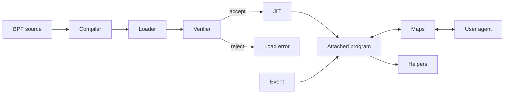

M01 has 11 nodes. The JIT branch represents a supported JIT target. An interpreter path exists on configurations outside this teaching path.

### 2. CO-RE adapts kernel layouts, not Go layouts — 30 seconds

**Motto:** “Type metadata makes kernel reads portable.”

**Slide facts:**

- BTF means BPF Type Format. It describes types and fields. E05.
- The compiler records relocatable accesses. The loader matches them to target BTF. E05.
- CO-RE means Compile Once, Run Everywhere. It adapts relevant accesses, not all kernel features. E05.
- Go library layouts need a separate resolver. E06.

**SAY:**

“A field can move between kernel builds. BTF tells the loader what the target kernel's types look like. CO-RE uses that information to adjust recorded field accesses before loading. The same BPF object can then work across supported kernel layouts. That mechanism does not describe a Go HTTP request. We still need Go-specific information for that request.”

**Visual:** M02. No selected external visual explains the kernel-versus-Go boundary as narrowly.

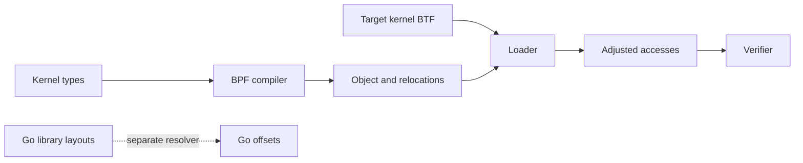

M02 has 9 nodes. The dotted branch marks a separate problem, not a CO-RE input.

### 3. Choose the place to observe — 35 seconds

**Motto:** “The hook decides what you can see.”

**Slide facts:**

- Kprobes target kernel instructions. Kernel tracepoints are named, explicit hooks. E07.
- Uprobes target userspace file offsets. Uretprobes observe function returns through a trampoline. E08.
- Fentry/fexit target supported kernel or BPF functions through BPF trampolines. E09.
- Attachment kind and BPF program type are related, but not identical terms. E04.

**SAY:**

“First choose which event answers the question. A kernel tracepoint gives us an explicit event such as a scheduler event. A kprobe observes a kernel instruction or function. A uprobe observes an instruction in a userspace binary. A uretprobe observes a return through a different mechanism. Fentry and fexit use efficient BPF trampolines for supported kernel or BPF targets, not arbitrary Go functions.”

**Visual:** M03. V03 is a usable overview, but it omits part of this menu. Use two spatial groups so that the audience does not mistake fentry for a Go hook.

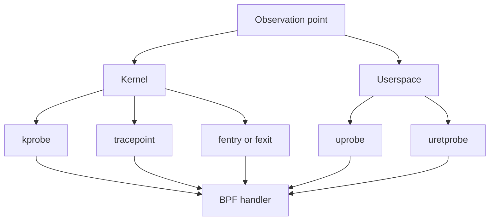

M03 has 9 nodes. Tracepoints are often less sensitive to compiler changes than arbitrary instructions. Do not promise that every tracepoint field is a permanent ABI.

### 4. A uprobe hit enters the kernel — 50 seconds

**Motto:** “A probe hit crosses the kernel boundary.”

**Slide facts:**

- The loader resolves a symbol to a file offset. The kernel patches the mapped instruction. E08, E10.
- On conventional x86, INT3 traps into the kernel and dispatches the attached BPF program. E10–E11.
- The kernel emulates the instruction or single-steps a displaced copy before normal execution continues. E11.
- Cost depends on the site, BPF work, and kernel. Recent lockless work improves scaling. E12–E14.

**SAY:**

“The symbol name helps the loader find an instruction. The kernel places a breakpoint in the process's mapped code, not in the file on disk. When execution reaches that breakpoint, the task enters the kernel and runs our attached handler. The kernel must then preserve the original instruction's effect. It can emulate that instruction or execute a copy with single-step recovery. Newer kernels reduce shared locking, but each active hit still has a cost.”

**Visual:** M04. Put the cost evidence in a small caption or spoken note. Keep the main visual about one hit. Label the figure **conventional x86 path**.

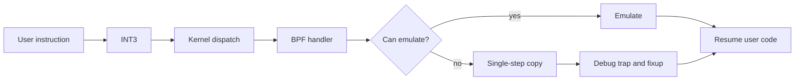

M04 has 9 nodes. NOP and some other instructions can avoid single-step recovery. Later optimized NOP sites can use a CALL-based route instead. Neither exception removes the need to measure the deployed path.

#### Cost evidence for notes or a compact chart

S05's **uprobe-nop** benchmark reports the following rates. The kernel commit describes the workload and hardware. These are not OBI request benchmarks.

| CPUs triggering the probe | Baseline aggregate rate | SRCU-series aggregate rate |
| ---: | ---: | ---: |
| 1 | 3.032 million/s | 3.276 million/s |
| 8 | 3.718 million/s | 8.097 million/s |
| 64 | 3.205 million/s | 6.452 million/s |

The reciprocal of the one-CPU rates is about **330 ns** and **305 ns per benchmark iteration**. These are derived elapsed costs for that empty-NOP workload. They are **not** an isolated incremental uprobe cost and **not** a bound for real handlers. Source: S05, accessed 2026-10-29. Calculation: `1e9 / 3.032e6` and `1e9 / 3.276e6`.

Use the multi-CPU rates to explain scalability, not as per-hit latency. Do not combine these numbers with an unrelated “3 microseconds” result as if the tests share a method. S06 provides later optimized-NOP evidence, but that path requires eligible sites and kernel support. It does not make arbitrary Go RET probes free.

### 5. Read Go values, not C arguments — 40 seconds

**Motto:** “A goroutine is the identity. A thread is the carrier.”

**Slide facts:**

- Go 1.17 introduced register arguments on amd64. Modern ABIInternal still has stack fallback. E15.
- On amd64, the initial integer component registers are AX, BX, CX. They do not follow the C argument order. E15.
- Goroutines can change threads. A TID-only start/end map is insufficient. E16.
- OBI uses the current `g` pointer plus PID, not numeric `goid`. E20–E21.

**SAY:**

“Go does not use the C function-call convention here. On amd64, the first integer components use AX, BX, and CX. A string or interface can occupy more than one component. The runtime can resume the goroutine on another thread before the function ends. We therefore need the goroutine's identity, not just the thread ID. OBI reads the current `g` pointer from a dedicated register and includes the process ID in its map key.”

**Visual:** M05. Keep the register order as a short caption. State amd64 on that caption. Arm64 uses a different register mapping.

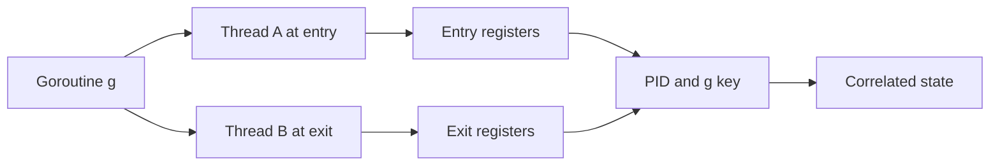

M05 has 7 nodes. The `g` address and `g.goid` are different values. A tool that needs numeric `goid` must resolve that internal field's offset. This slide does not publish a hard-coded runtime offset.

### 6. Probe the RET, not the saved return address — 45 seconds

**Motto:** “Do not hide a foreign return address in a Go stack.”

**Slide facts:**

- Conventional uretprobes replace the stored caller address with a trampoline. E18.
- Go stack growth copies frames and requires valid frame metadata. E17–E18.
- The foreign address can break stack walking and return bookkeeping. A target can crash. E18.
- OBI finds RET instructions and attaches ordinary uprobes at those offsets. E19.

**SAY:**

“A conventional uretprobe changes where the function returns. The kernel stores the original address and places a trampoline address in the frame. Go can inspect and copy that frame when the stack grows. The trampoline address does not describe an ordinary Go caller, so the runtime can reject the stack. OBI avoids that mechanism by finding the function's return instructions. An ordinary uprobe at each RET observes the exit without replacing the saved caller address.”

**Visual:** M06. Show the unsafe route in one color and the RET-site route in another. A RET-site probe is an ordinary **uprobe**, even if a tool names its handler `Returns`.

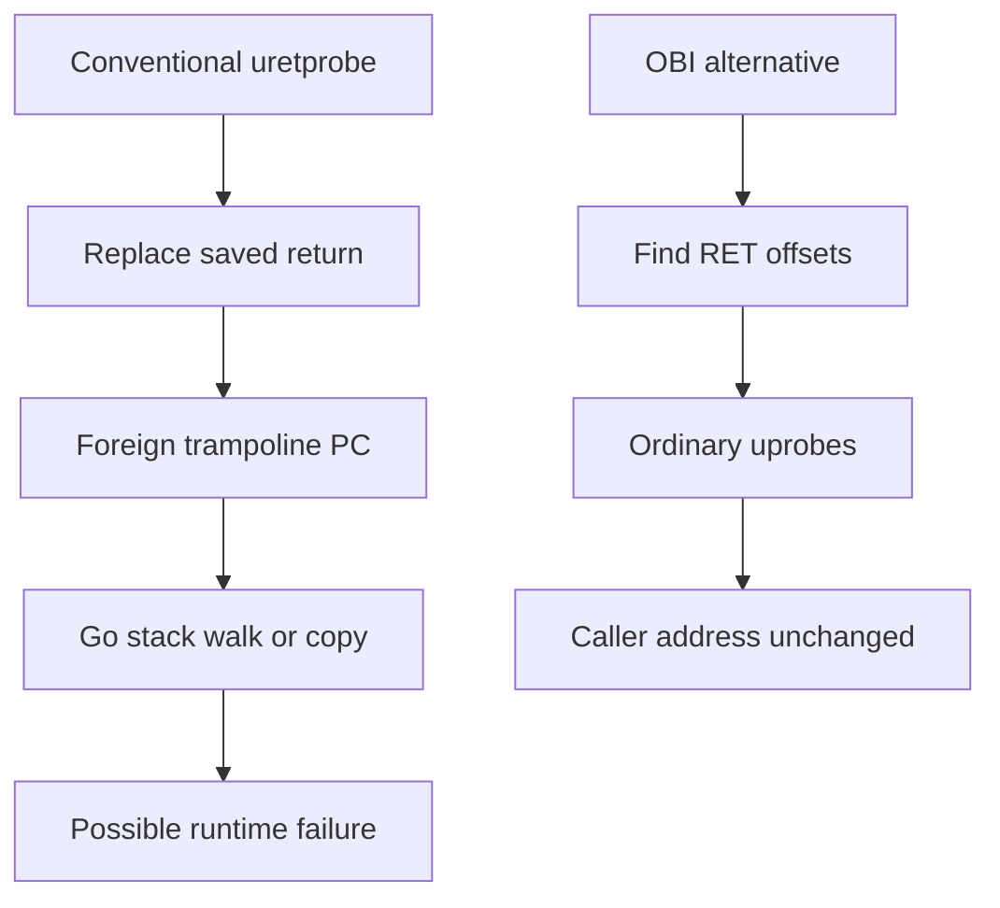

M06 has 9 nodes. Do not say that a stack copy merely loses an address. There are two conflicts: Go's frame metadata and the kernel's task/stack-based return bookkeeping. A goroutine can also change threads. RET-site attachment avoids the saved-address replacement, but it still needs correct decoding and end-event correlation. Panic paths, inlining, and nonlocal exits need tool-specific handling. Do not claim that every operation necessarily reaches the selected RET.

### 7. Find the instruction and the field — 35 seconds

**Motto:** “A function address is not a type layout.”

**Slide facts:**

- Function information locates probe sites. DWARF can describe struct fields. E22–E23.
- OBI tries DWARF first, then a versioned offset database. E22.
- Build information identifies Go and library versions. E22.
- `.gopclntab` can survive stripping. Its presence does not guarantee every required field or function exists. E23.

**SAY:**

“The tracer needs two different kinds of information. It needs an instruction address to attach the probe. It also needs field offsets to read a request or response. OBI can read those offsets from DWARF when debug information exists. Otherwise it uses build versions and a prepared database. Go's runtime tables can still identify functions in stripped binaries, but they do not replace every type-layout check.”

**Visual:** M07. Place instruction offsets and field offsets in separate columns. This separation also explains why kernel BTF does not solve the Go problem.

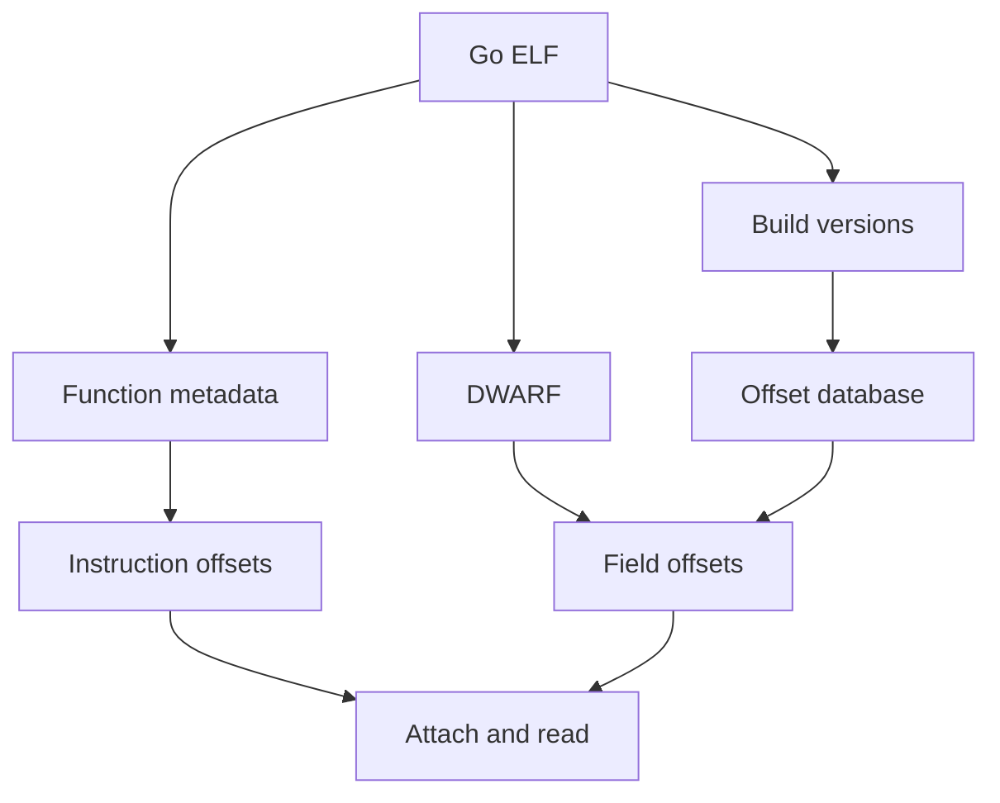

M07 has 8 nodes. “Function metadata” includes the ELF symbol table when available and Go runtime tables. A stripped symbol table is not the same thing as absent DWARF, although common build flags remove both.

### 8. USDT declares the probe contract — 40 seconds

**Motto:** “A named site comes with a recipe for its values.”

**Slide facts:**

- User Statically-Defined Tracing adds a site and an ELF note. E24.
- The note gives provider, name, address information, and argument recipes. E24.
- The consumer reads the note and attaches a uprobe at the site. E25.
- An optional semaphore lets the producer avoid costly preparation while inactive. E25.

**SAY:**

“User Statically-Defined Tracing makes the probe site explicit. In the usual ELF design, the producer emits a NOP and a note that names the probe. The note also tells the tracer where to read each value. The tracer uses that information to attach an ordinary uprobe. An optional semaphore tells the producer whether a tracer needs the probe. That check can avoid costly argument preparation while no tracer is attached.”

**Visual:** M08. Use the same INT3 color as slide 4. That color makes the common execution mechanism clear.

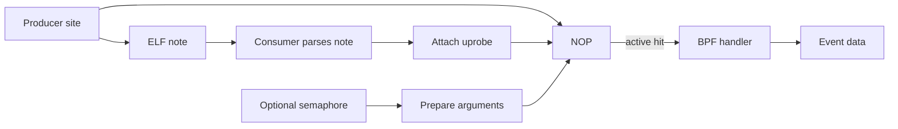

M08 has 9 nodes. The active edge represents the patched site, not a NOP instruction that calls BPF by itself. With no attachment, the NOP remains. Argument setup and semaphore checks can still cost instructions. With attachment, the site uses the uprobe path. USDT's main teaching advantage is an explicit semantic contract, not a promise of zero active overhead.

### 9. Go needs a producer, not another tracer — 30 seconds

**Motto:** “A tracer cannot invent a stable semantic hook.”

**Slide facts:**

- The checked upstream Go 1.26.0 source has no native USDT producer. E26.
- Salp and libstapsdt provide an opt-in, cgo-based path. E27–E28.
- Polar Signals describes Go-based consumer work, not a Go compiler feature. E30.
- The speaker's pinned fork experiments with producer support and `go tool usdt`. E31.

**SAY:**

“Upstream Go does not supply this producer in the source version that we checked. A C macro cannot directly add a probe to ordinary Go source. Salp gives an application an opt-in path through cgo and libstapsdt. Polar Signals shows the other side: a Go-based tracer that consumes USDT notes. My fork experiments with support in the Go toolchain and standard library. The fork is a proof of concept, not an upstream delivery promise.”

**Visual:** M09, with a small amber **proof of concept** label on the fork branch. Use the existing screenshot only as a callback, not as evidence that the demo works.

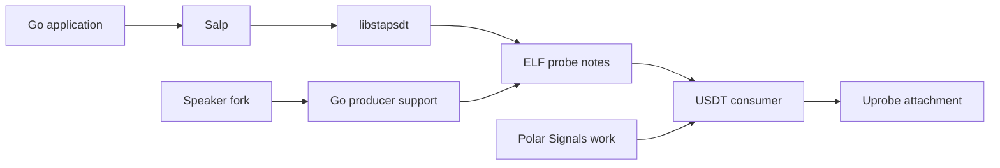

M09 has 9 nodes. The branches are alternatives, not a dependency chain. `libbpf/usdt` is another producer for C/C++, not the missing Go compiler support. The Go meeting notes discuss the value of stable hooks and their maintenance contract. They do not establish one official reason that Go lacks native USDT. Do not invent a blocker such as “Go's ABI makes USDT impossible.”

### 10. OBI turns observations into spans — 50 seconds

**Motto:** “Sites give events. Correlation gives spans.”

**Slide facts:**

- OBI resolves supported Go functions and field offsets, then attaches entry and end-site uprobes. E19, E22, E32.
- BPF handlers read values and retain timestamps and context in maps. E03, E20, E32.
- Userspace converts completed records into exported spans and metrics. E32.
- Propagation requires protocol-specific trace headers and supported access, not timestamps alone. E33.

**SAY:**

“Now we can explain the OBI architecture instead of treating it as a box. The loader finds supported HTTP, gRPC, and SQL sites and the layouts that their handlers need. BPF handlers read request data and keep timestamps and trace context in maps. End-site events let the agent construct completed spans. OBI can read incoming trace headers and inject outgoing headers on supported paths. Go gRPC also needs stream-aware handling because several requests share one connection.”

**Visual:** M10. The dotted branch marks propagation, which is a separate operation from span export. The SQL operation is an example child operation, not a claim that every request performs SQL.

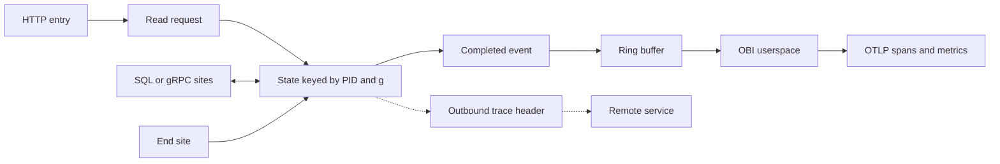

M10 has 11 nodes. Incoming header parsing feeds the state node. In the pinned implementation, HTTP/1 can use Go buffer writes or network paths. Go gRPC can write HPACK data before encryption. Generic HTTP/2 propagation also uses HPACK. Do not draw “TCP option → all gRPC context,” because multiplexed streams need separate context. Do not draw kernel packet reads as a way to decrypt arbitrary TLS.

**Scope note:** This path does not require the speaker's fork or any native Go USDT probe. OBI currently infers function and layout semantics from supported versions. USDT explains what a declared producer contract could replace. Kernel BTF/CO-RE, Go-specific offsets, and protocol parsing solve different problems.

### 11. Go metadata tells the profiler how to unwind — 40 seconds

**Motto:** “Keep runtime metadata. Reconstruct the sampled stack.”

**Slide facts:**

- `.gopclntab` retains function and stack-delta information in stripped Go binaries. E23, E34.
- Userspace prepares compact unwind rules and loads them into BPF maps. E34–E35.
- CPU sample events trigger the eBPF unwinder. Function-name resolution completes the profile. E34–E35.
- The pinned reader uses frame pointers when suitable and stack deltas where needed. No special debug build is the useful claim. E34.

**SAY:**

“Profiling uses a different event from request tracing. A CPU sample interrupts execution and gives the unwinder a starting machine state. The agent reads Go's runtime metadata and prepares rules that describe how to find callers. The BPF unwinder uses those rules from maps. Ordinary Go frames can use frame pointers, while other frames need stack deltas. Stripping debug symbols does not remove the runtime information that this path uses.”

**Visual:** M11. Do not reuse only the existing binary-to-names arrow. The new evidence is the rule-preparation stage and the sample-time stage.

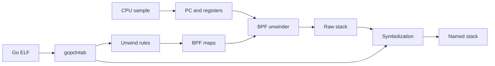

M11 has 10 nodes. `.gopclntab` has more than line numbers: function records refer to PC/SP delta tables. On the pinned amd64 path, the reader deliberately compresses most Go code into frame-pointer rules to save map space. It generates explicit deltas for assembly and selected runtime cases. Older arm64 versions have a different strategy. Do not claim universal support for arbitrary custom Go builds with frame pointers removed.

**Boundary:** This slide explains on-CPU sampled call chains. It does not claim that CPU sampling enumerates every parked goroutine, proves request causality, or gives all `pprof` profile types. OBI trace propagation is distinct from the proposed pprof-label bridge already present in the deck.

## Validation and handoff limits

- The output contains 11 concepts. Each has a motto, four slide facts, a six-sentence SAY block, and a Mermaid fallback.
- Each Mermaid fallback has 6–12 distinct nodes. The diagrams preserve the required learning order.
- The source register pins OBI to v0.10.0, Go implementation examples to release tags, and the profiler and speaker fork to full commit SHAs.
- The claim register contains no PENDING entries. PLAUSIBLE and REFUTED rows are excluded from slide facts.
- The benchmark arithmetic derives approximately 330 ns and 305 ns per empty-NOP benchmark iteration. It does not claim application latency.
- No Go code, Linux BPF workload, Salp build, fork build, or attach test ran. This is source research, not runtime validation.
- No diagram render or slide build ran. Render and inspect the chosen visuals when the owner edits the deck and script.
- `vale --config ~/.claude/vale-ste.ini` on this file stopped with code 2 because the configuration file is absent. STE lint remains blocked. The prose received a manual check.
- The Makefile's `make check` target builds decks and synchronizes theme assets. This task permits only the named output file, so that target did not run. The deck and source remain unchanged. The later deck edit must run the documented checks and PDF/footer checks.
- Before publication, promote accepted technical claims to `research/without-a-single-line/claims-ledger.md`. This task does not edit that ledger.

## Proposed slides

The order below is intentional. Steps 1–2 define the program. Step 3 selects its event. Step 4 explains a userspace hit. Steps 5–7 explain Go's constraints. Steps 8–9 introduce an explicit producer contract. Step 10 applies the pieces to OBI. Step 11 changes the event source for profiling.

1. **A checked program runs at an event** — Loader, verifier, JIT, helpers, maps, and program type. **Visual:** V01 or M01. **40 s.**
2. **CO-RE adapts kernel layouts, not Go layouts** — BTF and relocations solve the kernel side. **Visual:** M02. **30 s.**
3. **Choose the place to observe** — Kernel and userspace attachment menu. **Visual:** M03, with V03 as an alternative overview. **35 s.**
4. **A uprobe hit enters the kernel** — INT3, handler, emulation or single-step, and bounded cost evidence. **Visual:** M04. **50 s.**
5. **Read Go values, not C arguments** — ABIInternal, goroutine migration, and the PID-plus-`g` key. **Visual:** M05. **40 s.**
6. **Probe the RET, not the saved return address** — Unsafe uretprobe bookkeeping versus ordinary RET-site uprobes. **Visual:** M06. **45 s.**
7. **Find the instruction and the field** — Function metadata, DWARF, build versions, and fallback offsets. **Visual:** M07. **35 s.**
8. **USDT declares the probe contract** — NOP, `.note.stapsdt`, argument recipes, and optional semaphore. **Visual:** M08. **40 s.**
9. **Go needs a producer, not another tracer** — Salp/libstapsdt, Polar Signals' consumer work, and the speaker's fork. **Visual:** M09. **30 s.**
10. **OBI turns observations into spans** — Library events, maps, userspace export, and protocol-specific propagation. **Visual:** M10. **50 s.**
11. **Go metadata tells the profiler how to unwind** — `.gopclntab`, prepared rules, sample-time unwinding, and honest frame-pointer wording. **Visual:** M11. **40 s.**

**Total: 435 seconds, or 7:15.** This leaves **30:45** of the 38-minute presentation for the opening, other instrumentation paths, deployment constraints, examples, and conclusion. Rehearse the six-sentence scripts with the visuals. If the primer exceeds eight minutes, shorten benchmark detail and project history in speech. Do not remove the uretprobe safety explanation or the CO-RE/Go-layout distinction.

## Open questions

1. Which Go version and Linux kernel will the speaker use for the demo? The source pins here are explicit, but they are not the selected deployment matrix.
2. Does the speaker want a measured per-hit demo? If yes, compare no probe, an empty entry probe, RET-site probes, and the real handler on the same host. Record CPU, kernel, mitigations, site, concurrency, and event loss.
3. Does the speaker's pinned fork build and emit correct notes on that host? Inspect notes and disassembly before running generated commands. Test argument recipes and goroutine-aware correlation. Do not copy the README's TID-only map as a general Go latency example.
4. Does Salp build with the selected Go version and native libraries? Treat its compatibility as unverified until that test runs.
5. Do newer Go releases after the checked Go 1.26.0 boundary add native USDT support? Recheck the selected release before saying “today” on screen.
6. Which distribution kernels contain the optimized-NOP red-zone fix and the relevant loader support? Keep the NOP10 update in notes unless the demo needs it. Do not promise a minimum version from mainline commit existence alone.
7. Will the owner use the reusable eBPF.io diagrams or the original Mermaid versions? Inspect the final slide size before choosing. Keep the license links with distributed slides.
8. Does the owner need Brendan Gregg's specific diagram? If yes, obtain permission for the public talk, recording, and distributed slides. Otherwise use the supplied fallback.
9. Should the profiler section say “no special build needed” rather than “no frame pointers needed”? The pinned Go reader supports the first wording and contradicts a blanket version of the second.
10. Can the owner complete a read-through within the 7:15 budget? The present estimate does not replace a timed rehearsal.
