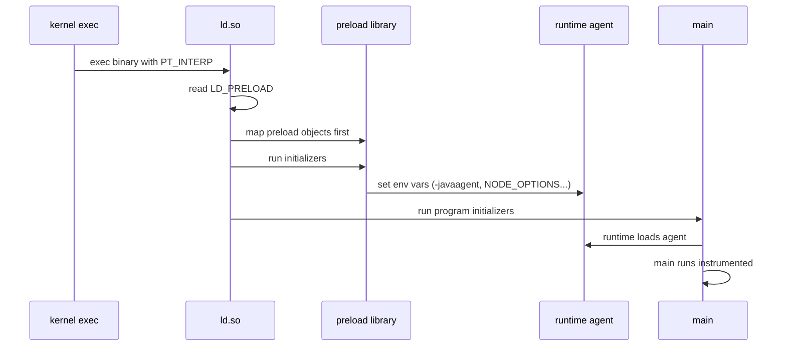
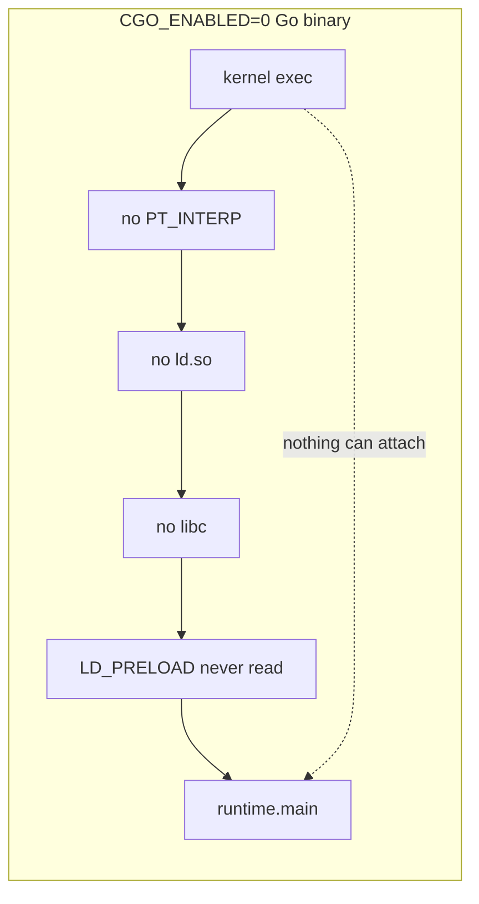

# Research R-injector: the process-start path and the accepted cgo proposal

> **Status:** Research complete (R-injector, 2026-10-29). All sources public.
> **Brief:** local research brief (not committed)
> **Rule applied:** No speculation about the Datadog Go injector design. Everything
> that touches it is in the "Needs owner review" section, with public sources
> quoted word for word. Claim IDs here are local (`[I-NN]`); the owner decides
> which rows move into `research/without-a-single-line/claims-ledger.md`.

---

## 1. THE PROPOSAL — cgo without a C toolchain

**Verdict: CONFIRMED, with one correction to the brief's premise ([I-01], [I-02])**

### The two issues

| Field | Value | Verdict |
| --- | --- | --- |
| Main proposal | **golang/go#81450** — `proposal: cmd/cgo: cgo without a C toolchain` | CONFIRMED ([I-01]) |
| Filed by / date | `matloob`, 2026-09-10 | CONFIRMED |
| Main proposal status (2026-10-29) | **OPEN, under review.** Labels: `Proposal`, `cgo`. Milestone: `Proposal`. **NOT labeled Proposal-Accepted.** | CONFIRMED |
| GOEXPERIMENT issue | **golang/go#81662** — `cmd/cgo: add cgo without a C toolchain as a GOEXPERIMENT` | CONFIRMED ([I-02]) |
| Accepted | 2026-10-01 — aclements, for the proposal review group: "No change in consensus, so **[accepted]**. 🎉 This issue now tracks the work of implementing the proposal." Milestone: Backlog | CONFIRMED |
| GOEXPERIMENT name | `GOEXPERIMENT=cgobindings` (`CgoBindings bool` in `src/internal/goexperiment/flags.go`, Go master, commit `6bbd163b33ff`, 2026-10-01) | CONFIRMED |

**Correction to the brief.** The brief asked for "the recently accepted Go proposal".
The single accepted item is **#81662**, which exists only to add the `cgobindings`
GOEXPERIMENT so that the work can land behind a flag. Its own body says:

> "For the purposes of proposal #81450 (cgo without a C toolchain), we'd like to
> add a `cgobindings` GOEXPERIMENT so we can start adding code that implements
> the proposed functionality guarded behind a GOEXPERIMENT. … The GOEXPERIMENT
> would be disabled by default until the proposal is decided on: if accepted it
> would be turned on and removed; and if rejected the experiment and all code
> behind it would be removed."

The design proposal itself, **#81450**, is still open and under active review.
For the talk, the accurate sentence is: "The Go team accepted the experiment that
lets this work land behind a flag; the design proposal is still in review."

### What #81450 proposes (word for word, from the issue body)

Goals quoted from the proposal:

> - **No C toolchain at build time**: For a cgo program that only references
>   pre-compiled C libraries (without C source definitions), `go build` can
>   proceed without requiring a C compiler installed.
> - **Type safety**: Preserve Go type safety at the C boundary. …
> - **Compatibility**: Retain compatibility with standard cgo (`import "C"`,
>   `C.symbol_name` syntax) so that Go source code does not need to be rewritten.
> - **Gradual & per-platform adoption**: Allow package authors to migrate to the
>   new mechanism for specific target platforms …

Mechanism, quoted: the package author "writes or generates the bindings";
"the `cgo` command processes files with bindings, and generates the glue code in
Go and assembly, which is then built with the Go toolchain, without a C compiler."
The `runtime/cgo` package itself "will be rewritten to use Go and assembly."
Bindings are Go files annotated with `//cgo:binding`, for example:

```go
//cgo:binding C.compute
func Compute(p0 Point) float32
```

The proposal also covers dynamic loading: "The binding mechanism will also
support dynamically loaded functions, by generating type-safe Go wrappers and
trampolines for dynamically resolved functions" — with a `//cgo:dynamic_library`
mechanism still being worked out ("we will share more in a separate document").

### Implementation status (checked 2026-10-29)

| Change | Title | Status |
| --- | --- | --- |
| CL 832864 | `internal/goexperiment: add cgobindings experiment` | **MERGED** to master (2026-10-01, commit `6bbd163b33ff`) |
| CL 839325 | `cmd/link: support SDYNIMPORT with internal linking on Linux` | OPEN (NEW) |
| CL 839326 | `runtime/cgo: implement runtime/cgo in Go and assembly on darwin and linux` | OPEN |
| CL 839327 / 846946 | `cmd/cgo: add C ABI layout and trampoline generation` | OPEN (846946 is the re-upload) |
| CL 839328 | `cmd/cgo: support generating Go-syntax binding files (-gen-binding)` | OPEN |
| CL 839329 / 846947 | build cgo packages using Go-syntax bindings without a C toolchain | OPEN |
| CL 839330 | cgo callbacks (`//export`) with bindings | OPEN |
| CL 839331 | C function pointers (`//cgo:funcptr`) | OPEN |
| CL 839332 | C variadic functions (`//cgo:variadic`) | OPEN |
| CL 839333 | runtime-loaded dynamic libraries (`//cgo:dynamic_library`) | OPEN |

External evidence that it builds today, quoted from issue #81450
(Quinn-With-Two-Ns, Temporal, 2026-10-15):

> "I checked out and built the `cgobindings` branch and, after fixing a few bugs
> in the current branch, was able to get our Go SDK using our Rust core without
> a C compiler."

Related public history that makes this moment legible ([I-03], all CONFIRMED):

- **#38917** `cmd/cgo: add support for pre-compiled cgo packages` — declined as
  infeasible by rsc, 2023-12-04. In that thread, Julio-Guerra (DataDog)
  described publicly how dd-trace-go already ships cgo bindings without a C
  toolchain at the end user's site, by copying the CGO-generated files.
- **#38918** `cmd/link: support -linkmode=internal with Cgo` — closed 2026-09-21
  by eliasnaur: "Closing as a subset of <https://github.com/golang/go/issues/81450>."
- **#77386** `x/tools/ffi` — closed 2026-02-01 ("seems fine to exist as an
  external project"); and purego (ebitengine, Apache-2.0) already does runtime
  `dlopen`+call "without Cgo" today.

### Why it matters for process-start injection

**Facts (CONFIRMED, from #81450 and its comments):**

- A static pure-Go binary has no dynamic loader and no libc. Today the only
  route to libc from Go without a C toolchain at build time is purego-style
  `syscall` trampolines (purego README: "A library for calling C functions
  from Go without Cgo").
- The CL series makes the **internal linker** able to emit dynamic imports
  (CL 839325, `SDYNIMPORT`), rewrites `runtime/cgo` in Go and assembly (CL 839326),
  and adds type-safe **runtime-loaded dynamic libraries** (CL 839333).
- cherrymui (2026-10-09): "I think we can make that this mode (cgo with
  bindings, no other .c files) supported by default when cross compiling
  (i.e. CGO_ENABLED not explicitly set)."
- qmuntal (2026-09-23): if supported with `CGO_ENABLED=0`, it "has the
  potential to replace all `syscall.SyscallN` calls on Windows and
  `unix.Syscall[3,6,9]` on Darwin."
- Counterpoint, hajimehoshi (2026-10-09): "As long as we'd need
  `CGO_ENABLED=1` … this can never replace at least purego."

**Inference (labeled, not proposal text):** if Go binaries — including ones built
without a C toolchain — routinely carry `PT_INTERP`-style dynamic library
dependencies, then more of them pass through `ld.so`, where `LD_PRELOAD` and
`/etc/ld.so.preload` live. That could widen the population of Go processes that
a process-start injector can reach. The proposal does **not** promise preload
interposition, constructor invocation in preloaded libraries, or any specific
linking default. Do not put the inference on a slide as fact.

**Motto:** "Cgo without a C compiler. The linker learns to speak ELF on its own."

**Slide facts (3–5):**

1. Proposal #81450: call prebuilt C libraries from Go with no C toolchain at build time.
2. Accepted GOEXPERIMENT (#81662, 2026-10-01): the work lands behind `GOEXPERIMENT=cgobindings`.
3. The glue code becomes Go and Go assembly; `runtime/cgo` is rewritten without C.
4. The internal linker gains dynamic imports (`SDYNIMPORT`, CL 839325) on Linux.
5. The design proposal itself is still in review; the experiment is on Go master.

**Spoken (STE):** Today, a Go program that wants libc must compile C code. That
needs a C compiler at build time. The proposal in flight removes that need. The
package author writes or generates Go bindings. The cgo tool then emits Go code
and Go assembly. The Go compiler builds everything. The user needs no C
compiler. The team also rewrites `runtime/cgo` in Go and assembly. And the
internal linker learns to reference shared libraries on Linux. This work is not
finished. The experiment flag is accepted and merged. The design proposal is
still in review. Watch issue #81450.

---

## 2. HOW PROCESS-START INJECTION WORKS

**Verdict: CONFIRMED ([I-04] through [I-09])**

### The loader path, quote by quote

- man7.org `ld.so(8)`, DESCRIPTION: "The programs ld.so and ld-linux.so* find and
  load the shared objects (shared libraries) needed by a program, prepare the
  program to run, and then run it." [I-04]
- `LD_PRELOAD`: "A list of additional, user-specified, ELF shared objects to be
  loaded before all others. This feature can be used to selectively override
  functions in other shared objects." [I-04]
- `/etc/ld.so.preload`: "File containing a whitespace-separated list of ELF
  shared objects to be loaded before the program. … If both LD_PRELOAD and
  /etc/ld.so.preload are employed, the libraries specified by LD_PRELOAD are
  preloaded first. /etc/ld.so.preload has a system-wide effect." [I-04]
- Why code in the preloaded library runs before the application, System V ABI
  (GABI), "Initialization and Termination Functions": "After the dynamic linker
  has built the process image and performed the relocations, each shared object
  and the executable file get the opportunity to execute some initialization
  functions. **All shared object initializations happen before the executable
  file gains control.**" [I-05]

### Why it works for Java, .NET, Node.js, Python, Ruby, PHP

Every one of these runtimes has a documented load-time hook an injector can set
through an environment variable. Confirmed from the OpenTelemetry injector
README (commit `22a9aa877`) and the Datadog injector guide, which use exactly
these mechanisms [I-06]:

| Runtime | Documented hook (env var set by the injector) |
| --- | --- |
| Java | `JAVA_TOOL_OPTIONS` gains `-javaagent:<jar>`; the JVM runs the agent's `premain` "before the application main method is invoked" (java.lang.instrument docs) [I-07] |
| Node.js | `NODE_OPTIONS` gains `--require` (or `--import`) |
| .NET | `CORECLR_ENABLE_PROFILING`, `CORECLR_PROFILER`, `CORECLR_PROFILER_PATH`, `DOTNET_STARTUP_HOOKS` — the CLR Profiling API |
| Python | `PYTHONPATH` prepend; the `site` module's `sitecustomize` runs at interpreter startup |
| Ruby | `RUBYOPT` gains `-r <entry point>` |
| PHP | `PHP_INI_SCAN_DIR` points at a Datadog loader directory |

The one-sentence version: the loader gives the injector an entry before `main`,
and each runtime gives the agent a designed entry point after `main`. Go gives
neither.

### Why a default Go binary ignores it

- `CGO_ENABLED=0` builds are fully static. There is no `PT_INTERP`, so the kernel
  never maps `ld.so`. The `LD_PRELOAD` variable is read by `ld.so`, not by the
  kernel, so it is simply never consulted. [I-04; CONFIRMED by mechanism, consistent with S-TH-03]
- Even cgo builds link internally by default. Ian Lance Taylor, golang/go#28909:
  "the internal linker is only used for pure Go programs that are not linked
  against any C code. Such programs have no constructors." And: "I'm perfectly
  comfortable in saying that anybody who wants to use `LD_PRELOAD` must force
  the use of external linking. … The purpose of internal linking is to avoid
  requiring C development tools." [I-08; CONFIRMED]
- #28909's own title is the sharper fact: `cmd/link: shared object constructor
  functions are not invoked with internal linker and musl libc` — with internal
  linking, preloaded constructors never run.
- Dynatrace's public Go limitations document the same wall from the vendor side
  (static cgo binaries rejected; `CGO_ENABLED=0`+PIE structurally incompatible
  with injection) [S-TH-04; already in the shared ledger].

### What changes for cgo-enabled, externally linked Go binaries

With `-linkmode=external` (or any build that produces a dynamically linked
binary), the process goes through `ld.so`. Then, per man7 and the GABI quotes
above: `LD_PRELOAD` libraries are mapped before all others, and their
initializers run before the executable gains control. So a constructor in a
preloaded library can run first. But the Go runtime is then already in the
process, and a foreign library must live under its rules: the cgo pointer-passing
rules ("C code may not keep a copy of a Go pointer after the call returns …")
and the runtime's signal handling (os/signal: by default a synchronous signal
such as `SIGSEGV` "is converted into a run-time panic"; some signals are
"explicitly unblocked", including glibc's internal `SIGCANCEL`/`SIGSETXID`)
[I-09; CONFIRMED].

**Motto:** "LD_PRELOAD hooks the loader. A static Go binary has no loader."

**Slide facts:**

1. `ld.so` maps `LD_PRELOAD` objects before all others (man7).
2. Their initializers run before the executable gains control (System V ABI).
3. Java/.NET/Node/Python/Ruby/PHP all have a designed post-main entry point.
4. `CGO_ENABLED=0`: no `ld.so`, no libc, nothing to hook.
5. Internally linked Go binaries invoke no shared-object constructors (#28909).

**Spoken (STE):** On Linux, a dynamically linked program starts in the dynamic
loader. The loader reads `LD_PRELOAD`. It maps those libraries before all
others. The ELF specification says their initializers run before the program
gains control. So an injector gets code into the process before `main`. Then it
sets one environment variable. The runtime does the rest. Java runs the agent
before `main`. Node loads a module at startup. The CLR loads a profiler. Now
look at a default Go binary. There is no dynamic loader. There is no libc. The
variable is never read. Nothing enters the process. Even with cgo, the internal
linker invokes no constructors. That is the gap.

### Diagrams (original — no usable public visual found)

Search for an existing public diagram of `exec → ld.so → LD_PRELOAD → agent`
(2026-10-29): Wikipedia's dynamic-linker articles carry no relevant figures;
man7.org has none; the OpenTelemetry and Datadog injector docs describe the
mechanism in prose only. No candidate with a reusable license was found. The
two Mermaid diagrams below are original and safe to use.

Sequence diagram, dynamically linked program:



Contrast diagram, static Go binary:



Keep both to 6–8 visible nodes when drawn.

---

## 3. THE OPENTELEMETRY INJECTOR, THE OPERATOR, AND DATADOG SSI

**Verdict: CONFIRMED ([I-06], [I-11] through [I-13])**

### opentelemetry-injector (host injector)

README (commit `22a9aa877`, 2026-10-02; accessed 2026-10-29) [I-06]:

> "The OpenTelemetry injector is a shared library (written in Zig) that is
> intended to be used via the environment variable `LD_PRELOAD`, the
> `/etc/ld.so.preload` file, or similar mechanisms to inject environment
> variables into processes at startup."

It "serves two main purposes": inject an auto-instrumentation agent, and set
resource attributes. Languages packaged: **Java, Node.js, .NET, Ruby, and
Python (disabled by default)**. The README mentions no Go runtime anywhere.
Activation on a host: append to `/etc/ld.so.preload` (root required), or set
`LD_PRELOAD` per process. It also supports include/exclude path globs and
argument patterns, so an operator can scope injection.

Correction for the talk vs the shared ledger: the host injector's language list
now includes **Ruby** and Python is **disabled by default** [I-06]. The old
C-024 wording ("Java, Node.js, .NET, and Python") is out of date in both details.

### OpenTelemetry Operator, Go path

Operator automatic-instrumentation docs (opentelemetry.io, accessed 2026-10-29)
[I-11]:

> "Unlike other languages' auto-instrumentation, Go works via an eBPF agent
> running via a sidecar. When opted in, the Operator will inject this sidecar
> into your pod."

Requirements quoted from the same page: opt in with the
`instrumentation.opentelemetry.io/inject-go` annotation **and** set
`OTEL_GO_AUTO_TARGET_EXE` ("Failure to set this value causes instrumentation
injection to abort"); the feature gate `enable-go-instrumentation` **defaults to
`false`** (the table lists Java/Python/.NET/PHP as `true`); and "Since Go
auto-instrumentation uses eBPF, it also requires elevated permissions"
(`privileged: true`, `runAsUser: 0`).

Why the injector does not do Go today, in one sentence the sources support:
the injector's entire mechanism is a loader-time environment-variable handshake
with a runtime that has a designed startup hook, and Go has no such hook
(Section 2) — the Operator's Go story is therefore a different mechanism, an
eBPF sidecar, behind a feature gate.

### Datadog Single Step Instrumentation (public docs, quoted)

SSI overview (docs.datadoghq.com, accessed 2026-10-29): "Single Step
Instrumentation (SSI) automatically installs the Datadog SDKs with no
additional configuration required, reducing onboarding time from days to
minutes." [I-12]

Injector guide (same site) [I-13], quotes verbatim:

- "On Linux systems, the injector uses the `LD_PRELOAD` mechanism—a dynamic
  linking feature in UNIX-like environments—to load itself into all dynamically
  linked processes."
- Docker: "the injector uses the same `LD_PRELOAD` mechanism as on Linux hosts
  … a custom `runc` shim that replaces Docker's default container runtime."
- Kubernetes: the Admission Controller "mutates the pod spec to: Deliver the
  injector and SDKs using init containers or the Datadog CSI driver; Set
  environment variables (such as `LD_PRELOAD`)".
- Windows: "the injector is delivered as a DLL. A Datadog kernel driver loads
  the injector DLL into every new process."
- "The injector completes its work before the application's `main` function
  runs."
- Scope: "It does not install kernel modules, patch the kernel, hook system
  calls, or use eBPF."
- Detected runtimes: "such as Python, Node.js, PHP, Java, .NET, Ruby, or NGINX."

SSI compatibility page (same site, accessed 2026-10-29): "SSI automatically
instruments applications written in the following languages by loading a
compatible Datadog Language SDK at runtime." The languages offered:
**Java, Python, Ruby, Node.js, .NET, PHP.** **Go is not in the list.** The page
also says: "If either requirement is not met, SSI falls back gracefully and your
application runs without instrumentation."

What the public Datadog docs say about Go today, therefore, is precisely:
nothing in SSI. Datadog's publicly documented Go APM paths are build-time (Go
compile-time instrumentation via Orchestrion — see shared ledger C-020 to
C-023) and kernel-level eBPF. That contrast is the section's punchline, and it
comes from public pages only.

**Motto:** "Every injector on the market loads the same way. Not one of them ships Go."

**Slide facts:**

1. OTel injector: a Zig shared library, activated by `LD_PRELOAD` or `/etc/ld.so.preload`.
2. It packages Java, Node.js, .NET, Ruby, and Python (Python off by default).
3. OTel Operator Go support is a separate feature-gated eBPF sidecar (`enable-go-instrumentation`, default false).
4. Datadog SSI on Linux uses `LD_PRELOAD`/`/etc/ld.so.preload` too (public docs).
5. Datadog SSI lists Java, Python, Ruby, Node.js, .NET, PHP. Go is absent.

**Spoken (STE):** The OpenTelemetry injector is a shared library written in Zig.
You activate it with `LD_PRELOAD` or `/etc/ld.so.preload`. It detects the
runtime. It sets one variable. The runtime loads the agent. Java, Node.js,
.NET, Ruby, and Python are covered. Go is not. Datadog's Single Step
Instrumentation works the same way. The public docs say the injector loads
through `LD_PRELOAD` on Linux. It lists the same runtimes. Go is absent there
too. The OpenTelemetry Operator does have a Go option. It is an eBPF sidecar
behind a feature gate that defaults to off. Same story everywhere. The loader
path exists. Go does not sit on it.

---

## 4. GO'S OWN BUILDING BLOCKS

**Verdict: CONFIRMED ([I-14] through [I-17])**

### `-buildmode=c-shared`

`go help buildmode` (Go 1.27.3) [I-14]: "Build the listed main package, plus
all packages it imports, into a C shared library. The only callable symbols
will be those functions exported using a cgo `//export` comment." c-shared
today unconditionally requires external linking and therefore the C-adjacent
toolchain; this is the same wall the mobile community described in #81450
(kolkov: every Go framework with Android support "carries a cgo layer for
exactly this reason"). Internal linking for c-shared on android/arm64 is
declared in scope of the #81450 project by cherrymui (2026-10-09), tracked
in golang/go#82111.

### `plugin` package limits

Package doc (Go 1.27.3) [I-15], verbatim warnings: "Plugins are currently
supported only on Linux, FreeBSD, and macOS"; "Runtime crashes are likely to
occur unless all parts of the program … are compiled using exactly the same
version of the toolchain, the same build tags, and the same values of certain
flags and environment variables"; and the conclusion: "the application and its
plugins must all be built together by a single person or component … In that
case, it may be simpler for that person or component to generate Go source
files that blank-import the desired set of plugins and then compile a static
executable in the usual way."

### `//go:linkname` since Go 1.23

Go 1.23 release notes [I-16]: "The linker now disallows using a `//go:linkname`
directive to refer to internal symbols in the standard library (including the
runtime) that are not marked with `//go:linkname` on their definitions. … For
backward compatibility, existing usages of `//go:linkname` found in a large
open-source code corpus remain supported. Any new references to standard
library internal symbols will be disallowed." Proposal: #67401, closed as
accepted for Go 1.23. Consequence for injectors: any Go hook that reaches into
the runtime by linkname now needs an upstream-sanctioned push linkname or a
fork. (The GLS pattern in the shared ledger, C-002/C-002b, predates and
illustrates this fragility.)

### Runtime rules a foreign library must obey

From the cgo documentation (Go 1.27.3) [I-17]: pointer rules are "checked
dynamically at runtime … `GODEBUG=cgocheck=1`" — "C code may not keep a copy of
a Go pointer after the call returns". From the os/signal package doc [I-09]: the
runtime converts synchronous signals (`SIGSEGV`, `SIGBUS`, `SIGFPE`) into
runtime panics, handles `SIGPROF` itself, and explicitly unblocks several
signals including glibc's internal `SIGCANCEL`/`SIGSETXID` — a foreign library
that swaps signal handlers or spawns threads that never register with the Go
scheduler is operating outside every documented contract. #28909 adds the
musl case: constructor invocation is a dynamic-loader behavior, and Go's
internal linker deliberately never enters that world ("The purpose of internal
linking is to avoid requiring C development tools").

**Motto:** "Go has the parts. It just refuses to assemble them."

**Slide facts:**

1. c-shared exists, but demands the full external-linking, C-toolchain world.
2. plugin exists on three OSes and requires building app and plugins as one program.
3. Since Go 1.23, linkname into stdlib internals is locked down (#67401).
4. The runtime owns signals and pointers; foreign code must obey or fork.
5. The #81450 series touches all of these: linker, runtime/cgo, cgo codegen.

**Spoken (STE):** Go does have loadable code. It has three pieces. The first is
`c-shared`. It builds your program as a C shared library. It needs external
linking. It needs the C toolchain world. The second is the plugin package. It
works on Linux, FreeBSD, and macOS. The docs warn that the program and its
plugins must be built together with the same toolchain. That kills the model of
an injector that ships a binary it did not build. The third is `go:linkname`.
Since Go 1.23, the linker blocks new linkname references into the standard
library. The door that Orchestrion's GLS trick used is now guarded. The
proposal in section one touches all three. It rewires the linker, the runtime,
and the cgo command.

---

## Needs owner review

Everything below touches the Datadog Go injector. Public sources only,
quoted word for word. No design inference, no linking model, no entry path,
no binary-compatibility claim is made here.

1. **The teaser slide (current deck, injector section of `slides/presentation.md`).** What
   is public today: the invocation `LD_PRELOAD=./libdd_go_hook.so` with
   `DD_SERVICE` and `DD_TRACE_DEBUG=1`, the amber "in development" chip, and the
   ledger note C-051: "the mechanism is deliberately undisclosed. Never add
   linking model, entry path, or binary-compatibility detail to any slide or
   script line."
2. **The only public Datadog injector text** is the Single Step Instrumentation
   guide quoted in Section 3 [I-13]. It describes the Linux mechanism as
   `LD_PRELOAD` / `/etc/ld.so.preload` and says the injector "loads itself into
   all dynamically linked processes", detects "Python, Node.js, PHP, Java,
   .NET, Ruby, or NGINX", and "completes its work before the application's
   `main` function runs". It says nothing about Go. Owner decision: how much of
   this public SSI text may be spoken next to the Go teaser without implying a
   shared mechanism.
3. **The natural audience question the talk must be ready for**, grounded only
   in public sources: if `LD_PRELOAD` is the public SSI mechanism on Linux, and
   Go's internal linking invokes no preload constructors (#28909, [I-08]), what
   does the teaser invocation imply about the target binary's linking? The
   talk's current answer — "the mechanism is deliberately undisclosed; defer to
   next year's talk" — is the only answer this research supports. Do not
   speculate from the invocation.
4. **Interaction with section 1.** If #81450 ships, more Go binaries will carry
   dynamic dependencies and pass through `ld.so`. Whether that changes the
   population a Go injector can reach is exactly the kind of binary-compatibility
   statement that is out of bounds until the owner says otherwise.

---

## Visuals

| Concept | Existing public visual | License / usable? | Attribution needed |
| --- | --- | --- | --- |
| exec → loader → preload → agent sequence | none found (man7, Wikipedia dynamic-linker pages, OTel/Datadog injector docs searched 2026-10-29) | — | — |
| Static Go binary contrast | none found | — | — |
| Replacement | original Mermaid diagrams in Section 2 | original work, no license issue | none |

If a public diagram is later found, it must carry a reuse-permitting license
(CC BY, CC BY-SA, MIT) and its attribution string on the slide.

---

## Proposed slides (5 slides, about 4 minutes)

1. **"How process start injection works"** — the loader sequence: `LD_PRELOAD`
   objects map first, initializers run before the program gains control, the
   injector sets one env var, the runtime loads the agent. Visual: the Mermaid
   sequence diagram (6–8 nodes).
2. **"A static Go binary has no loader"** — the contrast: no `PT_INTERP`, no
   `ld.so`, no libc, `LD_PRELOAD` never read; internal linker invokes no
   constructors (#28909). Visual: the static-Go contrast diagram.
3. **"Every injector ships the same runtimes"** — OTel injector (Zig,
   `LD_PRELOAD`/`ld.so.preload`, Java/Node/.NET/Ruby/Python-off-by-default) and
   Datadog SSI (Java/Python/Ruby/Node/.NET/PHP); the Operator's Go option is a
   feature-gated eBPF sidecar, not the injector. Visual: two-column table,
   no diagram.
4. **"cgo without a C toolchain"** — the proposal: bindings in Go syntax, glue
   in Go and assembly, `runtime/cgo` rewritten, internal linker gains dynamic
   imports; accepted GOEXPERIMENT #81662 (2026-10-01), design #81450 still in
   review, CLs open, a third party already built a Rust-core SDK with it.
   Visual: before/after two-lane strip (today: cgo → C compiler → binary;
   proposal: bindings → Go toolchain → binary).
5. **"Go's parts, un-assembled"** — c-shared, plugin, linkname lock-down
   (Go 1.23), runtime signal/pointer rules; one line each on why each is not a
   process-start hook. Visual: three-cell strip.

Slide 5 can be cut first if the section runs long; slides 1–4 carry the
argument. The teaser slide already exists in the deck and is untouched by this
research.

---

## Open questions

- [ ] Owner review of the "Needs owner review" section above (4 items).
- [ ] Does #81450 reach a decision before the talk (GoLab 2026)? Re-check
  labels and the CL statuses close to the date; the "still in review" wording
  on slide 4 must match the day.
- [ ] Which Go release first ships `GOEXPERIMENT=cgobindings`? It merged to
  master (Go 1.28 development) after the 1.27 branch; confirm against the Go
  1.28 release notes when they exist. Currently an inference, not a fact.
- [ ] The shared-ledger wording of C-024 is stale (no Ruby, Python now
  default-off). This research corrects it in the talk's facts; the owner
  decides whether to update the ledger and the OBI/otelc research docs.
- [ ] For the sequence diagram, decide whether `systemd`/container runtimes
  (runc shim, CSI driver, admission webhook) belong in the visible diagram or
  only in the spoken track.

---

## Sources

| Key | Description | Pin | URL |
| --- | --- | --- | --- |
| [I-01] | golang/go#81450 `proposal: cmd/cgo: cgo without a C toolchain` | issue, opened 2026-09-10, read 2026-10-29 | <https://github.com/golang/go/issues/81450> |
| [I-02] | golang/go#81662 GOEXPERIMENT issue, Proposal-Accepted 2026-10-01 | aclements comments 2026-09-24 / 2026-10-01 | <https://github.com/golang/go/issues/81662> |
| [I-03] | Related history: #38917 (declined 2023-12-04), #38918 (closed 2026-09-21), #77386 (closed 2026-02-01), #82111 | read 2026-10-29 | github.com/golang/go issues |
| [I-04] | man7.org `ld.so(8)` | man-pages, accessed 2026-10-29 | <https://man7.org/linux/man-pages/man8/ld.so.8.html> |
| [I-05] | System V ABI / GABI, "Initialization and Termination Functions" | accessed 2026-10-29 | <https://refspecs.linuxbase.org/elf/gabi4+/ch5.dynamic.html> |
| [I-06] | opentelemetry-injector README | commit `22a9aa877` (2026-10-02), accessed 2026-10-29 | <https://github.com/open-telemetry/opentelemetry-injector> |
| [I-07] | java.lang.instrument package summary | Java SE 21 docs, accessed 2026-10-29 | <https://docs.oracle.com/en/java/javase/21/docs/api/java.instrument/java/lang/instrument/package-summary.html> |
| [I-08] | golang/go#28909, Ian Lance Taylor comments | issue opened 2018-11-21, read 2026-10-29 | <https://github.com/golang/go/issues/28909> |
| [I-09] | `os/signal` package documentation | Go 1.27.3 (`go doc os/signal`), 2026-10-29 | <https://pkg.go.dev/os/signal> |
| [I-11] | OpenTelemetry Operator automatic instrumentation docs | accessed 2026-10-29 | <https://opentelemetry.io/docs/platforms/kubernetes/operator/automatic/> |
| [I-12] | Datadog Single Step APM Instrumentation overview + compatibility | accessed 2026-10-29 | <https://docs.datadoghq.com/tracing/trace_collection/single-step-apm/> |
| [I-13] | Datadog guide "Understanding Injector Behavior with Single Step Instrumentation" | accessed 2026-10-29 | <https://docs.datadoghq.com/tracing/guide/injectors/> |
| [I-14] | `go help buildmode` | Go 1.27.3 local toolchain, 2026-10-29 | <https://go.dev/doc/install> or `go help buildmode` |
| [I-15] | `plugin` package doc | Go 1.27.3, 2026-10-29 | <https://pkg.go.dev/plugin> |
| [I-16] | Go 1.23 release notes, linker linkname change; proposal #67401 | accessed 2026-10-29 | <https://go.dev/doc/go1.23> |
| [I-17] | `cmd/cgo` documentation (pointer rules) | Go 1.27.3, 2026-10-29 | <https://pkg.go.dev/cmd/cgo> |
| [I-18] | Go master `src/internal/goexperiment/flags.go`, `CgoBindings` | commit `6bbd163b33ff` (2026-10-01) | <https://github.com/golang/go/blob/master/src/internal/goexperiment/flags.go> |
| [I-19] | CL statuses on go-review (832864 merged; 839325–839333, 846946–846947 open) | queried 2026-10-29 | <https://go-review.googlesource.com/c/go/+/839329> |
| [I-20] | ebitengine/purego README and LICENSE (Apache-2.0) | main, accessed 2026-10-29 | <https://github.com/ebitengine/purego> |
| [I-21] | Dynatrace Go known limitations | already [S-TH-04] in shared ledger | <https://docs.dynatrace.com/docs/ingest-from/technology-support/application-software/go/support/go-known-limitations> |

### Claim tally (this document)

- CONFIRMED: [I-01]–[I-09], [I-11]–[I-18] (17 claims)
- PLAUSIBLE (inference, labeled in text): the "why it matters for injection"
  paragraph in Section 1; the Go 1.28 shipping target in Open questions
- REFUTED: none. One premise corrected: the accepted item is the GOEXPERIMENT
  issue #81662, not the design proposal #81450.
