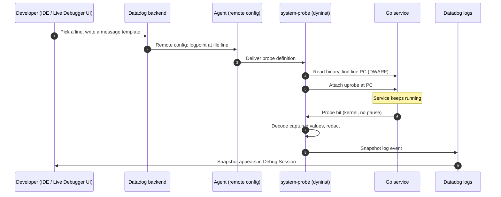
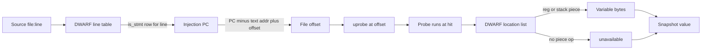

# Research R-debugger: live debugging of production Go without a code change

> Brief: local research brief (not committed).
> Accessed: 2026-10-29. Code pinned to datadog-agent commit `fd1f089014df9e80e6949323f7349041deadff5c`
> (last commit touching `pkg/dyninst`, 2026-10-28). Cited URLs below use that SHA where the file is in the repo.
> Public sources only. No private paths, internal names, or unreleased mechanism detail appear here.

## Summary for the owner

1. The deck's close says "Bits Live Debugger does this today, in preview." Public docs confirm **Bits Live Debugger is in Preview**. Preview is the only status the docs use for it. Keep the word "preview" on the slide.
2. Public docs also say Bits **only starts sessions for services in Targeted redaction mode**. Strict mode is not supported. The deck does not claim otherwise. The speaker should know this before a live demo.
3. "No redeploy, no restart" is a public claim. The docs say so in the Dynamic Instrumentation overview, and the Live Debugger overview says the same. It is safe to use as written.
4. Go support is documented with these requirements: Datadog Go SDK 2.9.0+ (strongly recommended), Datadog Agent 7.73.0+ on the same host, **Linux kernel 5.17+**, and `dynamic_instrumentation.enabled: true` in `system-probe.yaml`. The deck and script never state a version, so no contradiction. The speaker ledger (C-050) already says "Linux 5.17+". That matches the docs.
5. The public docs give **no explicit architecture list, no explicit Go version list, and no BTF statement** for Go. Do not put those on a slide as Datadog facts. They are open questions (section 8).
6. Rate limits are public: logpoints with variable capture run at **1 execution per second**, logpoints without capture at **5000 per second per service instance**. Use these numbers only with the exact source.
7. The repo `pkg/dyninst` shows a **session-wide default of 100 snapshots per second** (`DefaultSessionSnapshotsPerSecond`). This is a code default at the pinned SHA, and it is not a documented product limit. Mark it PLAUSIBLE for slides.
8. Live Debugger logpoints expire when the Debug Session ends. This is the public basis for the script line "expire automatically."
9. A line probe does not resolve to an arbitrary line. The code picks an `is_stmt` line-table entry for the line within the function. If there is none, it returns "no suitable injection point". Inlining and optimisation can therefore make a line unusable.

---

## 1. Public status, support, and requirements

### 1.1 Product status

| Claim | Verdict | Source | Exact quote |
| --- | --- | --- | --- |
| Live Debugger is a product that uses non-breaking logpoints and does not pause the application. | CONFIRMED | [S-DD-L1] <https://docs.datadoghq.com/tracing/live_debugger/> (markdown `https://docs.datadoghq.com/tracing/live_debugger.md`), accessed 2026-10-29 | "Live Debugger uses logpoints: auto-expiring, non-breaking breakpoints that collect diagnostic data without pausing the application." |
| Bits Live Debugger is in Preview. | CONFIRMED | [S-DD-L2] <https://docs.datadoghq.com/tracing/live_debugger/bits-live-debugger.md>, accessed 2026-10-29 | "Bits Live Debugger is in Preview. Request access to join the waiting list." |
| Bits Live Debugger requires Targeted redaction mode; Strict mode is not supported. | CONFIRMED | [S-DD-L2] | "The selected service and environment for the Bits debug session are set to Targeted redaction mode. Manually created Live Debugger sessions work in both Strict and Targeted redaction modes." and "Bits initiates debug sessions only for service and environment combinations set to Targeted redaction mode. Strict mode is not supported." |
| Bits uses Bits Code as the underlying agent. | CONFIRMED | [S-DD-L2] | "Bits Live Debugger uses Bits Code as the underlying agent." |
| Live Debugger and Dynamic Instrumentation use the same instrumentation technology. | CONFIRMED | [S-DD-L1], [S-DD-DI1] <https://docs.datadoghq.com/tracing/trace_collection/dynamic_instrumentation/> (markdown), accessed 2026-10-29 | "Live Debugger and Dynamic Instrumentation use the same instrumentation technology." |
| Dynamic Instrumentation's own status note: the product is "not compatible with Azure App Services or serverless environments." | CONFIRMED | [S-DD-DI1] | "Dynamic Instrumentation is not compatible with Azure App Services or serverless environments." |

Note on "Go Live Debugger is GA": the public docs do not label the Go Live Debugger as GA, beta, or preview. Only Bits Live Debugger carries a "Preview" label in the docs read here. Do not claim "GA" for Go without a source. Mark the Go status as **open question** (section 8).

### 1.2 Go requirements (public docs)

Source: [S-DD-L1] Live Debugger setup, "Language is Go" section, accessed 2026-10-29.

| Requirement | Verdict | Quote from docs |
| --- | --- | --- |
| Datadog Go SDK version | CONFIRMED | "Datadog Go SDK, version 2.9.0 or higher strongly recommended (or 1.74.6 or higher on the v1 line); versions below 2.9.0 may result in unexpected errors and a degraded experience. Minimum for in-app enablement: 2.6.0" |
| Agent version and placement | CONFIRMED | "Datadog Agent, version 7.73.0 or higher, running on the same host as your application" |
| Linux kernel | CONFIRMED | "Linux kernel 5.17 or higher" |
| Agent configuration | CONFIRMED | "Update `system-probe.yaml` ... `dynamic_instrumentation: enabled: true`" (or env `DD_DYNAMIC_INSTRUMENTATION_ENABLED=true`, or Helm `datadog.dynamicInstrumentationGo.enabled: true`) |
| Remote Configuration | CONFIRMED | "Remote Configuration enabled in the Agent" |
| Logs collection | CONFIRMED | "Agent log collection enabled with `logs_enabled: true`" |
| Agent-side first-request requirement | CONFIRMED | "**Note**: Live Debugger initializes on the first HTTP request. Your service must receive at least one request before you can create a logpoint." |
| Activation delay | CONFIRMED | "After a logpoint is created, modified, or re-activated, it can take a couple of minutes to instrument the code and begin capturing log events." |

Not stated in public docs (do not claim): architectures (amd64/arm64), supported Go versions, BTF requirement, the Go SDK's stripped-binary behaviour, CGO behaviour.

Public Go-version check (repo, not docs): the agent repo has no file that lists supported Go toolchains in `pkg/dyninst`. Open question (section 8).

### 1.3 Go support in the repo (pinned SHA)

These are facts about the code, not product claims. Use them only as the source for mechanics (section 2).

- `pkg/dyninst/doc.go` at `fd1f089014df9e80e6949323f7349041deadff5c`: "Package dyninst contains the implementation of the dynamic instrumentation as provided by the agent that supports such products as Live Debugger and Dynamic Instrumentation for Go." (Build tag: `linux && bpf`.) Source: <https://github.com/DataDog/datadog-agent/blob/fd1f089014df9e80e6949323f7349041deadff5c/pkg/dyninst/doc.go> — CONFIRMED.
- `pkg/dyninst/module/doc.go`: "Package module encapsulates a system-probe module which uses uprobes and bpf to exfiltrate data from running processes. This is the Go implementation of the dynamic instrumentation product." — CONFIRMED.
- Probe kinds in the IR: `ir/probe_kind.go`, `ir/event_kind.go` (entry, return, line). The code handles `FunctionWhere` (entry/return) and `LineWhere` (line). Source: <https://github.com/DataDog/datadog-agent/tree/fd1f089014df9e80e6949323f7349041deadff5c/pkg/dyninst/ir> — CONFIRMED.

**Probe types (public docs vs repo):** The public Live Debugger page offers *logpoints* (log message, variable capture, conditions). The Dynamic Instrumentation page offers *metrics, spans, and span tags* ("Dynamic spans, span tags, and metrics remain active until you disable them"). The brief asked about log, snapshot, metric, span probes. Public docs use "logpoint" for log+snapshot. Metric and span probes belong to Dynamic Instrumentation, which is a different product page and is not Live Debugger. CONFIRMED for the doc statement; do not describe metric/span probes as part of the Live Debugger demo.

---

## 2. Mechanics (public sources and pinned code)

The public docs describe the user-visible behaviour. The mechanics come from the pinned code at `fd1f089014df9e80e6949323f7349041deadff5c`. The repo is public (Apache 2.0, Copyright Datadog).

### 2.1 Source line → PC → uprobe

The chain in the code:

1. **Line selection.** `irgen.go`, case `ir.LineWhere`: parse the line number, call `pickLineInjectionPC(line, ranges, rootRanges, lineData)`. Source: <https://github.com/DataDog/datadog-agent/blob/fd1f089014df9e80e6949323f7349041deadff5c/pkg/dyninst/irgen/irgen.go> (function `pickLineInjectionPC`). CONFIRMED.
2. **Line table lookup.** `collectLineDataForRange` reads the DWARF line table with `dwarf.LineReader.SeekPC`, with fallbacks for "holes" between line-table sequences. The code comment cites Go issue #73996 as a TODO. CONFIRMED.
3. **Statement preference.** `pickLineInjectionPC` returns the first PC where `l.line == line` and `l.isStatement` is true. If only non-statement rows match, it returns the first non-statement PC. If none match, it returns `IssueKindInvalidProbeDefinition` with "no suitable injection point found for line". CONFIRMED.
4. **Disassembly check.** After picking the PC, the code disassembles the function (`disassembleFunction`) to validate the injection point. CONFIRMED.
5. **Uprobe address.** `uprobe/attach.go` converts each attach point PC to a file offset: `addresses[i] = ap.PC - textSection.Addr + textSection.Offset`, then calls `linkExe.UprobeMulti` (multi-attach) or the single-attach path. Source: <https://github.com/DataDog/datadog-agent/blob/fd1f089014df9e80e6949323f7349041deadff5c/pkg/dyninst/uprobe/attach.go>. CONFIRMED.
6. **Executable identity check.** Before attaching, `Attach` resolves the process executable again and fails with "executable changed during probe setup" if it no longer matches. CONFIRMED.

### 2.2 Reading variables (DWARF locations)

- Location lists come from DWARF. The code parses DWARF expressions into `ir.Piece` values, each with a size and an optional operation. Source: `pkg/dyninst/dwarf/loclist/parse.go` at the pinned SHA. CONFIRMED.
- The code comment in `parse.go` says: "Consecutive pieces always indicating that parts of the variable data are not available." CONFIRMED (quote from source). It also says: "This assumption holds true up to go1.24. It no longer holds in go1.25, due to introduction of dw_op_deref." And "TODO(piob): support dw_op_deref." So the code states a Go 1.25 gap for `DW_OP_deref`. Mark as a known limitation in the code, not a product claim.
- Location parse errors are logged and the variable gets no location. `irgen.go` `computeLocations`: on error it logs "ignoring locations for variable at 0x%x" (rate-limited) and returns nil. A variable with no location cannot be read. CONFIRMED.
- `fix.go` (in the same package) compacts location pieces to work around an SSA bug: "The bug occurs because of some behavior in ssa where different pieces of a ..." CONFIRMED (quote is from the source comment; the full comment should be read before quoting).

### 2.3 Registers vs stack; Go ABIInternal

- The eBPF side carries register tables (`dwarf_regs.h`) and a stack offset for a `context.Context` that is in scope: `CTX_LOC_REGISTERS` (interface in registers) or `CTX_LOC_STACK` (interface at CFA plus offset). Source: `pkg/dyninst/ebpf/types.h`, lines 37-39 at the pinned SHA. CONFIRMED.
- `irgen/abi.go` maps ABI details to the IR. Read this file before quoting ABI specifics. Not read in full here. Mark ABIInternal register-assignment details as **not verified in this pass**.

### 2.4 Inlining and optimisation (variables unavailable)

- The code handles inlined subroutines explicitly: it visits `DW_TAG_inlined_subroutine`, tracks `inlinedPCRanges` per inlined instance, and propagates locations from abstract to concrete inlined variables. Source: `irgen.go` near lines 2557-2640 and 3376-3420 at the pinned SHA. CONFIRMED.
- A variable whose DWARF location is missing or whose pieces have no operation is "not available" at that PC. The capture result carries `notCapturedReason` values from `decode/not_captured_reason.go`: `length`, `depth`, `collectionSize`, `pruned`, `unavailable`, `unimplemented`, `circular reference`, `missing type information`, `redactedIdent`, `redactedType`. Source: pinned SHA, `decode/not_captured_reason.go`. CONFIRMED.
- For a condition that references a variable with no available location, the code raises `IssueKindConditionVariableUnavailable` with "condition variable %q not available at any event". Source: `irgen.go` near line 998. CONFIRMED.

Plain-language mapping for the talk: an optimised-out variable is "unavailable" at that PC. The probe still fires. The snapshot marks the variable as not captured.

### 2.5 How captures stay bounded (no stop-the-world)

Public statement: "Safe, non-invasive data capture that collects debugging information without pausing applications or requiring redeploys." (Live Debugger docs, [S-DD-L1]). CONFIRMED as a product claim.

Code evidence for bounded work:

- Probe parameters carry hard limits: `pointer_chasing_limit`, `collection_size_limit`, `string_size_limit` in `ebpf/types.h` (pinned SHA). CONFIRMED that the fields exist. Their default values are not in this repo (they come from the probe config, which is set outside `pkg/dyninst`). Open question (section 8).
- The chain walk for trace context is bounded: "The chain walk needs ~32 hops worst-case" (`irgen/trace_context.md`). The pre-decision walk follows **16** links, the capture walk follows **32** (`docs/coordinated-sampling.md`). CONFIRMED (both in-repo docs).
- The eBPF `probe_run` path has a 512-byte verifier stack budget per call chain. Quote from `docs/coordinated-sampling.md`: "the verifier's 512-byte limit on the combined stack of a call chain." CONFIRMED.
- `irgen` caps the recursive type-walk depth with `const maxDepth = 30` in `extractRootVariableName`. CONFIRMED (this is the expression walk, not the capture depth).
- Overflow handling: the event path marks buffered events as `truncated` and emits the partial event. Source: `ebpf/event.c` lines near 370 and 428 ("truncated", "lost"). CONFIRMED.

What the code does **not** show: a "stop-the-world" pause. The code does not send SIGSTOP or use ptrace attach in `ebpf/event.c` (grep for `sigstop`, `ptrace`, `stop_the` returned no matches at the pinned SHA). CONFIRMED absence in the probe event path. Do not state "no stop-the-world" as a Datadog claim unless the owner accepts this as their own reading of the code.

### 2.6 Overhead and rate-limit controls

Public, Live Debugger docs (`ld.md`, [S-DD-L1]), section "Limitations":

- "Logpoints with variable capture: Limited to 1 execution per second."
- "Logpoints without variable capture: Limited to 5000 executions per second, per service instance."

Repo, pinned SHA: `irprog.go` line 67: `const DefaultSessionSnapshotsPerSecond = 100`. The comment says it is "the session-wide ceiling used when no CoordinatedSampling config is provided." This is a code default. It is not in the public docs, so mark it PLAUSIBLE for slides and say "code default" if quoted.

Coordinated sampling (repo doc `pkg/dyninst/docs/coordinated-sampling.md`, pinned SHA): "Coordinated sampling makes the keep-or-drop decision once per request and applies it to every probe in that request. You get the whole chain of snapshots or none of it." And: "At most one snapshot per probe per request." CONFIRMED (in-repo design doc). Status line in the same doc: "`WithCoordinatedSampling` is not wired to remote config, so the session rate is always the default." So the session rate is not user-tunable yet. CONFIRMED.

Throttle (repo, `ebpf/throttler.h`): a per-probe token budget refreshed each period. Quote: "Check if we are within budget. First do only a memory read, to avoid..." CONFIRMED.

Overhead numbers: no public, measured overhead figure for Go Live Debugger was found. Do not state an overhead number. Open question (section 8).

---

## 3. Other ways to live-debug Go in production

Comparison in one table. "Reads variables" and "production safe" are based on the cited source, and "production safe" is the owner's question, so each cell names what the source supports.

| Approach | Needs code change | Needs redeploy | Stops the process | Reads variables | Production safe (what the source says) | Source |
| --- | --- | --- | --- | --- | --- | --- |
| Datadog Live Debugger (logpoints) | No | No | No (non-breaking) | Yes (snapshot) | Docs say non-pausing and bounded; rate limits documented | [S-DD-L1] |
| Delve attach/breakpoint | No (needs debug binary and attach) | No | **Yes** (breakpoint halts the goroutine) | Yes | Not designed for live production; halts the program | [S-DELVE] <https://github.com/go-delve/delve/blob/master/Documentation/cli/README.md>, accessed 2026-10-29: "functions can only be called when the goroutine is stopped at a safe" ; "Sets a breakpoint." ; tracepoint doc: "A tracepoint is a breakpoint that does not stop the execution of the program" |
| Delve tracepoint (`trace` command) | No | No | No (notification only, per Delve doc) | Prints notifications; not a full snapshot per the doc | Delve's own doc says it does not stop the program; attach model still requires debugger access | [S-DELVE] |
| Go 1.25 flight recorder (`runtime/trace.FlightRecorder`) | **Yes** (you call the API in code) | Yes | No | No (execution trace: goroutine timing, not variable values) | Keeps a bounded in-memory window and snapshots on request; scope is trace events | [S-GO-FR] <https://go.dev/blog/flight-recorder>, accessed 2026-10-29; API: `trace.NewFlightRecorder(trace.FlightRecorderConfig{MinAge, MaxBytes})`, `fr.Start()`, `fr.WriteTo(f)` |
| bpftrace / raw uprobes on a Go binary | No | No | No (uprobe, no halt) | Only registers/stack at the probe offset, by hand | Kernel docs: "the uprobe event interface expects the user to calculate the offset of the probepoint in the object." Go symbol and inlining handling is manual | [S-KUP] <https://docs.kernel.org/trace/uprobetracer.html>, accessed 2026-10-29 |
| Datadog Dynamic Instrumentation (metrics, spans, span tags) | No | No | No | No (metric/span output, not variable snapshots) | Public docs say "Dynamic spans, span tags, and metrics remain active until you disable them." | [S-DD-DI1] |
| OpenTelemetry equivalent of dynamic instrumentation for Go | — | — | — | — | **Not found in this pass.** OBI (OTel eBPF instrumentation) covers HTTP/gRPC RED metrics and 13 Go library spans, not variable reads (see research/without-a-single-line/claims-ledger.md C-014). | repo research ledger |

Notes on the table:

- The Delve row needs care. The Delve doc does not say Delve "halts the process" in the exact words in the cell. It says a breakpoint stops execution at the point where the goroutine is stopped, and the tracepoint doc says a tracepoint "does not stop the execution." Quote the doc, not the summary, on a slide. Mark "stops the process" as CONFIRMED for breakpoints and CONFIRMED that tracepoints do not stop.
- The flight recorder row is correct for the question "is it production safe". It does not read variables. It is an execution trace. Link to the earlier research `research/without-a-single-line/06-runtime-futures.md` (C-040 CONFIRMED) for the API.
- The bpftrace row: `bpftrace` reference guide fetch failed (HTTP 141-byte error at the pinned URL). The kernel uprobetracer doc is the source used. Treat bpftrace-specific claims as **not verified in this pass**.

Link to the related primer (another researcher). The uprobe mechanics here reference the eBPF and uprobe primer; that primer is not written by this brief. Do not restate its content.

---

## 4. Security and safety

### 4.1 What a snapshot can capture

- Public, Live Debugger docs: "Built-in sensitive data scrubbing to help prevent exposure of personal data, secrets, and credentials." CONFIRMED.
- Captured values include method arguments, local variables, and execution context: "This includes variable values, method parameters, and execution context." CONFIRMED.
- Trace context: a captured `context.Context` can yield trace IDs. Repo doc: "dyninst captures dd-trace correlation IDs from captured context.Context values and surfaces them on snapshot messages." CONFIRMED (in-repo design doc).

### 4.2 Redaction controls (public)

Source: [S-DD-SCRUB] <https://docs.datadoghq.com/tracing/live_debugger/sensitive-data-scrubbing.md>, accessed 2026-10-29.

- Two modes: "Strict Mode: Redacts all values except numbers and Booleans." and "Targeted Mode: Redacts known sensitive patterns such as credit card numbers, API keys, IPs, and other PII. It also runs a high-entropy secrets scanner that automatically redacts likely secrets, which appear as `[REDACTED:HIGH_ENTROPY]` in captured data." CONFIRMED.
- "These redaction modes cannot be disabled, only switched." CONFIRMED.
- "Targeted Mode is applied automatically in common pre-production environments such as `staging` or `preprod`." CONFIRMED.
- Identifier redaction: "Live Debugger automatically redacts values linked to sensitive identifiers, such as `password` and `accessToken`, before captured data leaves the host." CONFIRMED. The docs use `password` and `accessToken` as examples.
- Custom identifiers are set in the application's environment, not in `datadog-agent`: "In your application's environment (not on `datadog-agent`), set the `DD_DYNAMIC_INSTRUMENTATION_REDACTED_IDENTIFIERS` environment variable". CONFIRMED.
- Type-based redaction: `DD_DYNAMIC_INSTRUMENTATION_REDACTED_TYPES`. CONFIRMED.
- Sensitive Data Scanner runs **after** upload: "Datadog Sensitive Data Scanner performs its redaction *after* the information is uploaded to Datadog." CONFIRMED. Say this on the slide if redaction is shown: identifier and type rules run in the infrastructure first.

Repo, Go-specific (pinned SHA, `redaction/doc.go`): "Unlike the in-process tracers, Go's dynamic instrumentation captures values out of process in system-probe, so redaction is enforced when the captured data is decoded." CONFIRMED (in-repo). Also: the redaction defaults are "originally derived from the Sentry SDK scrubber" (in-repo). CONFIRMED for the in-repo statement.

Repo, Go-specific: redaction also rejects probe conditions that reference a redacted identifier, "because a condition is evaluated in eBPF and would otherwise leak the value through the fire/no-fire result." CONFIRMED (in-repo design statement).

### 4.3 Required privileges

Public docs: the Live Debugger role permissions (`live_debugger_read`, `live_debugger_write`, `live_debugger_redaction_write`) apply to the Datadog UI user, not to the process. CONFIRMED.

Agent-side privilege: the Go path runs in `system-probe` (public: "Uses eBPF through Datadog's `system-probe`" is in the speaker ledger C-050; the public docs say "system-probe.yaml" for the enabling config). CONFIRMED for the config file and for the module name in code (`pkg/dyninst/module`).

Not verified in this pass: the exact Linux capabilities or root requirement for `system-probe` in the Go path. Do not state a capability list. Open question (section 8).

Security posture from the repo: the uprobe attach code checks that the executable did not change before attach. CONFIRMED.

---

## 5. Visuals

### 5.1 Public visuals

Search for public Datadog diagrams of the dynamic instrumentation flow was attempted in the Datadog docs and blog index. The docs pages fetched here are text-only (no image URLs were extracted). No usable public diagram with a reuse license was found in this pass. **Result: no reusable public visual found.** Use the Mermaid diagrams below.

### 5.2 Sequence diagram: developer picks a line → snapshot appears

Built from the public flow in the docs (create logpoint, activation delay, first capture) and the code path (IR, attach, capture, decode). Labels are kept short.

Source of the flow: [S-DD-L1] (logpoint creation, "a couple of minutes to instrument," first request), [S-DD-SCRUB] (redaction before upload), and the pinned code `uprobe/attach.go` (attach) and `irgen/irgen.go` (line PC). Uncertain boundary: the exact hop from remote config to `system-probe` is not documented in the public docs read here. Shown as one arrow; flag this to the owner.

### 5.3 Diagram: source line → DWARF → PC → uprobe → variable read

Source: pinned code `irgen.go` (`pickLineInjectionPC`, `collectLineDataForRange`), `uprobe/attach.go` (address = PC - text.Addr + text.Offset), `dwarf/loclist/parse.go` (pieces with no op mean not available). CONFIRMED for each step in the code. The "unavailable" branch is confirmed by the parse comment, not by a runtime test. Uncertain boundary: the eBPF side reads registers and stack per piece; exact register mapping per Go ABI was not verified in this pass.

---

## 6. Other visuals and licences

No third-party visual was reused. Both diagrams are original Mermaid. If the owner wants the Datadog docs screenshots, check their licence first. No licence was found on the docs pages read here (all rights reserved by Datadog is the default for Datadog-hosted content; not verified). Mark as **unknown licence**.

---

## 7. Spoken explanation and slide facts

### 7.1 Motto

**"The probe goes to the running process. The process does not stop."**

### 7.2 Facts a slide needs (each one has a source)

1. Live Debugger logpoints capture logs and variable snapshots without pausing the application. [S-DD-L1]
2. Go needs Linux kernel 5.17+, Datadog Go SDK 2.9.0+, and Agent 7.73.0+ on the same host. [S-DD-L1]
3. Bits Live Debugger is in Preview and needs Targeted redaction mode. [S-DD-L2]
4. Logpoints with variable capture run at most 1 execution per second. [S-DD-L1]
5. Logpoints expire automatically when the Debug Session ends. [S-DD-L1]

### 7.3 Spoken explanation (for an intermediate Go developer)

Live Debugger puts a probe at one line of a running Go service. The product reads the binary's DWARF line table and finds the machine address for that line. It attaches a uprobe at that address. The service keeps running. When the line executes, the probe runs in the kernel. Values are read from registers or the stack, using the DWARF location list for each variable. Some variables are optimised away at that address, so the snapshot marks them as unavailable. Captures have hard limits on depth, size, and rate. The data is redacted before it leaves the host. The logpoint expires after a set time.

Keep the claims in the spoken text to the ones marked CONFIRMED above.

---

## 8. Proposed slides (4-6, about 4 minutes)

These build on the eBPF and uprobe primer, which another researcher writes. Reference the primer; do not restate it.

1. **"The probe goes to the running process"**: the sequence diagram (5.2). Content: pick a line, the service keeps running, the snapshot appears. Visual: sequence diagram.
2. **"From a line to a machine address"**: the flowchart (5.3), left half only. Content: the line table gives a PC, the PC becomes a uprobe offset. Visual: flowchart.
3. **"Some variables are not there"**: content: an optimised variable is unavailable at that PC; the probe still fires. Visual: text callout with one example code line from the talk. (No new claim.)
4. **"Bounded by design"**: content: 1 execution per second with capture; 5000 per second without capture; logpoints expire; redaction before upload. Visual: short table, four rows, each with a source link.
5. **"Other ways, and their cost"**: content: one compact table row set (Delve stops, flight recorder does not read variables, raw uprobes are manual). Visual: the comparison table from section 3, reduced.
6. **"Preview, with the limits"**: content: Bits Live Debugger is in Preview; Targeted redaction only; Go needs kernel 5.17+. Visual: amber chip "Preview". This slide replaces the current close claim with the public wording.

---

## 9. Open questions

1. **Go Live Debugger status (GA, preview, or beta).** The public docs read here label only Bits Live Debugger as Preview. Ask Datadog or the owner which label to use for the Go Live Debugger itself. Do not say "GA" without a source.
2. **Architectures and Go toolchain versions for Go.** Not stated in the public docs. The repo `pkg/dyninst` has no list in the files read. Need a source before a slide claims amd64/arm64 or a Go version range.
3. **BTF requirement for Go path.** Not stated in the public Live Debugger docs read here. The OBI BTF statement (C-011) applies to OBI, not to this product. Do not transfer it.
4. **Default capture limits.** The defaults for pointer depth, collection size, and string length are set in the probe config outside this repo. The repo has the fields (`pointer_chasing_limit`, `collection_size_limit`, `string_size_limit`) but not the default values. Need the probe-config defaults or a public doc to state them.
5. **Overhead.** No public measured overhead for Go Live Debugger found. Do not state a percentage or latency number.
6. **Capabilities for system-probe.** The exact privilege list for the Go path is not in the public docs read here. Do not publish a capability list.
7. **Bits Live Debugger agent flow.** The docs say Bits uses Bits Code as the agent. The hop from remote config to system-probe in Figure 5.2 is an inference. Confirm with the owner before the sequence diagram goes on a slide.
8. **OpenTelemetry equivalent.** None found in this pass for variable snapshots in Go. Check OTel eBPF/OBI roadmap before claiming "no OTel equivalent." (The OBI ledger C-014 says OBI does not cover custom in-process telemetry.)
9. **bpftrace reference.** The bpftrace reference guide URL returned an error in this pass. Re-fetch before citing bpftrace behaviour.
10. **Go 1.25 DWARF gap.** The code comment in `loclist/parse.go` says `DW_OP_deref` is not supported for Go 1.25 (TODO piob). Check whether this limits variables on Go 1.25 before the talk claims Go 1.25 support.
11. **Current deck wording.** The deck says "Bits Live Debugger does this today, in preview." This matches the public docs. The speaker note says "Name the product once." Keep this. But the Bits Targeted-mode requirement is absent from the slide and script; the owner should decide whether to add it.

---

## Source list

| Key | URL | Type | Version / SHA | Accessed |
| --- | --- | --- | --- | --- |
| S-DD-L1 | <https://docs.datadoghq.com/tracing/live_debugger.md> (page <https://docs.datadoghq.com/tracing/live_debugger/>) | Datadog docs (markdown) | docs, current | 2026-10-29 |
| S-DD-L2 | <https://docs.datadoghq.com/tracing/live_debugger/bits-live-debugger.md> | Datadog docs (markdown) | docs, current | 2026-10-29 |
| S-DD-DI1 | <https://docs.datadoghq.com/tracing/trace_collection/dynamic_instrumentation.md> | Datadog docs (markdown) | docs, current | 2026-10-29 |
| S-DD-SCRUB | <https://docs.datadoghq.com/tracing/live_debugger/sensitive-data-scrubbing.md> | Datadog docs (markdown) | docs, current | 2026-10-29 |
| S-DD-EXPR | <https://docs.datadoghq.com/dynamic_instrumentation/expression-language.md> | Datadog docs (markdown) | docs, current; fetched, not quoted | 2026-10-29 |
| S-REPO-DOC | <https://github.com/DataDog/datadog-agent/blob/fd1f089014df9e80e6949323f7349041deadff5c/pkg/dyninst/doc.go> | official-repo | `fd1f089014df9e80e6949323f7349041deadff5c` | 2026-10-29 |
| S-REPO-CS | <https://github.com/DataDog/datadog-agent/blob/fd1f089014df9e80e6949323f7349041deadff5c/pkg/dyninst/docs/coordinated-sampling.md> | official-repo doc | `fd1f089014df9e80e6949323f7349041deadff5c` | 2026-10-29 |
| S-REPO-IRGEN | <https://github.com/DataDog/datadog-agent/blob/fd1f089014df9e80e6949323f7349041deadff5c/pkg/dyninst/irgen/irgen.go> | official-repo | `fd1f089014df9e80e6949323f7349041deadff5c` | 2026-10-29 |
| S-REPO-ATTACH | <https://github.com/DataDog/datadog-agent/blob/fd1f089014df9e80e6949323f7349041deadff5c/pkg/dyninst/uprobe/attach.go> | official-repo | `fd1f089014df9e80e6949323f7349041deadff5c` | 2026-10-29 |
| S-REPO-LOCLIST | <https://github.com/DataDog/datadog-agent/blob/fd1f089014df9e80e6949323f7349041deadff5c/pkg/dyninst/dwarf/loclist/parse.go> | official-repo | `fd1f089014df9e80e6949323f7349041deadff5c` | 2026-10-29 |
| S-REPO-REDACT | <https://github.com/DataDog/datadog-agent/blob/fd1f089014df9e80e6949323f7349041deadff5c/pkg/dyninst/redaction/doc.go> | official-repo | `fd1f089014df9e80e6949323f7349041deadff5c` | 2026-10-29 |
| S-REPO-IR | <https://github.com/DataDog/datadog-agent/blob/fd1f089014df9e80e6949323f7349041deadff5c/pkg/dyninst/ir/program.go> | official-repo | `fd1f089014df9e80e6949323f7349041deadff5c` | 2026-10-29 |
| S-REPO-TRACECTX | <https://github.com/DataDog/datadog-agent/blob/fd1f089014df9e80e6949323f7349041deadff5c/pkg/dyninst/irgen/trace_context.md> | official-repo doc | `fd1f089014df9e80e6949323f7349041deadff5c` | 2026-10-29 |
| S-DELVE | <https://github.com/go-delve/delve/blob/master/Documentation/cli/README.md> | official-repo doc | master, accessed 2026-10-29 (pin before publishing) | 2026-10-29 |
| S-GO-FR | <https://go.dev/blog/flight-recorder> | official-blog | published 26 Sept 2025 | 2026-10-29 |
| S-KUP | <https://docs.kernel.org/trace/uprobetracer.html> | kernel docs | kernel.org current | 2026-10-29 |
| S-LOCAL-RS06 | research/without-a-single-line/06-runtime-futures.md (C-040) | repo research | local | 2026-10-29 |
| S-LOCAL-C050 | research/without-a-single-line/claims-ledger.md (C-050, C-051) | repo research | local | 2026-10-29 |

---

## Claim ledger (this research only)

Counts: **CONFIRMED** = read at a primary source. **PLAUSIBLE** = secondary or code default, not a product claim. **REFUTED** = contradicted by a source.

### CONFIRMED (primary source read)

1. Live Debugger uses non-breaking, auto-expiring logpoints that do not pause the application. [S-DD-L1]
2. Bits Live Debugger is in Preview. [S-DD-L2]
3. Bits sessions require Targeted redaction mode; Strict mode is not supported. [S-DD-L2]
4. Bits Live Debugger uses Bits Code as the underlying agent. [S-DD-L2]
5. Live Debugger and Dynamic Instrumentation use the same instrumentation technology. [S-DD-L1, S-DD-DI1]
6. Go requirements: Go SDK 2.9.0+ (recommended), Agent 7.73.0+ on the same host, Linux kernel 5.17+. [S-DD-L1]
7. Go agent config: `dynamic_instrumentation: enabled: true` in `system-probe.yaml`. [S-DD-L1]
8. Live Debugger initializes on the first HTTP request; a logpoint can take a couple of minutes to activate. [S-DD-L1]
9. Logpoints with variable capture: 1 execution per second. Without capture: 5000 per second per service instance. [S-DD-L1]
10. Targeted Mode applies automatically in staging and preprod. Mode cannot be disabled, only switched. [S-DD-SCRUB]
11. Identifier redaction (`password`, `accessToken`) happens before data leaves the host. [S-DD-SCRUB]
12. Sensitive Data Scanner redaction happens after upload. [S-DD-SCRUB]
13. Dynamic Instrumentation adds spans, span tags, and metrics that stay active until disabled; it is not a variable-snapshot product. [S-DD-DI1]
14. The Go path is in `pkg/dyninst`, a system-probe module that uses uprobes and eBPF; Go is named as the target. [S-REPO-DOC, module doc]
15. A line probe picks a line-table statement row; no suitable row gives "no suitable injection point found for line". [S-REPO-IRGEN]
16. The uprobe address is PC minus `.text` address plus `.text` file offset. [S-REPO-ATTACH]
17. The executable is re-checked before attach; a change fails the attach. [S-REPO-ATTACH]
18. Location pieces with no operation mean the value is not available; a loclist parse error drops the location. [S-REPO-LOCLIST, S-REPO-IRGEN]
19. The loclist parser assumes the no-operation piece rule only holds up to Go 1.24; `DW_OP_deref` on Go 1.25 is a TODO. [S-REPO-LOCLIST]
20. Trace-context walk: 16 hops pre-decision, 32 hops for capture. [S-REPO-CS, S-REPO-TRACECTX]
21. Coordinated sampling: one keep-or-drop decision per request; at most one snapshot per probe per request. [S-REPO-CS]
22. Session rate is not wired to remote config; always the default. [S-REPO-CS]
23. Captured values are redacted at decode in system-probe for Go, not in the process. [S-REPO-REDACT]
24. Redaction also blocks probe conditions that reference a redacted identifier. [S-REPO-REDACT]
25. Flight recorder (Go 1.25) buffers execution-trace data and snapshots it with `WriteTo`; it does not capture variable values. [S-GO-FR]
26. The uprobe interface requires the user to compute the offset of the probe point. [S-KUP]
27. Delve: a breakpoint stops the goroutine; a tracepoint does not stop the program. [S-DELVE]
28. The probe event path has no SIGSTOP or ptrace stop in `ebpf/event.c` at the pinned SHA. [S-REPO-*, grep result]

### PLAUSIBLE (secondary or code default; flag in prose)

 1. Session-wide default of 100 snapshots per second. Code constant `DefaultSessionSnapshotsPerSecond = 100`, not a documented product limit. [S-REPO-IR]
 2. "Stop-the-world-free" as a general property of the Go path. Supported by the public phrase "without pausing applications" and the absence of stop signals in the code, but not stated as a design guarantee in the docs. Flag before using the phrase "no stop-the-world" on a slide.
 3. Trace-context walk ~32 hops is the worst case in a design doc, not a measured bound. [S-REPO-TRACECTX]

### REFUTED

None found in this pass. The speaker ledger C-050 ("logpoints expire automatically," "system-probe," "Linux 5.17+") matches the public docs.

### Not verified in this pass (do not use)

- Architectures (amd64/arm64) and Go toolchain version range for the Go path.
- BTF requirement for the Go path.
- Default values of capture limits (depth, collection size, string length).
- Overhead numbers.
- ABIInternal register-assignment details beyond the register table references.
- bpftrace-specific behaviour (reference URL failed).
- Any OpenTelemetry equivalent for variable snapshots in Go.

---

## Notes on process

- Searching: the `web_search` tool was not available in this session. Discovery was done with `gh api` over the public `DataDog/datadog-agent` repo and direct HTTP reads of public docs pages. Every URL above was read directly, not from search results.
- Logged gateway: no query text contained private paths, internal names, or code. The only queries were repo and file paths in public repos.
- No files in the repo were edited. The only file written is this one.
