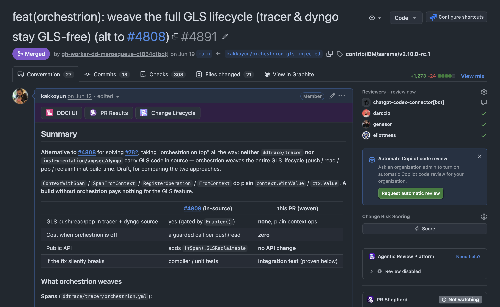
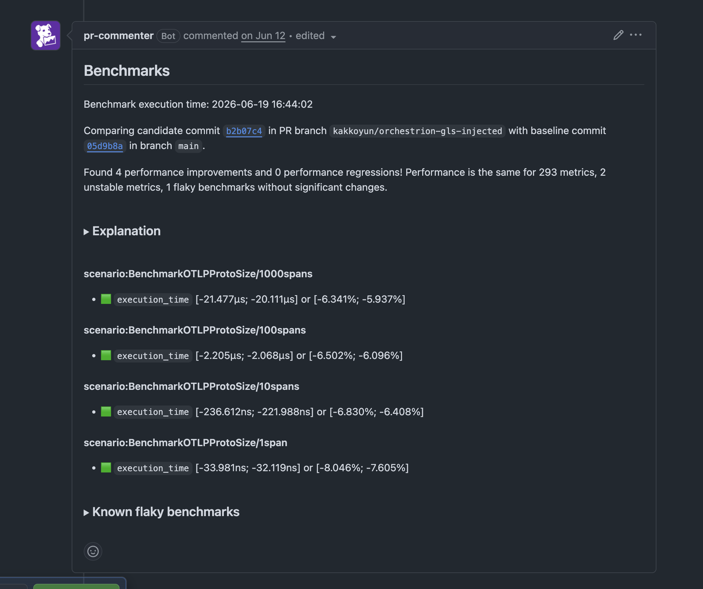
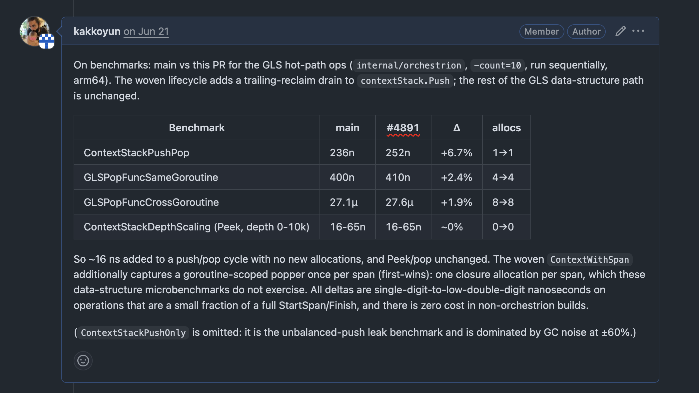
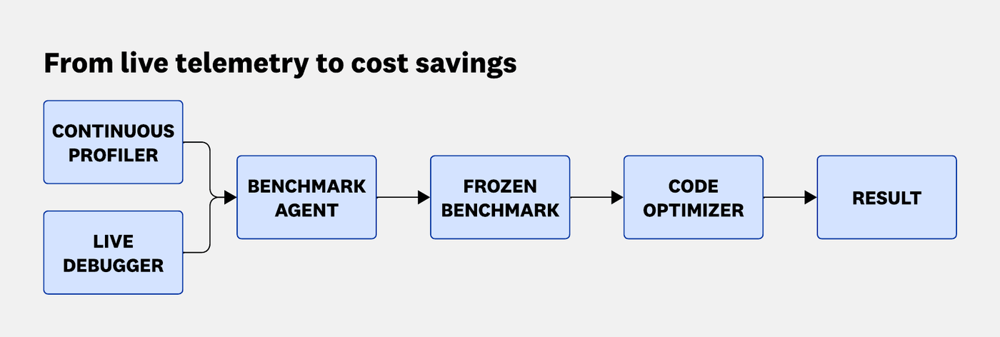
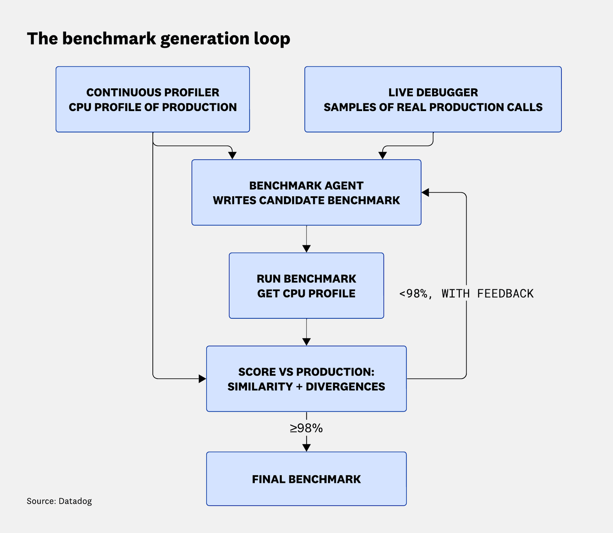

<!-- _class: title gopher-sage -->
<!-- _paginate: false -->
<!-- _header: "" -->

##### GoLab · 2026

# Why Your Go Benchmarks Are Lying

And How to Stop Them

### Kemal Akkoyun · Datadog

<!--
SAY

Every benchmark you write is a measurement system. Like any instrument, it can be precise and still wrong.

Today I give you three questions. They turn a number into a measurement. And I show you how we answer them at Datadog, where a wrong benchmark costs real money, and how the Go team answers them for the toolchain you use every day.

DO

Do not introduce yourself yet. Advance.
-->

---

<!-- _class: vcenter -->

## "Not all fast software is world-class,

## but all world-class software is fast."

<br>

<div class="center">

**Performance is *the* killer feature.**

Tobi Lütke, Shopify · [X, 5 May 2024](https://x.com/tobi/status/1787139157078188180)

</div>

<!--
SAY

Before we talk about benchmarks, one question. Why should you care about speed at all?

Tobi Lütke, who runs Shopify, said it better than I can. Read it with me. Not all fast software is world-class, but all world-class software is fast.

Speed is not decoration. It is part of what makes software good.

DO

Pause after the quote. Ledger row 12. If someone asks: the post needs an X login to open.
-->

---

<!-- _class: vcenter -->

## Measure customer happiness,

## not CPU usage

<div class="center">

A benchmark measures a **proxy**. Pick the right one.

</div>

<!--
SAY

But be careful what you chase. The goal is not CPU usage, or allocations, or requests per second. The goal is a happy user.

Everything else is a proxy. A benchmark measures the proxy. So the proxy must be the right one.

DO

Slow down here. This is the frame for the whole talk.
-->

---

## Latency and throughput

<div class="cols">
<div class="card">

### Latency

One operation.

*Users feel this.*

</div>
<div class="card measure">

### Throughput

Operations per second.

*Your ceiling.*

</div>
</div>

<div class="center big">

Improve one, damage the other.

</div>

<!--
SAY

Two words that people use as if they were the same.

Latency is one operation, start to finish. That is what a user feels. Throughput is operations per second. That is your ceiling.

You can improve one and damage the other. Batching raises throughput and makes latency worse. Know which one your user pays for.

DO

Point at each card. No numbers.
-->

---

## The cost of slowness

<div class="flow">
<div class="card">

### 0.1–0.2 s

barely noticeable

</div>
<div class="card measure">

### 0.3–0.5 s

slightly slow

</div>
<div class="card">

### 1–3 s

you notice the wait

</div>
<div class="card measure">

### 5–10 s

users leave

</div>
</div>

<div class="center big">

Half a second slower: **−20%** Google search traffic.

</div>

<div class="small center">

Nielsen, *Usability Engineering* (1993) · Google, via [Coding Horror: Performance is a Feature](https://blog.codinghorror.com/performance-is-a-feature/)

</div>

<!--
SAY

Rough thresholds, from Jakob Nielsen's usability work. Under two hundred milliseconds, nobody notices. Half a second feels a bit slow. Past one second, people notice that they wait. Past five seconds, they leave.

Google measured it on search. Half a second of extra delay cost them twenty percent of the traffic.

So speed is a product decision, not only an engineering one.

DO

Ledger rows 10 and 17. Say "Google". Do not name Marissa Mayer: that attribution is not confirmed.
-->

---

## Before you optimize

<div class="columns3">
<div class="card">

### Is it slow?

Profile production.

<span class="small">`pprof` · [Continuous Profiler](https://docs.datadoghq.com/profiler/) · [OTel eBPF profiler](https://github.com/open-telemetry/opentelemetry-ebpf-profiler) · [Parca](https://www.parca.dev/)</span>

</div>
<div class="card measure">

### Can it go faster?

Headroom is the gap to the hardware ceiling.

</div>
<div class="card">

### Is it worth it?

SLO, error budget.

Amdahl: only the hot path pays.

</div>
</div>

<div class="center big">

Benchmark what production says is **hot**.

</div>

<!--
SAY

Three questions before you write a single benchmark.

Is it slow? Check in production, not in your head. In-process, that is pprof or a continuous profiler. Across the whole system, the OpenTelemetry eBPF profiler or Parca.

Can it go faster? Slow does not mean improvable. The ceiling is the hardware: memory bandwidth, instruction latency. Headroom is the gap between you and that ceiling.

Is it worth it? If you are inside your SLO and your error budget, optimizing is optional. And Amdahl: ten percent off code that runs one percent of the time is nothing.

So benchmark the path that production says is hot. Not the one that looks interesting.

DO

Walk the three cards left to right. One sentence each if you are behind.
-->

---

## Finding what to optimize

<div class="columns">
<div>

[**Optimizing Go Code Without a Blindfold**](https://www.youtube.com/watch?v=oE_vm7KeV_E)

Daniel Martí · GopherCon 2019

He covers *what* to optimize.

This talk covers *whether you can trust the number*.

</div>
<div class="center">


</div>
</div>

<!--
SAY

If you want the "what to optimize" half properly, watch Daniel Martí at GopherCon 2019. It is still the best talk on it.

He covers what to optimize. I cover whether you can believe the number when you get there.

DO

Ledger row 28. Then advance to why Datadog cares.
-->

---

<!-- _footer: "▸ " -->
<!-- _class: vcenter -->

## Why Datadog cares

<div class="columns">
<div>

### Our code, your process

Every ns comes out of a
customer's budget.

</div>
<div>

### <span class="hl-blue">−3.4%</span> CPU

on one large service, from PGO alone.

</div>
</div>

<div class="center">


<span class="small">Datadog invests in performance testing internally. This talk is the spillover.</span>

</div>

### Overhead is product correctness

<!--
SAY

Why do I care so much? Before Datadog, I maintained Prometheus `client_golang` and worked on the Parca profiler. Each of those jobs punished me for a benchmark I did not question.

At Datadog, our code runs inside your process. Every nanosecond we spend comes out of your budget. For us, overhead is product correctness.

One public number: profile-guided optimisation took three point four percent of CPU off one large production service. Staging was too noisy to show it. The team had to divide CPU by the work done before the change was visible.

We invest in this internally. The effort is called SpeedLab. This talk is the spillover.

DO

Say the SpeedLab name once. Ledger row 30 permits the name and its existence only. The practice comes in §05. The PGO number is one service, not all of production. Ledger row 47.
-->

---

## dd-trace-go #4891

<div class="shot pr">



</div>

<div class="small center">

[dd-trace-go pull request #4891](https://github.com/DataDog/dd-trace-go/pull/4891) · June 2026

</div>

<!--
SAY

Now a real story. June this year, dd-trace-go, the Datadog Go tracer. This is my pull request. With Orchestrion, it moves goroutine-local storage out of the tracer source and weaves it in at build time.

Four reviewers. More than three hundred checks. And one of those checks is a benchmark bot.

DO

Point at the title and the checks count. Do not read the summary table.
-->

---

<!-- _footer: "∙ " -->
## A benchmark bot comment

<div class="big center">

`BenchmarkOTLPProtoSize`

**6-9% slower than main**

</div>

<br>

<div class="center">

Nothing in the diff touches OTLP encoding.

**Would you fix it?**

</div>

<!--
SAY

The bot answers: `BenchmarkOTLPProtoSize` is six to nine percent slower than main. Nothing in my diff goes near OTLP encoding.

So. Would you fix it?

Most of us would. A red comment on your pull request feels like an accusation. So we open a profiler, find something that looks slow, and push a fix. The comment turns green, and everybody is happy.

DO

Ask the question. Wait two seconds. Do not solve it.
-->

---

## The last bot run

<div class="shot bot">



</div>

<div class="center">

Same benchmark, final commit: **6–8% faster**.

</div>

<!--
SAY

I did not fix it. A week later, the bot ran again on the final commit. Same benchmark. Now it says six to eight percent faster.

My pull request never touched that code. First slower, then faster.

DO

Let the contradiction land. Ledger row 52.
-->

---

## The benchmark that matters

<div class="shot cmp">



</div>

<div class="center">

The code I changed: **~16 ns** per push and pop. No new allocations.

</div>

<!--
SAY

And this is the benchmark that matters for this change. I ran the GLS hot-path benchmarks myself, main against the pull request, ten runs each.

The cost is about sixteen nanoseconds per push and pop, with no new allocations. That number I trust, because the benchmark calls the code I changed.

So why did the bot say slower, and then faster, about code I never touched? Keep that question. The answer comes in section three.

DO

Point at the delta column. Do not read the rows. Ledger row 52.
-->

---

<!-- _footer: "◆ " -->
<!-- _class: section -->
<!-- _paginate: false -->

###### 01

# A Loose Cable

<!--
DO

Section budget 4:30, including the basics slide. Start by 3:00.
-->

---

## September 2011

<div class="center">


</div>

<!--
SAY

September 2011. The OPERA experiment fires neutrinos from CERN to a detector in Italy. The neutrinos arrive early. Faster than light.

If that is true, Einstein is wrong. The team knows it. Their coordinator says: a result is never a discovery until other people confirm it.

So they publish, and they ask the world to find their mistake.

DO

Let the headline stand for a beat before you speak. Ledger row 46 holds the quote.
-->

---

<!-- _footer: "∙ " -->
<!-- _class: vcenter -->

## "Trivial things we are

## clever enough to rule out."

<br>

<div class="center">

Antonio Ereditato, OPERA coordinator · *The Guardian*, 22 Sep 2011

</div>

<!--
SAY

And then he says this.

"If there is a problem, it must be a tough, nasty effect, because trivial things we are clever enough to rule out."

Remember that sentence.

DO

Read the quote slowly. Pause after "rule out".
-->

---

## The cause

<div class="columns">
<div>

### A loose fibre connector

**~73 ns** early bias

A second fault pushed back
and *partly offset* it

<div class="small">

CERN, 22 Feb 2012 · Cartlidge,
*Science* 335(6072):1027

</div>

</div>
<div class="center">


</div>
</div>

<!--
SAY

It was this. A fibre-optic connector, not fully seated, in the GPS timing chain. Seventy-three nanoseconds of bias.

A trivial thing.

And a second fault pushed the other way and partly hid the first. The bug hid behind another bug.

DO

Let them look at the photo first. Do not put a number on the second fault. Ledger row 9.
-->

---

## Your cables

<div class="big">

compiler · statistics · machine

</div>

<!--
SAY

These physicists were not careless. They were very careful, and the instrument was still wrong.

You have `testing.B`, a laptop, and thirty browser tabs. Your cables are the compiler, the statistics, and the machine.
-->

---

<!-- _class: meme -->


systematic error survives expert review

<!--
SAY

Which brings us to the only rule that matters today.

DO

Ten seconds. Do not explain the joke.
-->

---

<!-- _footer: "◦ " -->
## Three questions

<div class="big">

1. **Real work?**
2. **Stable sample?**
3. **Above the noise?**

</div>

<!--
SAY

Three questions.

Is the benchmark measuring real work?

Is my sample stable enough?

Is the difference bigger than the noise?

The first one is about the code: did the work you think you measure really run? The second is about the sample: would the same run give the same answer? The third is about the machine: can this machine see a change this small?

If you cannot answer all three, you do not have a measurement. You have a number. We ask them on the laptop first, and then in CI.

DO

Pause after each question. The audience hears them again in every section.
-->

---

## One command, two habits

```bash
go test -bench=. -benchmem -count=10 ./...
```

###### bloop_bench_test.go

```text
BenchmarkHash_BLoop-16   6834830   356.2 ns/op   0 B/op   0 allocs/op
```

<div class="center big">

`-count=10`: one run is one draw.

`-benchmem`: always show allocations.

</div>

<!--
SAY

A quick reminder of the instrument. One command.

`-count=10`, because one run is one draw, not a measurement. `-benchmem`, always, because allocations show what the code really did.

We need both in a minute.

DO

Thirty seconds. Do not teach the flags.
-->

---

<!-- _footer: "◆ " -->
<!-- _class: section -->
<!-- _paginate: false -->

###### 02

# Is It Real Work?

Question 1: real work?

<!--
DO

Section budget 4:30. Question 1: real work? Start by 7:30.
-->

---

## The compiler is not neutral

It sees the result is unused.

It removes the work, **correctly**.

<br>

<div class="big">

Your loop still runs `b.N` times.

It just runs empty.

</div>

<!--
SAY

Question one. Real work.

Your benchmark is just code. The compiler reads it, sees that you never use the result, and removes the work. It is right to do that. That is the same optimisation that makes your production code fast.

The compiler does not know that this function is a benchmark. It does not care.

Your loop still runs `b.N` times. It just runs empty.
-->

---

## Dead-code elimination

###### dce_bench_test.go

```go
func makeBuffer(n int) []byte {
    return make([]byte, n) // heap-escaping allocation
}

func BenchmarkMakeBuffer_DCE(b *testing.B) {
    for range b.N {
        makeBuffer(64) // result discarded → call removed
    }
}
```

<!--
SAY

`makeBuffer` allocates sixty-four bytes. The benchmark calls it and throws the result away. This looks harmless. I have seen this shape in many real repositories.

Watch what happens.
-->

---

## `make bench-dce`

###### dce_bench_test.go

```text
DCE       0.2532 ns/op   0 B/op   0 allocs/op
correct  11.14   ns/op  64 B/op   1 allocs/op
```

<div class="center big">

A quarter of a nanosecond. **0 allocs/op.**

The work is gone.

</div>

<!--
SAY

A quarter of a nanosecond, against eleven. It looks forty times faster.

Now look at the allocations. Zero. A quarter of a nanosecond is not enough time to do any work. Zero allocations and no time: the call is gone.

If you only look at time, you celebrate a forty-times speedup. If you look at allocations, you see that you measured nothing.

DO

Point at the allocations column.
-->

---

<!-- _footer: "◦ " -->
<!-- _class: vcenter -->

## `ns/op` can lie

## so check `allocs/op` too

<br>

<div class="center">

Always `-benchmem`.

</div>

<!--
SAY

Time can lie. A very fast function and an empty loop look the same.

So look at a second witness. Allocations are harder to fool than time. When both are suspiciously low, the compiler has deleted your work.

Always pass `-benchmem`.

DO

Land this slowly. It is the most reusable line in the talk.
-->

---

<!-- _class: meme -->


the compiler deleted your benchmark

<!--
SAY

Those are the real numbers from two slides ago.

DO

Ten seconds.
-->

---

## `b.Loop()` · Go 1.24, fixed in 1.26

###### bloop_bench_test.go

```go
func BenchmarkHash_BLoop(b *testing.B) {
    data := make([]byte, 1024)   // setup excluded automatically
    copy(data, payload)

    var s [32]byte
    for b.Loop() {
        s = sha256.Sum256(data)
    }
}
```

<div class="center">

**Go 1.26** stopped blocking inlining in the loop. Upgrade first.

</div>

<!--
SAY

The fix is `b.Loop`, from Go 1.24. Setup before the loop is not timed. The loop body stays alive, so the compiler cannot delete it.

But there is a catch that many people missed. In 1.24 and 1.25, `b.Loop` kept the body alive by blocking inlining. So your benchmark could allocate where your production code does not.

Go 1.26 removed that. Upgrade before you compare.

DO

Ledger rows 39 and 40. Go 1.26 is the fix, not the regression. Do not say it backwards.
-->

---

## What `b.Loop` removes

<div class="centered-table">

| | `for range b.N` | `for b.Loop()` |
| --- | --- | --- |
| ResetTimer at start | No | **Yes** |
| StopTimer at end | No | **Yes** |
| Setup re-runs on ramp-up | Yes | **No** |
| DCE prevented | No | **Yes** |

</div>

<div class="center">

Must be written literally as `b.Loop()`.

</div>

<!--
SAY

Two rows matter. Setup is not timed, and the body is not deleted. That removes most of the hand-written scaffolding we used to need: the sinks, the timer resets, the global variables.

Write `b.Loop()` literally in the loop condition. If you assign it to a variable first, you lose the protection.

DO

Do not read the table. Point at two rows.
-->

---

## The cache can lie too

<div class="cols">
<div class="card">

### Same input every iteration

The cache remembers it.

You measure the **cache**.

</div>
<div class="card measure">

### Fresh input every iteration

The fake 50% speedup **disappears**.

</div>
</div>

<div class="small center">

Teiva Harsanyi · [How to Write Accurate Benchmarks in Go](https://p99conf.io/2023/08/16/how-to-write-accurate-benchmarks-in-go/) · *100 Go Mistakes* #91

</div>

<!--
SAY

One more trap for real work, and `b.Loop` does not fix it. If you give the benchmark the same input every iteration, the CPU cache remembers it. You measure the cache, not your function.

Teiva Harsanyi shows this in Go. With one reused input, one matrix size looked about fifty percent faster than its neighbour. With fresh input each iteration, the gap disappeared.

Production does not call your function with warm data every time. Your benchmark should not either.

DO

Ledger row 45. Say the idea, not his numbers. Do not explain the cache mechanism: the post does not.
-->

---

<!-- _footer: "◆ " -->
<!-- _class: section -->
<!-- _paginate: false -->

###### 03

# The Regression That Was a Speedup

Question 2: stable sample?

<!--
DO

Section budget 5:00. Question 2: stable sample? Start by 12:00. This section answers the opening question.
-->

---

## Read the benchmark first

###### dd-trace-go

```go
// The entire timed loop:
proto.Size(tracesData)
```

<div class="center">

Struct built **before** `ResetTimer`.

Calls **none** of the code the PR touched.

Locally: **<0.1%** run-to-run variance.

</div>

<!--
SAY

Back to the bot comment. Would you fix it?

I did not. First, I read the benchmark. This is the whole timed loop. One call, `proto.Size`, on a struct built before the timer starts.

It calls none of the code I changed. And on my machine it was stable: under zero point one percent from run to run.
-->

---

<!-- _footer: "∙ " -->
## Same machine, both branches

<div class="bars">
<div class="label"><code>main</code></div>
<div class="track"><div class="bar bad w98">883 ns</div></div>
<div class="label"><code>#4891</code></div>
<div class="track"><div class="bar w93">841 ns</div></div>
</div>

<div class="center big">

**The PR was faster.** CI inverted the sign.

</div>

<!--
SAY

So I built both branches on the same machine and compared them.

Main: eight hundred eighty-three nanoseconds. My branch: eight hundred forty-one. Same direction with ten spans.

My branch was faster. CI got the sign wrong.

If I had "fixed" it, I would have made a fast change slower to make a bot happy.

DO

Let this sit. It is the biggest surprise in the talk.
-->

---

## The mechanism

<div class="big">

Function addresses moved.

Cache lines and branch targets moved with them.

</div>

<br>

At sub-microsecond scale, alignment is worth several percent, **either direction**.

<div class="center">

**Resolution: no code change.**

</div>

<!--
SAY

Why? My change moved function addresses in the package. The hot loop moved relative to cache lines and branch targets.

At this speed, that is worth several percent, in either direction. On a CI runner that cannot pin its clock, that is enough to flip the verdict.

So neither number is the cost of my change. Both are layout. The fix: no code change. Nothing was wrong.
-->

---

## A known phenomenon

<div class="cols">
<div>

[**Performance Matters**](https://www.youtube.com/watch?v=r-TLSBdHe1A)
Emery Berger · Strange Loop 2019

<div class="big">

Code layout alone swings
performance **±10%**.

</div>

</div>
<div class="center">


</div>
</div>

<!--
SAY

This is well known. Emery Berger's talk, Performance Matters, shows that code layout alone can swing performance by ten percent. Where the linker puts your function can matter more than what you changed in it. Watch the talk. It is one of the best performance talks I know.
-->

---

<!-- _class: vcenter -->

## A noisy result can be

## **directionally wrong**

<br>

<div class="center">

It blocks good changes and waves regressions through.

</div>

<!--
SAY

So the lesson is not "CI is bad". A noisy result can point the wrong way.

It can block a good change. And it can let a real regression through.
-->

---

## One number is a point sample

###### noisy.txt

```text
BenchmarkMakeBuffer_Correct-16    41877204    39.39 ns/op
...
BenchmarkMakeBuffer_Correct-16    52521198    27.54 ns/op
```

<div class="center big">

Same binary. **43% swing.**

</div>

<!--
SAY

Here is how noisy one number is. Same binary, same machine, a few runs apart. Thirty-nine nanoseconds, then twenty-seven.

A forty-three percent swing, and nothing changed.

One run is one point. You need a sample.
-->

---

<!-- _class: meme -->
<!-- _paginate: false -->


you, when someone says "p-value"

<!--
SAY

I know. Statistics in a conference talk. Do not worry, I will not show you a single formula. One tool does the maths for you.

DO

Ten seconds. Then click to `benchstat`.
-->

---

## `benchstat`

```bash
go test -bench=. -benchmem -count=10 . | tee new.txt
benchstat old.txt new.txt
```

<div class="center big">

Is B different from A, beyond the noise?

`~` means **no**. That is a result.

</div>

<div class="center">

It cannot tell you whether the **machine** is trustworthy.

</div>

<!--
SAY

The tool is `benchstat`. Run with `-count`, give it the old and the new results, and it compares the two samples.

It answers one question: is B different from A, beyond the noise? A tilde means no. That is a result. Do not rerun until you get the answer you want.

It cannot tell you whether the machine is trustworthy. If an unchanged benchmark spreads by more than about five percent, fix the machine first.

DO

No formulas. Say why, not how.
-->

---

<!-- _class: meme -->


more samples will not fix a noisy machine

<!--
SAY

Only one of these buttons works.

DO

Ten seconds. The next section is about the other button.
-->

---

<!-- _footer: "◆ " -->
<!-- _class: section -->
<!-- _paginate: false -->

###### 04

# It Was the Machine

Question 3: above the noise?

<!--
DO

Section budget 4:30. Question 3: above the noise? Start by 17:00.
-->

---

## A second red number

<div class="bars">
<div class="label"><code>multi</code></div>
<div class="track"><div class="bar bad w92">230%</div><div class="limit"></div></div>
<div class="label"><code>largeidle</code></div>
<div class="track"><div class="bar bad w85">212%</div><div class="limit"><span>150% ceiling</span></div></div>
</div>

<div class="center">

A local run after a dependency fix. It looks like a serious regression.

</div>

<!--
SAY

Second story, three weeks later. OpenTelemetry Go compile-time instrumentation. I land a dependency fix and run the overhead benchmark on my laptop.

`multi`: two hundred thirty percent overhead, against a ceiling of one hundred fifty. `largeidle`: two hundred twelve.

Both fail. It looks like I broke something badly.
-->

---

<!-- _footer: "◦ " -->
<!-- _class: vcenter -->

## `largeidle` shares

## **zero** changed dependencies

<br>

<div class="center big">

It cannot have regressed.

The common factor was the **machine**.

</div>

<!--
SAY

But my change touched dependencies in `multi` only. `largeidle` shares none of them. It cannot have regressed. And it moved as much as `multi`.

When code that did not change gives a different result, the common factor is the machine. I ran parallel builds all afternoon while I benchmarked.

That is the trick to take home: a control benchmark. Keep one benchmark that your change cannot touch. If it moves, do not trust the others.

DO

The fix was to wait for CI. That job runs only in CI, on a dedicated runner.
-->

---

<!-- _footer: "∙ " -->
## The mirror image

<div class="columns">
<div>

### `#4891`

CI said slower.

The laptop was right.

Cause: **code layout**.

</div>
<div>

### `#643`

The laptop said slower.

CI was right.

Cause: **machine load**.

</div>
</div>

<div class="center big">

Neither environment is authoritative by default.

</div>

<div class="center">

Same tell: **a benchmark moved that could not have moved.**

</div>

<!--
SAY

Put the two stories side by side.

First: CI said slower, the laptop was right, and the cause was code layout.

Second: the laptop said slower, CI was right, and the cause was machine load.

Neither place is right by default. And the tell was the same both times: a benchmark moved that could not have moved.

DO

This is the throughline. Say the last line slowly.
-->

---

<!-- _class: meme fit -->
<!-- _paginate: false -->


PR #4891 and PR #643

<!--
SAY

Different causes, opposite directions. The same tell.

DO

Ten seconds. Then move on to the container run.
-->

---

## What does isolation actually buy?

<div class="bars">
<div class="label">idle laptop</div>
<div class="track"><div class="bar w24">4.8%</div></div>
<div class="label">+ 16 spinners</div>
<div class="track"><div class="bar bad w94">18.9%</div></div>
<div class="label">pinned container</div>
<div class="track"><div class="bar w26">5.3%</div></div>
</div>

<div class="center">

Run-to-run **spread**. Shorter is better.

</div>

<div class="small center">

One local run, August 2026 · Apple M4 Max · container under
Apple Virtualization.framework · `demo/results/cv-summary.txt`

</div>

<!--
SAY

"Run it in a container" is common advice. So we measured what it buys, on this laptop.

Idle: under five percent spread. Add sixteen background spinners: three times slower, four times noisier. Pin the benchmark in a container under the same load: the spread goes back to about the idle level.

DO

This is one local run from August. Do not call it a general result. The platform details are on the slide if someone asks.
-->

---

<!-- _class: vcenter -->

## 5.25% is not a triumph

## It is a ceiling

<br>

<div class="center">

For this benchmark, under this load, a change smaller than the spread is invisible.

</div>

<!--
SAY

Five percent is not a good number. It is the best this laptop can do.

For this benchmark, under this load, a change smaller than that is invisible. For a smaller change, you need a different machine. That is the next section.

DO

Do not compare this number with the bare-metal results. They come from a different benchmark on a different machine. Ledger row 8.
-->

---

## The macOS caveat

* `--cpuset-cpus=0` pins a **vCPU inside a VM**
* The VM can still migrate it across physical cores
* Nothing inside can disable host SMT or pin the clock

<br>

<div class="center">

**Get:** isolation from neighbours. **Don't get:** controlled hardware.

</div>

<!--
SAY

One caveat. On macOS, Docker runs in a Linux VM. `--cpuset-cpus` pins a virtual CPU.

The VM can still move it across physical cores. Nothing in the container can turn off SMT or pin the clock.

You get isolation from your other processes. You do not get controlled hardware.

DO

Do not soften this.
-->

---

<!-- _footer: "◆ " -->
<!-- _class: section -->
<!-- _paginate: false -->

###### 05

# How We Run It at Datadog

Question 3, at hardware scale.

<!--
DO

Section budget 6:00. Start by 21:30.
-->

---

<!-- _footer: "◦ " -->
## What we do at Datadog

<div class="cols">
<div class="card">

### Dedicated hardware

not shared runners

</div>
<div class="card measure">

### An overhead budget

per SDK

</div>
<div class="card measure">

### Several workloads

per SDK

</div>
<div class="card">

### Gate the release

not only the PR

</div>
</div>

<!--
SAY

So how do we do this at Datadog, where overhead is the product? Four things.

Dedicated hardware, not shared CI runners. An overhead budget for each SDK. Several workloads for each SDK, not one. And we gate the release, not only the pull request.

Let me show you why each one is there.

DO

Ledger row 23. Say the practice shape only. Give no hardware counts, budget figures, archetype names, or scale. If someone asks for numbers, say that they are internal.
-->

---

## Why not just add more runners?

<div class="center">

Shared runners hide real regressions and invent phantom ones.

</div>

> There is often only one physical machine for some configurations, and often backlogged with work […]

<div class="center">

The Go project, about its **scarce** builders.

<span class="small">[go.dev/wiki/SlowBots](https://go.dev/wiki/SlowBots)</span>

</div>

<!--
SAY

First, the hardware. Shared runners have neighbours, changing clocks, and shared caches. A real regression can vanish, and a fake one can appear.

So why not add more runners? Read what the Go project says about its scarce builders. Often there is only one physical machine, with a backlog of work.

More capacity helps correctness. Performance needs the scarce machine.

DO

Read the quote aloud. Ledger row 38.
-->

---

## FOSDEM 2026, Software Performance devroom

<div class="columns">
<div>

[**How to Reliably Measure Software Performance**](https://youtu.be/8211fNI_nc4)

Kemal Akkoyun & Augusto de Oliveira

The SMT and DFS experiments on the next slides come from this talk.

</div>
<div class="center">


</div>
</div>

<!--
SAY

The next data comes from the talk Augusto de Oliveira and I gave at FOSDEM this year. Augusto ran the experiments on bare-metal cloud machines. The video has the full method, if you want more than two charts.

DO

Credit Augusto by name. Ledger rows 1 to 3 and 29.
-->

---

## What's the impact of disabling SMT?

<div class="columns">
<div>


</div>
<div class="center big">

Spread: <span class="hl-blue">**~24%**</span> → <span class="hl-orange">**under 0.25%**</span>

**~100× less variance**, and twice as fast.

</div>
</div>

<div class="small center">

AWS m5.metal, FOSDEM 2026 experiment

</div>

<!--
SAY

What does dedicated hardware buy? These are the experiments behind our FOSDEM talk, on a bare-metal cloud machine. Two CPU-bound tasks, on the same physical core, then on separate cores.

Spread: about twenty-four percent with SMT on. Under a quarter of a percent with it off. About a hundred times less variance. And twice as fast, because the core is no longer shared.
-->

---

## What's the impact of disabling DFS?

<div class="columns">
<div>


</div>
<div class="center big">

Spread: <span class="hl-blue">**0.38%**</span> → <span class="hl-orange">**0.04%**</span>

**~10× less variance**, and the mean got *slower*.

</div>
</div>

<div class="small center">

AWS m5.metal, FOSDEM 2026 experiment

</div>

<!--
SAY

Now frequency scaling. The CPU changes its clock with temperature and load. Your benchmark runs at a different speed every minute. Turn it off: ten times less variance.

And the mean got slower. Turbo is fast, and inconsistent. A benchmark must be comparable. It does not need to be fast.
-->

---

## Three sysfs writes

```bash
echo off         | sudo tee /sys/devices/system/cpu/smt/control
echo performance | sudo tee /sys/.../scaling_governor
echo 0           | sudo tee /sys/devices/system/cpu/cpufreq/boost
```

<div class="columns">
<div>

### Bare metal

Spread ~24% → **under 0.25%**

</div>
<div>

### In a VM

The write may **succeed
and be ignored**.

</div>
</div>

<!--
SAY

All of that is three writes. Turn off SMT. Pin the governor. Turn off boost.

On bare metal, the spread goes from about twenty-four percent to under a quarter of a percent.

In a VM, the write can succeed and do nothing. That is worse than an error.
-->

---

<!-- _class: meme fit -->
<!-- _paginate: false -->


you, after three sysfs writes

<!--
SAY

Three writes to sysfs, and you are in charge of the hardware.

DO

Ten seconds. The next slide is for teams without root on bare metal.
-->

---

## No bare metal? Rent the scarce machine

<div class="flow">
<div class="card">

### 1

`/prombench` comment on a PR

</div>
<div class="card measure">

### 2

Dedicated nodes come up

</div>
<div class="card">

### 3

PR vs baseline, same workload

</div>
<div class="card measure">

### 4

Results, then the nodes go away

</div>
</div>

<div class="small center">

Prometheus · [prometheus/test-infra](https://github.com/prometheus/test-infra)

</div>

<!--
SAY

"We do not have bare metal" is the usual answer. Prometheus shows another way. A maintainer comments `/prombench` on a pull request. The automation creates dedicated nodes, runs the pull request against a baseline under the same workload, publishes the results, and deletes the nodes.

Dedicated for one run, and paid for one run. That is how an open-source project gets the scarce machine.

DO

Ledger row 44. Keep it short.
-->

---

## Noise goes all the way down

<div class="center">


**Don't shout in the datacenter.** · [Brendan Gregg](https://www.youtube.com/watch?v=tDacjrSCeq4)

</div>

<!--
SAY

And when you fix all of that, there is another layer. This is Brendan Gregg, in 2008. He shouts at a disk array, and the disk latency goes up.

Vibration is benchmark noise too. There is always one more layer.

DO

Let the picture land first. Ten seconds of laughter is fine. Ledger row 24.
-->

---

## Workload archetypes

<div class="centered-table">

| Archetype | Pattern | Shape |
| --- | --- | --- |
| **Idle** | background workers | low RPS, low CPU |
| **Latency** | microservices, APIs | high RPS, low CPU/req |
| **Throughput** | queues, batch | high CPU, many clients |
| **Enterprise** | business apps + DB | mixed CPU / I/O |

</div>

<div class="center">

`largeidle` is Idle. `multi` is Enterprise. Both moved:
**shared environment, not shared cause.**

</div>

<!--
SAY

Second, the workloads. One workload is not representative. Our FOSDEM talk describes four archetypes. Idle: background workers. Latency: APIs with many small requests. Throughput: queues and batch jobs. Enterprise: business apps with a database.

Remember the second story. `largeidle` is Idle. `multi` is Enterprise. Different code, same movement, same moment. That is a shared environment, not a shared cause.

DO

Ledger row 20. Do not say which archetypes Datadog runs.
-->

---

## The load generator can lie too

<div class="flow">
<div class="card">

### Server stalls

</div>
<div class="card measure">

### Generator waits

</div>
<div class="card">

### Stall never recorded

</div>
<div class="card measure">

### p99 looks **better**

</div>
</div>

<div class="center big">

Less measured, better numbers.

</div>

<div class="small center">

Gil Tene · [How NOT to Measure Latency](https://www.youtube.com/watch?v=lJ8ydIuPFeU) · coordinated omission

</div>

<!--
SAY

A macrobenchmark needs a load generator, and the load generator can lie too. Gil Tene calls this coordinated omission.

The server stalls. A simple load generator waits for the reply before it sends the next request. So the requests that would have hit the stall are never sent, and never measured. Your p99 looks better, because you measured less.

If your workload is about latency, check how your load generator behaves when the server is slow. Watch Gil's talk.

DO

Ledger rows 13 and 22. No numbers. Walk the four boxes left to right.
-->

---

## A macro gate is a budget

```text
scenario: multi
baseline: uninstrumented process
ceiling:  150% overhead
result:   230%   → FAIL
```

<div class="center">

Micro gates compare commits. Macro gates compare against a **budget**.

</div>

<!--
SAY

Third, the budget. A micro gate compares two commits. A macro gate compares against a budget: a ceiling that you must not cross. For a tracer or a profiler, the question is simple. How much slower is your service with us inside it?

That is a product decision, not a statistics question. How much of the customer's machine may we take?

The numbers on this slide come from the OpenTelemetry story, not from our budgets.

DO

The example values come from the second story, not from Datadog budgets.
-->

---

<!-- _footer: "◆ " -->
<!-- _class: section -->
<!-- _paginate: false -->

###### 06

# Detecting Change Over Time

Question 2, across days.

<!--
DO

Section budget 4:30. Question 2, across days. Start by 27:30.
-->

---

<!-- _class: vcenter -->

## A/B is the wrong model for CI

<div class="center big">

Benchstat compares **two** distributions.

CI has a **time series**.

</div>

<br>

<div class="center">

Comparing to the parent commit misses slow drift entirely.

</div>

<!--
SAY

Fourth, time. `benchstat` compares two samples. CI does not have two samples. It has a time series: one result per commit, for months, with hardware changes and dependency updates in between.

If you compare each commit with its parent, you ask the noise question every time. And you miss slow drift completely.
-->

---

## What regressions look like

<div class="columns">
<div>

### In a slide deck


</div>
<div>

### In real data


</div>
</div>

<!--
SAY

This is how we draw a regression on a slide: a clean step. This is what it looks like in real data: a cloud of points, and somewhere inside it, the step.

A step change is clear in a drawing. In real data, it hides in the noise.
-->

---

## Change-point detection

<div class="big center">

Not *"slower than its parent?"*

But *"where did it shift and stay shifted?"*

</div>

<div class="columns">
<div>

### Why

Finds lasting shifts.

Ignores one-off spikes.

</div>
<div>

### Implementations

**ED-PELT** · Akinshin

**e-divisive** · Apache Otava, Nyrkiö

Netflix, at scale

</div>
</div>

<!--
SAY

So ask a different question. Not "is this commit slower than its parent?" Ask "where did the history shift, and stay shifted?"

That is change-point detection. It finds lasting shifts and ignores one-off spikes. Apache Otava implements it. Netflix wrote about doing this at scale.

It needs history, so it belongs in a nightly job, not in the PR gate.

DO

No statistics. Say what it finds, not how.
-->

---

<!-- _class: meme -->
<!-- _paginate: false -->


you, nodding along to change-point detection

<!--
SAY

You do not need the maths. You need the tool that does it, and the history to feed it.

DO

Ten seconds. This is the release valve after the statistics. Smile, then continue.
-->

---

## Change points in the wild

<div class="cols">
<div class="card">

### Netflix TV UI

Static thresholds out. Anomaly and change-point detection in CI.

<span class="small">[Fixing Performance Regressions Before They Happen](https://netflixtechblog.com/fixing-performance-regressions-before-they-happen-eab2602b86fe)</span>

</div>
<div class="card measure">

### Henrik Ingo · FOSDEM 2026

Same devroom. Continuous benchmarking with change points and fewer false positives.

<span class="small">[Continuous Performance Engineering HowTo](https://archive.fosdem.org/2026/schedule/event/YNB7KR-continuous-perf-engineering/)</span>

</div>
</div>

<!--
SAY

This is not only a Datadog idea. Netflix's TV UI team wrote about dropping static thresholds for their performance tests. A fixed limit fired on noise, and it missed slow regressions. They moved to anomaly detection and change-point detection in CI.

And in the same FOSDEM room as our talk, Henrik Ingo gave a whole talk on continuous performance engineering: how to set up the infrastructure for low noise, and how to use change-point detection to alert with fewer false positives. If this section interests you, watch that talk next.

DO

Ledger rows 21 and 51. Do not claim more than the talk abstract says.
-->

---

## Why a baseline, not a pair

<div class="small">

> We never report performance numbers in isolation, and only relative to some baseline. […] The state of a machine or VM on one day is likely to be very different than the state of a machine or VM on the next day.

</div>

<div class="center">

That is the Go team, about **their own hardware**.

[go.dev/wiki/PerformanceMonitoring](https://go.dev/wiki/PerformanceMonitoring)

</div>

<!--
SAY

The Go team says why, about their own hardware. They never report a number alone, only relative to a baseline. Because the machine on one day is very different from the same machine the next day.

If that is true for the Go team, it is true for your CI runner.

DO

Read the quote aloud.
-->

---

## The Go team does this

<div class="center">


</div>

<div class="small center">

[perf.golang.org/dashboard](https://perf.golang.org/dashboard/) · every commit · against the last release

</div>

<!--
SAY

And they do not just say it. This is the Go performance dashboard. Every commit to the toolchain, on dedicated machines, compared against the last release.

The runtime and compiler teams look at this. When you upgrade Go and your service gets faster for free, this is part of why.

DO

Do not read the charts. Let the shape make the point: a time series, not a pair. Ledger row 36.
-->

---

## Before merge, on request

<div class="cols">
<div class="card">

### `perf_vs_parent`

the change, in isolation

</div>
<div class="card measure">

### `perf_vs_tip`

the change, against today's tip

</div>
</div>

<div class="center">

Opt-in per change, on the scarce builders. The trusted signal is still the time series.

<span class="small">[go.dev/wiki/PerformanceMonitoring](https://go.dev/wiki/PerformanceMonitoring)</span>

</div>

<!--
SAY

And before merge? If you contribute to Go, you can ask for performance results on your change. There are two SlowBot builders. `perf_vs_parent` measures your change in isolation. `perf_vs_tip` measures it against the current tip.

It is opt-in, because those machines are scarce. The cheap pairwise check runs before merge. The signal they trust is the time series after merge. That is the same split as our two patterns.

DO

Ledger row 37. A practical tip for Go contributors in the room.
-->

---

## Two patterns

<div class="columns">
<div>

### PR gate

Fast. Strict. Every PR.

Benchmarks that regressed before.

`-count=6`, same-machine A/B

</div>
<div>

### Nightly

Complete. Pinned runner.

All controls applied.

`-count=20`, change-point detection

</div>
</div>

<div class="center">

CI **detects**. A controlled machine **explains**.

</div>

<!--
SAY

So, two patterns. A PR gate: fast and strict. A small set of benchmarks that regressed before, a same-machine A/B, and a tight threshold.

A nightly suite: complete and slow. Pinned hardware, all controls on, and change-point detection. Before a release, the budget gate.

CI detects. To explain a result, you still measure on a controlled machine, like I did with the first bot comment.
-->

---

<!-- _class: meme -->
<!-- _paginate: false -->


BenchmarkOTLPProtoSize, eleven days later

<!--
SAY

And then, somehow, our old friend came back.

DO

Ten seconds. The next slide is the payoff.
-->

---

<!-- _footer: "▸ " -->
## Keep a ledger of false positives

<div class="small">

> Known `BenchmarkOTLPProtoSize` false positive, documented for #4891 as a same-package code-layout artifact. Touches no code I changed; local A/B was ~+0.3%. No action.

</div>

<div class="center big">

Documented noise is **benchmark hygiene**.

</div>

<!--
SAY

The last practice is the cheapest. Remember the first bot comment? The same benchmark fired again eleven days later, on another pull request.

That time, one comment closed it, because the first investigation was written down. Without that note, the next person repeats the investigation. Or worse, they "fix" it.

Write down every false alarm.

DO

Budget 0:45. Start by 32:00.
-->

---

<!-- _footer: "◆ " -->
<!-- _class: section -->
<!-- _paginate: false -->

###### 07

# Agents Need Real Benchmarks

Question 1, for agents.

<!--
DO

Section budget 5:00. Start by 33:00. This is the newest material. Slow down.
-->

---

## A benchmark is a prediction

<div class="bars">
<div class="label">benchmark</div>
<div class="track"><div class="bar w90">−5.4% CPU</div></div>
<div class="label">staging</div>
<div class="track"><div class="bar mute w90">too noisy to tell</div></div>
<div class="label">production</div>
<div class="track"><div class="bar w57">−3.4% CPU</div></div>
</div>

<div class="small center">

PGO on one large Datadog service · [Datadog blog, May 2024](https://www.datadoghq.com/blog/datadog-pgo-go/)

</div>

<!--
SAY

One more Datadog story, and then the newest one.

When we rolled out profile-guided optimisation, the benchmark said five point four percent less CPU. Staging was too noisy to tell. Production said three point four.

A benchmark is a prediction. Production is the answer. And that matters a lot right now, because of who writes our benchmarks next.

DO

Ledger row 47. One service, not all of production.
-->

---

<!-- _footer: "∙ " -->
<!-- _class: vcenter -->

## "Get the benchmark wrong, and the agent

## finds real speedups on the wrong hill."

<br>

<div class="center">

Datadog engineering blog, June 2026

</div>

<!--
SAY

Agents. I have seen coding agents do great work on Go performance. Give an agent a benchmark, and it optimises it, fast and without getting tired.

That is the problem. It optimises exactly what the benchmark measures. Our team put it like this: get the benchmark wrong, and the agent finds real speedups on the wrong hill.

DO

Read the quote slowly. Ledger row 48.
-->

---

<!-- _class: meme -->
<!-- _paginate: false -->


the agent, after it made the benchmark faster

<!--
SAY

Faster, yes. Better? Only if the benchmark looks like production.

DO

Ten seconds. Let the laugh land, then go to the DODO diagram.
-->

---

## Ground the benchmark in production

<div class="center">



</div>

<div class="center">

**DODO:** Datadog Observability-Driven Optimizer

</div>

<!--
SAY

So at Datadog we built DODO, the Observability-Driven Optimizer.

It reads two signals from production. The continuous profiler says where the CPU time goes. Live Debugger captures real calls, with real inputs and real state. An agent writes a benchmark from those. A second agent optimises the code against it.

DO

Point along the diagram from left to right.
-->

---

<!-- _footer: "◦ " -->
## Fit first, then freeze

<div class="cols wide-right">
<div>

<div class="big">

Real calls.

Real state.

Same CPU.

</div>

<br>

Then **freeze** it. The optimizer cannot touch the benchmark.

</div>
<div class="center">



</div>
</div>

<!--
SAY

The trick is the first loop. The agent writes a benchmark, runs it, and compares its CPU profile with production. It keeps going until the two match.

Then the benchmark is frozen. The optimising agent may change the code. It may not change the benchmark. Otherwise it improves the score instead of the code.

And it runs on the same CPU architecture as production. Question three, again.

DO

This is question one, real work, answered by production data.
-->

---

## What it found

<div class="columns">
<div class="center">

<div class="big">

**>8%** of a critical service's CPU

**O(10k)** cores, around the clock

</div>

</div>
<div class="card measure">

### `NormalizeTags`

About 25% of real tags have uppercase letters.

The agent found a fast path for that mix. A synthetic benchmark hides it.

</div>
</div>

<div class="small center">

[Datadog blog, June 2026: production-grounded code optimization](https://www.datadoghq.com/blog/ai/production-grounded-code-optimization/)

</div>

<!--
SAY

We pointed it at one of our largest services, already heavily optimised. Three changes cut more than eight percent of that critical service's CPU. On the order of ten thousand cores, all day.

My favourite one: about a quarter of real tags contain uppercase letters. The agent kept that mix in the benchmark and found a fast path for it. A synthetic benchmark would never show that.

DO

Ledger row 48. Say "on the order of ten thousand cores". Do not give a dollar figure.
-->

---

## Even optimized code had room

<div class="bars tight">
<div class="label"><code>filterTags</code></div>
<div class="track"><div class="bar w82">82%</div></div>
<div class="label"><code>writeTagsetsMut</code></div>
<div class="track"><div class="bar w76">76%</div></div>
<div class="label"><code>FilterPayloads</code></div>
<div class="track"><div class="bar w75">75%</div></div>
<div class="label"><code>intern</code></div>
<div class="track"><div class="bar w40">40%</div></div>
<div class="label"><code>ComputeTagsHash</code></div>
<div class="track"><div class="bar w27">27%</div></div>
<div class="label"><code>NormalizeTags</code></div>
<div class="track"><div class="bar w22">22%</div></div>
<div class="label"><code>HandleFromSorted…</code></div>
<div class="track"><div class="bar w15">15%</div></div>
<div class="label"><code>MergeTags</code></div>
<div class="track"><div class="bar w4"></div><div class="after a4">4%</div></div>
</div>

<div class="small center">

CPU saved in each function, one mature Datadog service · Datadog blog, June 2026

</div>

<!--
SAY

Here is every target from the first evaluation. Each bar is how much of its CPU cost one function saved. These functions sit in a service that we had already tuned for years.

The team expected little left in the hottest code, and they were surprised. Some functions lost most of their CPU cost. One saved four percent. The benchmark decided which ideas were real, not the agent's confidence.

DO

Do not read the bars. Point at the top and the bottom. Ledger row 48.
-->

---

## `dodo-cli` · internal beta

<div class="cols">
<div class="card">

### `explore`

Ranks the hottest production functions by how much they could gain.

</div>
<div class="card measure">

### `optimize go <func>`

Grounded benchmark first, then an agent loop.

</div>
<div class="card measure">

### Languages

Go · Java · Python (experimental)

</div>
<div class="card">

### Agents

Claude Code · Codex

</div>
</div>

<!--
SAY

Internally it is a CLI. `explore` ranks the hottest functions in production by how much room they have. `optimize` builds the grounded benchmark and then runs the agent loop.

It works for Go, Java, and experimental Python, with Claude Code or Codex. It is an internal beta, so I cannot give it to you today. But you can copy the idea: give your agent production data, not a guess.

DO

Ledger row 49. Features only. No install steps, no internal numbers.
-->

---

<!-- _footer: "◆ " -->
## Benchmarking is not easy

<div class="cols">
<div class="card">

### Investment

dedicated hardware

</div>
<div class="card measure">

### Maths

statistics you trust

</div>
<div class="card measure">

### Tooling

benchstat · change points · agents

</div>
<div class="card">

### A keen eye

what could not have moved

</div>
</div>

<div class="center big">

Datadog does it. The Go team does it.

</div>

<!--
SAY

So, honestly: benchmarking is not easy.

It needs investment, in dedicated hardware. It needs maths, statistics you can trust. It needs tooling. And it needs a keen eye, someone who asks what could not have moved.

But the value is huge. Datadog does this. The Go team does this.

DO

Budget for the close: 3:30. Start by 38:00.
-->

---

<!-- _footer: "∙ " -->
<!-- _class: punchline dark -->

# On a hot path? **Invest.**

<div class="center">

A library, a tool, or a service: if it is performance-sensitive, the measurement is part of the product.

</div>

<!--
SAY

So if you ship a library, a tool, or a service on a hot path, invest in it. The measurement is part of the product.

DO

Pause after "invest".
-->

---

<!-- _footer: "◦ " -->
## Now you know what to do

<div class="centered-table">

| | Laptop + micro | CI + macro |
| --- | --- | --- |
| **Real work?** | `b.Loop` · `-benchmem` | archetypes · budgets |
| **Stable sample?** | `-count=10` · benchstat | time series · change points |
| **Above noise?** | control benchmark · know the ceiling | bare metal · SMT + DFS off |

</div>

<div class="center">

A sub-10% micro delta can be layout noise.
A shared runner cannot be fixed with more samples.

</div>

<!--
SAY

And now you know what to do. Three questions, two scales.

Real work: `b.Loop` on the laptop. Real workloads and budgets in CI.

Stable sample: ten runs and `benchstat`. Then a time series with change points.

Above the noise: a control benchmark and a known ceiling. Then bare metal with SMT and boost off.

A sub-ten-percent micro delta can be layout noise. A shared runner cannot be fixed with more samples.

DO

Say the last two lines slowly.
-->

---

<!-- _footer: "▸ " -->
<!-- _class: dark -->

# Take it with you

<div class="columns">
<div>

### Check my numbers

[Talk repo: decks, script, captured results](https://github.com/kakkoyun/golab-26)

[Earlier FOSDEM version](https://youtu.be/8211fNI_nc4)

</div>
<div class="center">


**Scan for the talk repo**

</div>
</div>

<!--
SAY

The talk repo is the QR code. It has the deck, the script, every captured result, and the claims ledger with a source for each claim, so you can check my numbers. That is the same rule as the rest of the talk: do not trust a number you cannot check.

The earlier FOSDEM talk is there too, if you want the language-neutral version.
-->

---

<!-- _class: end gopher-rocket -->
<!-- _paginate: false -->

# Questions?

[kakkoyun.me](https://kakkoyun.me) · [github.com/kakkoyun](https://github.com/kakkoyun)

[linkedin.com/in/kakkoyun](https://www.linkedin.com/in/kakkoyun/) · [bsky.app/profile/kakkoyun.me](https://bsky.app/profile/kakkoyun.me) · [x.com/kakkoyun_me](https://x.com/kakkoyun_me)

<span class="small">Talk repo [github.com/kakkoyun/golab-26](https://github.com/kakkoyun/golab-26)</span>

<!--
SAY

OPERA's coordinator was right. A result is not a discovery until someone else confirms it. That includes your benchmarks, and your agents' benchmarks.

Trust a number only after the compiler, the sample, and the machine have each earned it.

Thank you.

DO

Stop. Leave the slide up. Three minutes of Q&A.
-->
