<!-- markdownlint-disable MD026 -->
<!-- _class: title gopher-network -->
<!-- _paginate: false -->
<!-- _header: "" -->

##### GoLab · 2026

# Zero-Touch

### Go Instrumentation

How to Instrument Go Without Changing a Single Line of Code

### Kemal Akkoyun · Datadog

---
<!-- _paginate: false -->

## The bug you cannot reproduce locally

<br>

* Added a log line. Redeployed.
* Wrong place. Did it again.

---
<!-- _class: vcenter -->
<!-- _paginate: false -->

# What if you did not have to?

---
<!-- _class: vcenter -->

# Every new dependency creates another place to forget

<br>

You wrapped every HTTP client and database call by hand.

The first service gets careful instrumentation.

The fiftieth inherits gaps.

---

## Go compiled away the attachment point

| Runtime | Zero-code mechanism |
| --- | --- |
| **JVM** | `-javaagent`, JVMTI, bytecode rewriting |
| **Python** | Import hooks, `sys.settrace` |
| **.NET** | CLR profiling APIs and startup hooks |
| **Go** | Native binary. No classloader. No bytecode. |

<br>

### Go made deployment simple. It made late instrumentation hard

---
<!-- _class: punchline dark -->
<!-- _paginate: false -->

# Hand-written instrumentation *decays*

---
<!-- _paginate: false -->
<!-- _header: "" -->


---
<!-- _paginate: false -->
<!-- _header: "" -->


---
<!-- _class: section -->
<!-- _paginate: false -->

###### 01

# Why Go resists instrumentation

---

## What makes Go different

* The compiler emits native machine code.
* Pure-Go builds are static by default.
* There is no classloader or general runtime hook API.
* Goroutines move between OS threads and use movable stacks.

<br>

There is no single point where an agent can safely rewrite every function at startup.

---

## Let the constraint pick the layer

<div class="center">

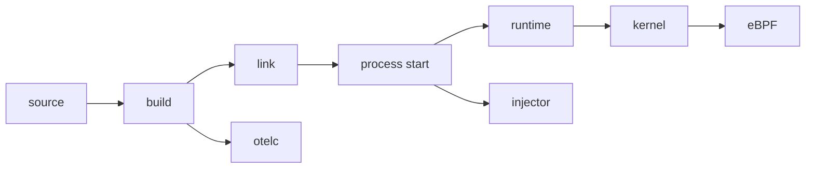

</div>

| Layer | Trade-off |
| --- | --- |
| **Build** | Rebuild required; rich Go semantics; portable binary |
| **Process start** | No source change; binary/linking restrictions |
| **Kernel** | No rebuild; Linux, privileges, and kernel contracts |

---
<!-- _class: punchline dark -->
<!-- _paginate: false -->

# Three intervention points. *Four signals.*

### Traces · Metrics · Logs · Profiles

---
<!-- _class: section -->
<!-- _paginate: false -->

###### 02

# otelc: instrument during the build

<div class="signal-map">
<span>Traces<b>SDK / integrations</b></span>
<span>Metrics<b>SDK / integrations</b></span>
<span>Logs<b>SDK / integrations</b></span>
<span>Profiles<b>SDK / integrations</b></span>
<small>The build path can reach all four. Coverage depends on the bundle.</small>
</div>

---

## Three organizations converged upstream

<div class="center">

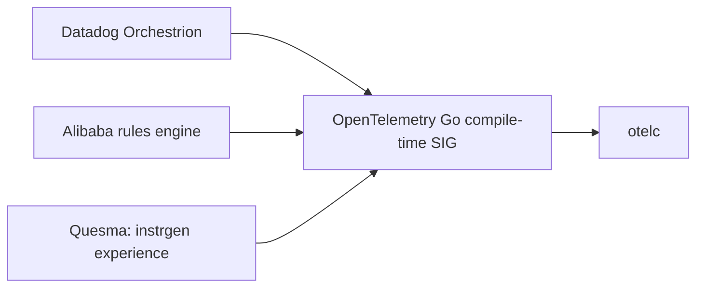

</div>

`otelc` is a vendor-neutral tool built by the SIG.

Orchestrion remains a production Datadog distribution of the same core idea.

---

## A short convergence timeline

| Date | Milestone |
| --- | --- |
| Jun 2024 | Elastic's profiler joins OpenTelemetry |
| Jan 2025 | Alibaba, Datadog, and Quesma form the Go compile-time SIG |
| 2025 | Beyla becomes OpenTelemetry eBPF Instrumentation |
| Jul 2026 | `otelc` v1 becomes stable |
| Oct 2026 | OBI v1.0.0 ships a stable core |

The projects did not collapse into one agent. They learned to compose.

---

## `-toolexec` puts otelc before the compiler

<div class="center">

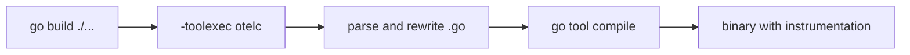

</div>

---
<!-- _class: stat -->

# about 20%

Growth in customer adoption of Orchestrion-based Go auto-instrumentation

`otelc` v1 is stable upstream. One build-command change can standardize instrumentation across a fleet.

---

## Build-time instrumentation is portable

| | otelc |
| --- | --- |
| Runtime privilege | None |
| Linux kernel dependency | None |
| Build pipeline change | `otelc go build` |
| Tested build targets | Linux, macOS, Windows |
| Go baseline | Go 1.26+ |
| Runtime cost | Injected SDK and instrumentation code |

The trade-off is build ownership, not operating-system access.

---

## Signal depth depends on the integration bundle

<div class="columns">
<div>

### Upstream otelc today

<ul>
<li>Traces</li>
<li>HTTP and gRPC metrics</li>
<li>Go runtime metrics</li>
<li>Trace IDs in <code>log</code>, <code>slog</code>, Logrus, and zap output</li>
</ul>

</div>
<div>

### Orchestrion + dd-trace-go

<ul>
<li>Traces</li>
<li>Runtime metrics</li>
<li>Correlated logs</li>
<li>Continuous profiles</li>
</ul>

</div>
</div>

The build path can reach all four signals. The SDK and integrations determine coverage.

Not every Datadog integration has moved to otelc yet.

---
<!-- _class: punchline dark -->
<!-- _paginate: false -->

# And it can reach *deep*

---

## Runtime internals are reachable. They are not an API.

###### runtime/proc.go

```go
// gopark should be an internal detail,
// but widely used packages access it using linkname.
// Notable members of the hall of shame include:
// ...
```

<br>

The Go team calls this access pattern a "hall of shame," not an instrumentation API.

---

## Compile time can reach Go internals! Dark Magic!

<div class="columns">
<div>

###### gls.orchestrion.yml

```yaml
join-point:
  struct-definition: runtime.g
advice:
  - add-struct-field:
      name: __dd_gls_v2
      type: any
```

</div>
<div class="center">

<br>


</div>
</div>

<div class="small">

The aspect adds goroutine-local storage, typed accessors, and exit cleanup.

`dd-trace-go` owns this aspect. Orchestrion applies it. otelc ships its own `runtime.g` rule.

</div>

---

## `go:linkname` variables are fragile

Unlike function linknames, variables have no definition/reference separation.

When both sides were uninitialized BSS symbols, the linker chose by symbol loading order.

> "the choice is arbitrary. In the implementation it depends on the symbol loading order"
>
> Go team, [golang/go#72032](https://github.com/golang/go/issues/72032)

This broke between Go 1.22 and 1.23.

Go 1.25 now keeps the larger symbol. Go 1.23.9 and 1.24.3 got the fix too.

---
<!-- _class: meme -->
<!-- _paginate: false -->


the linker picked by symbol loading order

---

## The build path has boundaries too

<ul>
<li>Requires control of the Go build pipeline.</li>
<li>Requires Go 1.26 or newer for current otelc.</li>
<li>Coverage stops at the supported integration set.</li>
<li>Toolchain internals such as <code>-toolexec</code> and <code>go:linkname</code> can change.</li>
</ul>

<br>

No root access and no kernel version gate, but the binary must be rebuilt.

---

## The long version: Hooking into the Go Toolchain

<div class="columns">
<div class="center">


</div>
<div>

This section is the short version. The guest post starts from a stopwatch wrapper and builds up to `otelc`.

[Hooking into the Go Toolchain · Internals for Interns](https://internals-for-interns.com/posts/hooking-into-the-go-toolchain/)

</div>
</div>

---
<!-- _class: section -->
<!-- _paginate: false -->

###### 03

# Process start: the injector

<div class="signal-map">
<span>Traces<b>SDK capabilities</b></span>
<span>Metrics<b>SDK capabilities</b></span>
<span>Logs<b>SDK capabilities</b></span>
<span>Profiles<b>SDK capabilities</b></span>
<small>The SDK supplies the signals. The Go hook shown here is in development.</small>
</div>

---

## How process-start injection works

<div class="center">

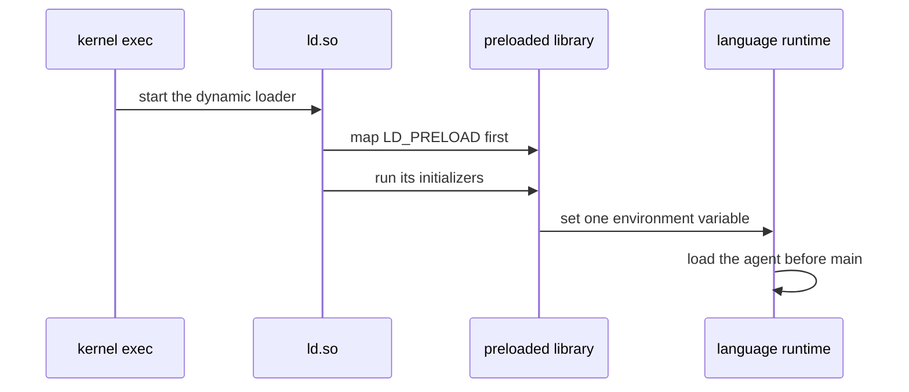

</div>

<div class="tiny">

[ld.so(8)](https://man7.org/linux/man-pages/man8/ld.so.8.html): preloaded objects load "before all others" · System V ABI: shared-object initializers run "before the executable file gains control"

</div>

---

## Runtime hooks that injectors use

| Runtime | The hook the injector sets |
| --- | --- |
| Java | `JAVA_TOOL_OPTIONS=-javaagent:…` |
| Node.js | `NODE_OPTIONS=--require …` |
| .NET | CLR profiler and startup-hook variables |
| Python | `sitecustomize` on `PYTHONPATH` |
| Ruby | `RUBYOPT=-r …` |
| **Go** | **none** |

<div class="small">

[OpenTelemetry injector](https://github.com/open-telemetry/opentelemetry-injector): Java, Node.js, .NET, Ruby, Python · [Datadog SSI](https://docs.datadoghq.com/tracing/trace_collection/automatic_instrumentation/single-step-apm/): Java, Python, Ruby, Node.js, .NET, PHP

</div>

---

## Runtime injection is a narrower route

<ul>
<li>Dynatrace OneAgent injects into eligible Go binaries, including static pure-Go ones started by a dynamic parent.</li>
<li>The OpenTelemetry host injector ships Java, Node.js, .NET, Ruby, and Python agents. It does not inject Go.</li>
<li>Datadog is working on a Go path for Single-Step Instrumentation.</li>
</ul>

<br>

Runtime injection works, but static Go binaries force vendor-specific workarounds.

---

## A static Go binary has no loader

<div class="center">

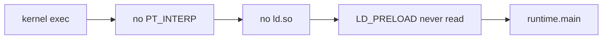

</div>

`CGO_ENABLED=0` gives no dynamic loader and no libc. Nothing reads the variable.

With musl, internal linking skips preloaded constructors ([golang/go#28909](https://github.com/golang/go/issues/28909)).

---

## `LD_PRELOAD` reaches only some Go binaries

```bash
LD_PRELOAD=./tracer.so ./python-app
LD_PRELOAD=./tracer.so ./go-app

go build -ldflags="-linkmode=external"
```

| Build | Result |
| --- | --- |
| Dynamic, including a default cgo build | Injection can work |
| `CGO_ENABLED=0` or static cgo | No dynamic-loader hook |
| Pure-Go PIE | Loader runs, no libc |

---

## We made it work

```bash
LD_PRELOAD=./libdd_go_hook.so \
DD_SERVICE=my-service \
DD_TRACE_DEBUG=1 \
./my-go-app
```

`DD_TRACE_DEBUG=1` shows span creation and trace-id extraction on stderr.

<span class="chip caution">in development</span>

---
<!-- _class: punchline dark -->
<!-- _paginate: false -->

## No rebuild.

## No source change.

## No kernel version gate.

### *One line.*

---
<!-- _class: section -->
<!-- _paginate: false -->

###### 04

# OBI: observe from the kernel

<div class="signal-map">
<span>Traces<b>emitted</b></span>
<span>Metrics<b>emitted</b></span>
<span class="signal-out">Logs<b>correlation only</b></span>
<span class="signal-out">Profiles<b>not emitted</b></span>
<small>No rebuild. Linux and privileges.</small>
</div>

---
<!-- _class: punchline dark -->
<!-- _paginate: false -->

## OBI *v1.0.0* shipped

### 30 October. Three days ago

---

## One DaemonSet, a whole node, no rebuild

**OBI** is the upstream successor to Grafana Beyla, donated to OpenTelemetry in 2025.

<ul>
<li>No application rebuild.</li>
<li>One DaemonSet can observe a mixed-language node.</li>
<li>Network protocols provide broad coverage.</li>
<li>Go-specific uprobes add library-level detail.</li>
</ul>

<br>

<span class="chip note">v1.0.0, 30 Oct 2026: stable core</span> <span class="chip caution">Go module API and gRPC telemetry not yet stable</span>

---

## A checked program runs at an event

<div class="center">


</div>

Load once. The verifier checks it. It runs when the event occurs.

<div class="tiny">

Diagram: eBPF.io authors, "Loader", [ebpf.io/what-is-ebpf](https://ebpf.io/what-is-ebpf/), [CC BY 4.0](https://creativecommons.org/licenses/by/4.0/)

</div>

---

## For Go code, the hook is a uprobe

| Hook | Observes |
| --- | --- |
| tracepoint | a named kernel event |
| kprobe | a kernel function or instruction |
| fentry / fexit | a kernel or BPF function, through a BPF trampoline |
| **uprobe** | **an instruction in a user-space binary** |
| uretprobe | a function return, through a return trampoline |

---

## A uprobe hit enters the kernel

<div class="center">

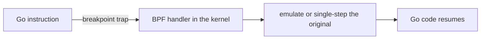

</div>

<div class="small">

Conventional x86 path. The kernel patches the mapped code, not the file on disk. Every active hit has a cost.

</div>

---

## OBI turns observations into spans

<div class="center">

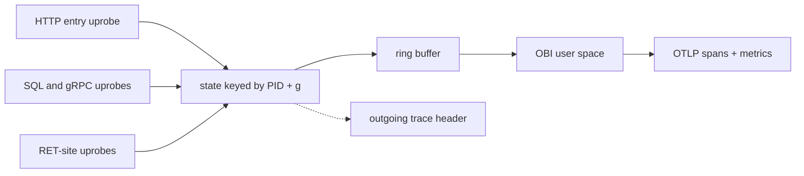

</div>

Probe sites give events. Correlation turns them into spans.

---

## Read Go values, not C arguments

<div class="center">

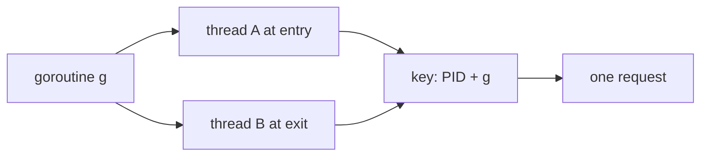

</div>

A goroutine is the identity. A thread is only the carrier.

<div class="small">

amd64 ABIInternal (Go 1.17+): the first integer arguments go in `AX`, `BX`, `CX`, not in the C order.

</div>

---

## Probe the RET, not the return address

<div class="columns">
<div>

### Conventional uretprobe

Replaces the saved return address with a trampoline.

Go copies the stack when it grows. The runtime can reject the foreign frame.

<span class="chip caution">crash risk in Go</span>

</div>
<div>

### What OBI does

Finds every `RET` instruction in the function.

Attaches an ordinary uprobe at each one.

The caller address stays untouched.

</div>
</div>

---

## CO-RE adapts kernel layouts, not Go layouts

<div class="center">

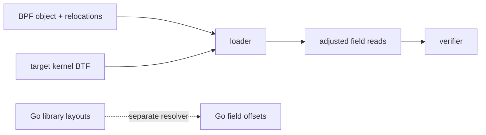

</div>

BTF describes the kernel's types. CO-RE fixes field reads at load time.

**A Go HTTP request is not a kernel type.**

---

## Find the instruction and the field

<div class="center">

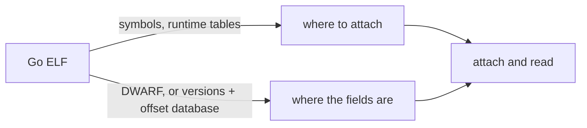

</div>

A function address is not a type layout.

---
<!-- _class: punchline dark -->
<!-- _paginate: false -->

# No source change. No rebuild. No *rollout*.

---

## Go library coverage: 13 documented baselines

<div class="columns">
<div>

<ul>
<li><code>net/http</code></li>
<li><code>golang.org/x/net/http2</code></li>
<li><code>gorilla/mux</code></li>
<li><code>gin-gonic/gin</code></li>
<li><code>google.golang.org/grpc</code></li>
<li><code>net/rpc/jsonrpc</code></li>
<li><code>database/sql</code></li>
</ul>

</div>
<div>

<ul>
<li><code>go-sql-driver/mysql</code></li>
<li><code>lib/pq</code></li>
<li><code>redis/go-redis/v9</code></li>
<li><code>segmentio/kafka-go</code></li>
<li><code>IBM/sarama</code></li>
<li><code>mongo-driver</code> v1 and v2</li>
</ul>

</div>
</div>

<div class="tiny">

`gin >= v1.6.0, != v1.7.5` · `redis/go-redis/v9 >= v9.0.0` · [OBI v1.0.0 support matrix](https://github.com/open-telemetry/opentelemetry-ebpf-instrumentation/blob/v1.0.0/SUPPORT_MATRIX.md)

</div>

---

## OBI emits traces and metrics. Logs get correlation.

<div class="columns">
<div>

### Native signals

**Traces**
HTTP, gRPC, database, messaging

**Metrics**
RED and runtime metrics

</div>
<div>

### Log correlation

Adds `trace_id` and `span_id` to selected **JSON and plain-text logs** while a span is active.

Not a log exporter. Linux 6.0+, no kernel lockdown.

</div>
</div>

<div class="tiny">

[OpenTelemetry: OBI trace-log correlation](https://opentelemetry.io/docs/zero-code/obi/trace-log-correlation/) · [OBI v1.0.0 telemetry contract](https://github.com/open-telemetry/opentelemetry-ebpf-instrumentation/blob/v1.0.0/TELEMETRY.md)

</div>

---

## OBI needs Linux, BTF, and kernel 5.8 or a backport

| Requirement | OBI |
| --- | --- |
| Operating system | Linux only |
| Architecture | `amd64`, `arm64` |
| Kernel | 5.8+, or documented RHEL 4.18+ backports |
| Kernel metadata | BTF |
| Deployment | Host process, sidecar, or DaemonSet |
| macOS / Windows | Linux VM or remote cluster |

---

## Privileges depend on the mode

| Mode | Additional access |
| --- | --- |
| Network flow capture | `CAP_BPF`, `CAP_NET_RAW` |
| Application observability | `CAP_PERFMON`, `CAP_NET_RAW`, process and ELF access |
| Context propagation | `CAP_NET_ADMIN` |
| Go library propagation | `CAP_SYS_ADMIN` on kernel 5.10+ |

<br>

`kernel.perf_event_paranoid`, Secure Boot, and kernel lockdown can change what works.

---

## What actually works without source changes

<div class="columns">
<div>

### OBI handles

<ul>
<li>Service boundaries</li>
<li>HTTP and gRPC spans</li>
<li>RED and runtime metrics</li>
<li>Supported library operations</li>
<li>Log correlation</li>
</ul>

</div>
<div>

### Application code still owns

<ul>
<li>Business events</li>
<li>Domain-specific attributes</li>
<li>Arbitrary internal functions</li>
<li>Unsupported libraries</li>
<li>Custom sampling decisions</li>
</ul>

</div>
</div>

<div class="tiny">

Go spans you write with `otel.Tracer` and no SDK: OBI can export them through the Auto SDK. It needs `CAP_SYS_ADMIN`.

</div>

---
<!-- _class: punchline dark -->
<!-- _paginate: false -->

# But it still has a *cost*

---
<!-- _class: meme -->
<!-- _paginate: false -->


zero-touch means zero cost... right?

---

## Uprobes have real costs

<div class="columns">
<div>

### Infrastructure cost

An attached uprobe crosses into the kernel. Heavy contention once hurt scalability across many CPUs.

Kernel 6.12 includes major RCU-protected hot-path improvements.

</div>
<div>

### Program and compatibility cost

Shared BPF state can serialize a concurrent application path.

Go runtime and library layout changes can invalidate offsets. Go 1.26 required an OBI symbol-resolution fix.

</div>
</div>

<div class="tiny">

[Usama Saqib, FOSDEM 2026](https://fosdem.org/2026/schedule/event/H3LM7G-performance_and_reliability_pitfalls_of_ebpf/) · [Linux uprobe hot-path series](https://lists.openwall.net/linux-kernel/2024/08/13/142) · [OBI PR #1851](https://github.com/open-telemetry/opentelemetry-ebpf-instrumentation/pull/1851)

</div>

---

## Usama Saqib: pitfalls of production eBPF

<div class="columns">
<div class="center">


</div>
<div>

He covers the pitfalls found building production eBPF at Datadog: kprobe performance across kernel versions, a fentry kernel bug, and the pain of scaling uprobes.

Twenty-eight minutes, public, and it goes deeper than this section can.

[Performance and reliability pitfalls of eBPF, FOSDEM 2026](https://fosdem.org/2026/schedule/event/H3LM7G-performance_and_reliability_pitfalls_of_ebpf/)

</div>
</div>

---
<!-- _class: meme -->
<!-- _paginate: false -->


somehow, it works

---
<!-- _class: section -->
<!-- _paginate: false -->

###### 05

# Profiles: observe CPU from the kernel

<div class="signal-map">
<span class="signal-out">Traces<b>not emitted</b></span>
<span class="signal-out">Metrics<b>not the application signal</b></span>
<span class="signal-out">Logs<b>not the application signal</b></span>
<span>Profiles<b>CPU samples</b></span>
<small>A rebuild-free route to profiling. Linux node access required.</small>
</div>

---
<!-- _class: punchline dark -->
<!-- _paginate: false -->

## Traces tell you which request was slow

## Profiles tell you where the *CPU* went

---

## One profiler, every process on the node

Originated as Elastic Universal Profiling and joined OpenTelemetry in June 2024.

<ul>
<li>Samples CPU from the kernel.</li>
<li>Profiles every process on a node.</li>
<li>Requires no application rebuild or injected library.</li>
<li>Emits the OpenTelemetry Profiles signal.</li>
</ul>

<br>

<span class="chip note">Profiles: Alpha specification</span>

---
<!-- _class: punchline dark -->
<!-- _paginate: false -->

# But how does it read a *stripped* binary?

---

## Go metadata tells the profiler how to unwind

<div class="center">

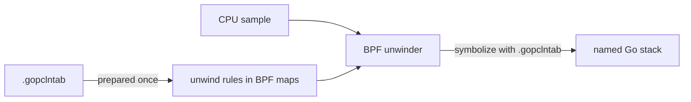

</div>

> "The information remains present even for fully static and stripped executables."
>
> [OpenTelemetry eBPF Profiler documentation](https://github.com/open-telemetry/opentelemetry-ebpf-profiler/blob/main/doc/gopclntab.md)

---

## Zero-touch profiling still has a deployment cost

| Application | Profiler agent |
| --- | --- |
| No source changes | Linux node access |
| No rebuild | `CAP_BPF` + `CAP_PERFMON` or root |
| No in-process agent | DaemonSet / Collector distribution |
| Stripped binaries supported | CPU profiling is the confirmed core signal |

<br>

The signal is profiles. Choose the profiler by its coverage and deployment cost.

---
<!-- _class: punchline dark -->
<!-- _paginate: false -->

# Traces and profiles. *Apart.*

---
<!-- _class: meme -->
<!-- _paginate: false -->


each one points at the other

---
<!-- _class: section -->
<!-- _paginate: false -->

###### 06

# Live debugging: probe a running process

<div class="signal-map">
<span class="signal-out">Traces<b>longer-term goal</b></span>
<span class="signal-out">Metrics<b>goal</b></span>
<span>Logs<b>logpoints + snapshots</b></span>
<span class="signal-out">Profiles<b>not this logpoint</b></span>
<small>Ask for missing evidence while the service runs.</small>
</div>

---

## The probe goes to the running process

<div class="center">

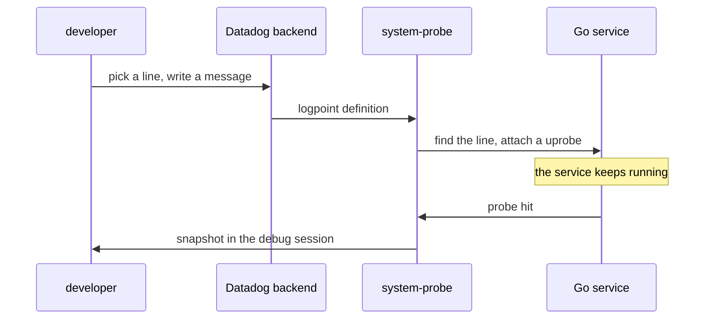

</div>

<div class="tiny">

Simplified. [Datadog Live Debugger](https://docs.datadoghq.com/tracing/live_debugger/): "non-breaking breakpoints that collect diagnostic data without pausing the application"

</div>

---

## From a line to a machine address

<div class="center">

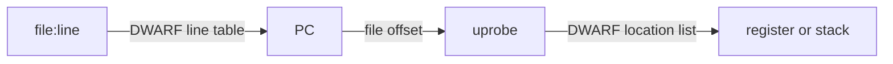

</div>

The same uprobe as before. DWARF supplies the address and the variable locations.

---

## Some variables are not there

<div class="columns">
<div>

### The compiler moved them

Inlining and register allocation leave some values with no location at that PC.

</div>
<div>

### The probe still fires

The snapshot marks the variable **unavailable**.

Some lines have no safe place for a probe.

</div>
</div>

---

## Bounded by design

| Control | Public limit |
| --- | --- |
| Logpoint with variable capture | 1 execution per second |
| Logpoint without capture | 5000 per second per service instance |
| Lifetime | Expires with the debug session |
| Sensitive identifiers | Redacted before the data leaves the host |

<div class="small">

Go: Linux 5.17+, Datadog Agent 7.73+, Go SDK 2.9+ recommended · [Live Debugger docs](https://docs.datadoghq.com/tracing/live_debugger/) · [Sensitive data scrubbing](https://docs.datadoghq.com/tracing/live_debugger/sensitive-data-scrubbing/)

</div>

---

## Other ways, and their cost

| | Code change | Stops the program | Reads variables |
| --- | --- | --- | --- |
| Delve breakpoint | no | **yes** | yes |
| Flight recorder (Go 1.25) | **yes** | no | no, execution trace |
| Hand-written uprobe | no | no | by hand |
| Live Debugger logpoint | no | no | yes, bounded |

---
<!-- _class: section -->
<!-- _paginate: false -->

###### 07

# Choose the signal and the layer

---

## Similar signals, different coverage

| Approach | Traces | Metrics | Logs | Profiles |
| --- | --- | --- | --- | --- |
| Build time | SDK | SDK | SDK | SDK |
| Injector (in development) | SDK | SDK | SDK | SDK |
| OBI | Yes | Yes | Correlation | No |
| eBPF Profiler | No | No | No | CPU |
| Live Debugger | Goal | Goal | Logpoints | No |

---

## When to reach for what

| Constraint | Prefer |
| --- | --- |
| No rebuild window | OBI on supported Linux hosts |
| Non-Linux target | otelc |
| Mixed-language boundary coverage | OBI |
| Rich Go library semantics | otelc |
| No privileged runtime agent | otelc |
| Whole-node CPU profiles | eBPF Profiler |
| A missing variable in production | Live Debugger logpoint |

---

## A practical production combination

<div class="center">

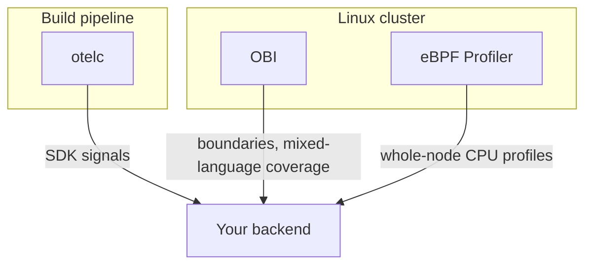

</div>

Add a layer when its signal earns the cost. Use live logpoints for missing evidence.

---
<!-- _class: section light -->
<!-- _paginate: false -->

###### 08

# Asks for the Go team

<div class="section-meme">


I can find you in the hallway. Pretty please 😊

</div>

---

## They already asked the question

> "We don't have a great way to add instrumentation in general. Companies will maintain patches to add hooks. What should we do?"
>
> Go runtime diagnostics sync, 31 July 2025

> "Maybe eBPF is the answer?"
>
> Go team, same meeting

Our answer: yes, if Go gives eBPF something stable to read.

---

## Ask 1: USDT probes in Go

<div class="columns">
<div>


</div>
<div>

<ul>
<li>A probe is a NOP plus an ELF note: a name and where each value lives.</li>
<li>Go 1.27 emits none. Salp adds them through cgo.</li>
<li>The eBPF profiler reads allocator USDT probes. The Go allocator has none.</li>
</ul>

**Ask:** let the toolchain emit SDT notes. Start with runtime sites.

<span class="chip caution">proof of concept</span>

</div>
</div>

---

## Ask 2: a read contract for pprof labels

| Today | Ask |
| --- | --- |
| Build-time rewriting adds fields to `runtime.g` | Use the labels Go already has |
| eBPF readers infer offsets per release | Document where `g.labels` lives |
| OTEP 4947 tells Go readers to read pprof labels | Keep that layout stable |

<!-- code-header: none -->

```yaml
threadlocal.schema_version: "go_pprof_labels_v1"
```

<div class="tiny">

[OTEP 4947: Alternative for Go support](https://github.com/open-telemetry/opentelemetry-specification/blob/main/oteps/profiles/4947-thread-ctx.md#alternative-for-go-support) · [golang/go#68785](https://github.com/golang/go/issues/68785)

</div>

---

## Ask 3: close the `-toolexec` gaps

<ul>
<li>otelc and Orchestrion both build on <code>-toolexec</code>.</li>
<li>A tool cannot add its own inputs to a package's build ID.</li>
<li><a href="https://github.com/golang/go/issues/69887">golang/go#69887</a> lists the gaps, from build-ID influence to new build-graph edges.</li>
</ul>

<br>

**Ask:** close those gaps. A problem report, not a new build mode.

---

## Ask 4: one supported start-up door

| Variable | Values an agent must handle |
| --- | --- |
| libc | glibc, musl, none |
| Link mode | internal, external |
| Build mode | exe, PIE, static |
| `plugin` | the exact toolchain and dependency versions |

**Ask:** tell agent authors which door Go supports.

<span class="chip note">cgo without a C toolchain: GOEXPERIMENT accepted (#81662)</span> <span class="chip caution">fit for agents still open</span>

---

## Four asks. I will find you in the hallway.

<div class="columns">
<div>

| Ask | Prior art |
| --- | --- |
| USDT probes | #57175 |
| A read contract for pprof labels | OTEP 4947, #68785 |
| `-toolexec` gaps | #69887 |
| A start-up door | #28909, #12465 |
| Bonus: stable runtime offsets | `moduledata` |

</div>
<div class="center">


**Draft problem reports**

</div>
</div>

---

## Where our tools go next

| Tool | Today | Plan |
| --- | --- | --- |
| Live Debugger | Logpoints and variable snapshots | Goal: metrics. Then traces, 12+ months |
| Go injector | In development | Go in Single-Step Instrumentation |
| eBPF Profiler | CPU profiles | Allocation profiling merged on `main`. Live heap in review |

<span class="chip caution">goals, not release commitments</span>

---
<!-- _class: section -->
<!-- _paginate: false -->

###### 09

# From question to evidence

---
<!-- _class: vcenter -->

## The loop, without the redeploy

<br>

Describe the bug in words. The agent places the probe and reads *production evidence*.

No source edit. No restart. No *redeploy*.

<br>

Bits Live Debugger does this today, in preview.

Same move as the opening joke, except now the agent has the *framework*.

---
<!-- _class: punchline dark -->
<!-- _paginate: false -->

# Takeaways

---
<!-- _class: punchline dark -->
<!-- _paginate: false -->

## Start from the *constraint* you cannot change.

## Add a layer only when its *signal* pays for its *operational cost*.

---

## Get involved in the SIGs

<div class="columns">
<div class="center">


</div>
<div>

[github.com/open-telemetry/community](https://github.com/open-telemetry/community) has every SIG's calendar, notes, and channels.

<ul>
<li>Go Compile-Time Instrumentation (<code>otelc</code>)</li>
<li>eBPF Instrumentation (OBI)</li>
<li>Injector</li>
<li>Profiling</li>
</ul>

</div>
</div>

---
<!-- _class: punchline dark -->
<!-- _paginate: false -->

# Shameless plug

## Why Your Go Benchmarks Are Lying (And How to Stop Them)

### Tomorrow · 10:45 · Golab #2

[golab.io/talks/why-your-go-benchmarks-are-lying-and-how-to-stop-them](https://golab.io/talks/why-your-go-benchmarks-are-lying-and-how-to-stop-them)

---
<!-- _class: dark -->

# Take it with you

<div class="columns">
<div>

### Talk material

[github.com/kakkoyun/golab-26](https://github.com/kakkoyun/golab-26)

Both decks · research · [earlier FOSDEM version](https://youtu.be/0TvrSebuDPk)

### zeroins toolkit

[github.com/kakkoyun/zeroins](https://github.com/kakkoyun/zeroins)

`obi-integration` · `otelc-aspect`<br>
`kubectl-obi` · `kubectl-profiler`

</div>
<div class="center">


**Scan for the talk repository**

</div>
</div>

---
<!-- _paginate: false -->
<!-- _class: end gopher-balloon -->

# Grazie!

Find me in the hallway.

[kakkoyun.me](https://kakkoyun.me) · [github.com/kakkoyun](https://github.com/kakkoyun)

[linkedin.com/in/kakkoyun](https://www.linkedin.com/in/kakkoyun/) · [bsky.app/profile/kakkoyun.me](https://bsky.app/profile/kakkoyun.me) · [x.com/kakkoyun_me](https://x.com/kakkoyun_me)

<span class="small">Talk repo [github.com/kakkoyun/golab-26](https://github.com/kakkoyun/golab-26) · Tools [github.com/kakkoyun/zeroins](https://github.com/kakkoyun/zeroins)</span>
