<!-- markdownlint-disable MD026 -->
<!-- _class: title gopher-network -->
<!-- _paginate: false -->
<!-- _header: "" -->

##### GoLab · 2026

# Zero-Touch

### Go Instrumentation

How to Instrument Go Without Changing a Single Line of Code

### Kemal Akkoyun · Datadog

<!--
DO

Let the title stand. Advance.
-->

---
<!-- _paginate: false -->

## The bug you cannot reproduce locally

<br>

* Added a log line. Redeployed.
* Wrong place. Did it again.

<!--
SAY

Imagine it is Friday, twenty to five. Checkout is slow, for one tenant
only. Staging is fine. Your laptop is fine.

So you add a log line around the cart total. You redeploy. Twenty minutes.

Wrong function. You move the log line. You redeploy again.

By the third deploy, the spike is gone. You never saw the value.

DO

Two beats of silence after "again." Do not rescue the silence.
-->

---
<!-- _class: vcenter -->
<!-- _paginate: false -->

# What if you did not have to?

<!--
SAY

What if you did not have to?

DO

Let the question stand. Advance.
-->

---
<!-- _class: vcenter -->

# Every new dependency creates another place to forget

<br>

You wrapped every HTTP client and database call by hand.

The first service gets careful instrumentation.

The fiftieth inherits gaps.

<!--
SAY

You wrapped every HTTP client and database call by hand.

The first service gets careful instrumentation. The fiftieth inherits gaps.

At fleet scale, instrumentation coverage is a platform problem.

Automatic instrumentation gives us a baseline. Later, we still need a way to
ask the question that the baseline misses.

DO

Land "a platform problem."
-->

---

## Go compiled away the attachment point

| Runtime | Zero-code mechanism |
| --- | --- |
| **JVM** | `-javaagent`, JVMTI, bytecode rewriting |
| **Python** | Import hooks, `sys.settrace` |
| **.NET** | CLR profiling APIs and startup hooks |
| **Go** | Native binary. No classloader. No bytecode. |

<br>

### Go made deployment simple. It made late instrumentation hard

<!--
SAY

Every other runtime has a place to intervene after the source was written.

The JVM has javaagent. Python has import hooks. .NET has profiling APIs.

Go compiles that place away. It made deployment simple. It made late
instrumentation hard.

DO

Point out that each runtime has one. Go does not.
-->

---
<!-- _class: punchline dark -->
<!-- _paginate: false -->

# Hand-written instrumentation *decays*

<!--
SAY

I wrapped handlers by hand for years. Then I worked on profiling at Parca.
Now I work on compile-time instrumentation. Hand-written coverage decays.

Datadog builds at all three intervention points. I need the right combinations
to work in customer services.

DO

Bare beat. Let "decays" land. Do not imply work on OBI.
-->

---
<!-- _paginate: false -->
<!-- _header: "" -->


<!--
SAY

Right. That is the talk. Thanks, everyone.

DO

Deadpan. Two seconds of silence. Do not explain the joke.
-->

---
<!-- _paginate: false -->
<!-- _header: "" -->


<!--
SAY

Not really. The agent still has to pick a mechanism, and it has to know what
that mechanism costs. That is what we need to understand.

DO

The turn. Ten seconds for both slides. Do not explain the joke.
This is a plant. It pays off at the agentic close.
-->

---
<!-- _class: section -->
<!-- _paginate: false -->

###### 01

# Why Go resists instrumentation

<!--
SAY

So why is Go the hard one?

DO

Tie the missing attachment point to the opening problem. Build-time
still requires a rebuild.
-->

---

## What makes Go different

* The compiler emits native machine code.
* Pure-Go builds are static by default.
* There is no classloader or general runtime hook API.
* Goroutines move between OS threads and use movable stacks.

<br>

There is no single point where an agent can safely rewrite every function at startup.

<!--
SAY

The compiler emits native machine code. Pure-Go builds are static by default. There is no classloader, no general runtime hook API.

And goroutines move between OS threads on movable stacks.

There is no single point where an agent can safely rewrite every function at
startup.

DO

Reveal each line. Do not rush. Land the last line.
-->

---

## Let the constraint pick the layer

<div class="center">

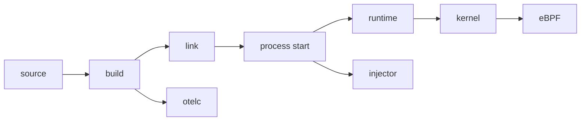

</div>

| Layer | Trade-off |
| --- | --- |
| **Build** | Rebuild required; rich Go semantics; portable binary |
| **Process start** | No source change; binary/linking restrictions |
| **Kernel** | No rebuild; Linux, privileges, and kernel contracts |

<!--
SAY

There are three practical places to intervene. Build time. Process start. The
kernel.

Build time preserves Go semantics but requires a rebuild. Process-start
injection avoids source edits but depends on binary and linker surfaces.
Kernel observation avoids the rebuild but inherits Linux, privilege, and
compatibility constraints.

The reason this matters is that you rarely pick the layer. The constraint
picks it for you.

We will follow that order: build, process start, then kernel.

DO

Point to each intervention point. Not all three are required.
-->

---
<!-- _class: punchline dark -->
<!-- _paginate: false -->

# Three intervention points. *Four signals.*

### Traces · Metrics · Logs · Profiles

<!--
SAY

At each point, ask which evidence we can collect. Traces, metrics, logs, and
profiles answer different questions about production.

We will track those signals in the same order throughout the talk.

Three parts. First, the three ways in. Second, the evidence they still miss.
Third, how to choose, and what Go could make easier.

DO

Introduce the signal indicators. They show capabilities, not a ranking.
-->

---
<!-- _class: section -->
<!-- _paginate: false -->

###### 02

# otelc: instrument during the build

<div class="signal-map">
<span>Traces<b>SDK / integrations</b></span>
<span>Metrics<b>SDK / integrations</b></span>
<span>Logs<b>SDK / integrations</b></span>
<span>Profiles<b>SDK / integrations</b></span>
<small>The build path can reach all four. Coverage depends on the bundle.</small>
</div>

<!--
SAY

Start at the build, while source structure is still available. We can add
instrumentation without writing wrappers throughout the application.

This route can reach all four signals. The SDK and integrations determine
which ones it produces. We still need a rebuild.

DO

Point to the four signal indicators. Upstream otelc does not enable every signal by default.
-->

---

## Three organizations converged upstream

<div class="center">

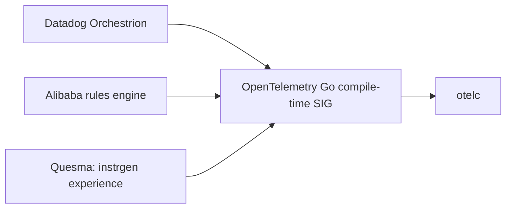

</div>

`otelc` is a vendor-neutral tool built by the SIG.

Orchestrion remains a production Datadog distribution of the same core idea.

<!--
SAY

Three organizations converged. Datadog's Orchestrion, Alibaba's rules engine,
Quesma's instrgen experience. They formed the OpenTelemetry Go compile-time SIG and
built otelc, a vendor-neutral tool.

Orchestrion remains a production Datadog distribution of the same core idea.

DO

Do not say Orchestrion was donated or renamed to otelc. Two separate tools.
-->

---

## A short convergence timeline

| Date | Milestone |
| --- | --- |
| Jun 2024 | Elastic's profiler joins OpenTelemetry |
| Jan 2025 | Alibaba, Datadog, and Quesma form the Go compile-time SIG |
| 2025 | Beyla becomes OpenTelemetry eBPF Instrumentation |
| Jul 2026 | `otelc` v1 becomes stable |
| Oct 2026 | OBI v1.0.0 ships a stable core |

The projects did not collapse into one agent. They learned to compose.

<!--
SAY

The projects matured in parallel. Profiling, eBPF instrumentation, and
compile-time instrumentation did not collapse into one agent. They learned to
compose.

This year both instrumentation projects reached v1. otelc in July. OBI in
October.

DO

Move quickly. Do not celebrate OBI here.
-->

---

## `-toolexec` puts otelc before the compiler

<div class="center">

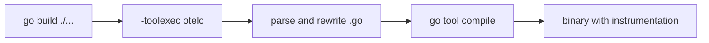

</div>

<!--
SAY

otelc wraps the Go command. It becomes a proxy for tool invocations. It
rewrites supported syntax before go tool compile sees it. The resulting binary
contains normal SDK calls. There is no process to attach at startup.

It covers your code, dependencies, and supported standard-library paths.

DO

The diagram is the point. Do not over-explain the proxy.
-->

---
<!-- _class: stat -->

# about 20%

Growth in customer adoption of Orchestrion-based Go auto-instrumentation

`otelc` v1 is stable upstream. One build-command change can standardize instrumentation across a fleet.

<!--
SAY

Customer adoption of Orchestrion-based Go auto-instrumentation grew by about
twenty percent. This is a production path, not a local debugging trick.

DO

Say exactly this. Do not add a denominator or claim that most users were new.
-->

---

## Build-time instrumentation is portable

| | otelc |
| --- | --- |
| Runtime privilege | None |
| Linux kernel dependency | None |
| Build pipeline change | `otelc go build` |
| Tested build targets | Linux, macOS, Windows |
| Go baseline | Go 1.26+ |
| Runtime cost | Injected SDK and instrumentation code |

The trade-off is build ownership, not operating-system access.

<!--
SAY

No runtime privilege. No Linux kernel dependency. One build-command change.
Tested on Linux, macOS, and Windows. Go 1.26 or newer.

The trade-off is build ownership, not operating-system access.

DO

Read across the table, not every row.
-->

---

## Signal depth depends on the integration bundle

<div class="columns">
<div>

### Upstream otelc today

<ul>
<li>Traces</li>
<li>HTTP and gRPC metrics</li>
<li>Go runtime metrics</li>
<li>Trace IDs in <code>log</code>, <code>slog</code>, Logrus, and zap output</li>
</ul>

</div>
<div>

### Orchestrion + dd-trace-go

<ul>
<li>Traces</li>
<li>Runtime metrics</li>
<li>Correlated logs</li>
<li>Continuous profiles</li>
</ul>

</div>
</div>

The build path can reach all four signals. The SDK and integrations determine coverage.

Not every Datadog integration has moved to otelc yet.

<!--
SAY

Upstream otelc today instruments traces, HTTP and gRPC metrics, runtime
metrics, and trace IDs in supported log output.

Orchestrion with dd-trace-go provides traces, runtime metrics, correlated
logs, and continuous profiles.

Not every Datadog integration has moved to otelc yet.

DO

Connect the examples to the four signal indicators. Do not say otelc alone enables every profile type.
-->

---
<!-- _class: punchline dark -->
<!-- _paginate: false -->

# And it can reach *deep*

<!--
SAY

Build-time rewriting can also reach Go runtime internals.

DO

Advance to the linkname example.
-->

---

## Runtime internals are reachable. They are not an API.

###### runtime/proc.go

```go
// gopark should be an internal detail,
// but widely used packages access it using linkname.
// Notable members of the hall of shame include:
// ...
```

<br>

The Go team calls this access pattern a "hall of shame," not an instrumentation API.

<!--
SAY

Go does have linkname, a way to reach into runtime internals from your own
package.

The Go team calls the people who do this a hall of shame. Not an
instrumentation API.

DO

Read only the phrase "hall of shame."
-->

---

## Compile time can reach Go internals! Dark Magic!

<div class="columns">
<div>

###### gls.orchestrion.yml

```yaml
join-point:
  struct-definition: runtime.g
advice:
  - add-struct-field:
      name: __dd_gls_v2
      type: any
```

</div>
<div class="center">

<br>


</div>
</div>

<div class="small">

The aspect adds goroutine-local storage, typed accessors, and exit cleanup.

`dd-trace-go` owns this aspect. Orchestrion applies it. otelc ships its own `runtime.g` rule.

</div>

<!--
SAY

Compile-time instrumentation can reach into Go internals. This aspect adds a
field to runtime.g for goroutine-local storage, typed accessors, and exit
cleanup.

dd-trace-go owns this aspect. Orchestrion applies it. otelc ships its own
`runtime.g` rule.

DO

Give the Palpatine GIF one beat. Do not name the film.
-->

---

## `go:linkname` variables are fragile

Unlike function linknames, variables have no definition/reference separation.

When both sides were uninitialized BSS symbols, the linker chose by symbol loading order.

> "the choice is arbitrary. In the implementation it depends on the symbol loading order"
>
> Go team, [golang/go#72032](https://github.com/golang/go/issues/72032)

This broke between Go 1.22 and 1.23.

Go 1.25 now keeps the larger symbol. Go 1.23.9 and 1.24.3 got the fix too.

<!--
SAY

Variable linknames are fragile. Unlike function linknames, variables have no
definition/reference separation. When both sides were uninitialized BSS symbols,
the linker chose by symbol loading order.

The Go team said it in golang/go 72032: the choice is arbitrary. In the
implementation it depends on the symbol loading order.

This broke between Go 1.22 and 1.23. Go 1.25 now keeps the larger symbol.
Go 1.23.9 and 1.24.3 got the fix too.

What that means is: a tool that worked on one Go release can break on the
next one.

DO

Keep the function and variable linkname distinction. Do not explain BSS layout unless asked.
-->

---
<!-- _class: meme -->
<!-- _paginate: false -->


the linker picked by symbol loading order

<!--
SAY

The linker picked by symbol loading order.

DO

Ten seconds. Do not explain the joke. Advance.
-->

---

## The build path has boundaries too

<ul>
<li>Requires control of the Go build pipeline.</li>
<li>Requires Go 1.26 or newer for current otelc.</li>
<li>Coverage stops at the supported integration set.</li>
<li>Toolchain internals such as <code>-toolexec</code> and <code>go:linkname</code> can change.</li>
</ul>

<br>

No root access and no kernel version gate, but the binary must be rebuilt.

<!--
SAY

The build path has boundaries. You need control of the Go build pipeline. You
need Go 1.26 or newer. Coverage stops at the supported integration set.
Toolchain internals like -toolexec and go:linkname can change.

No root access and no kernel version gate, but the binary must be rebuilt.
What if we cannot change the build?

DO

Move to the link slide. Do not imply more signals reach every service.
-->

---

## The long version: Hooking into the Go Toolchain

<div class="columns">
<div class="center">

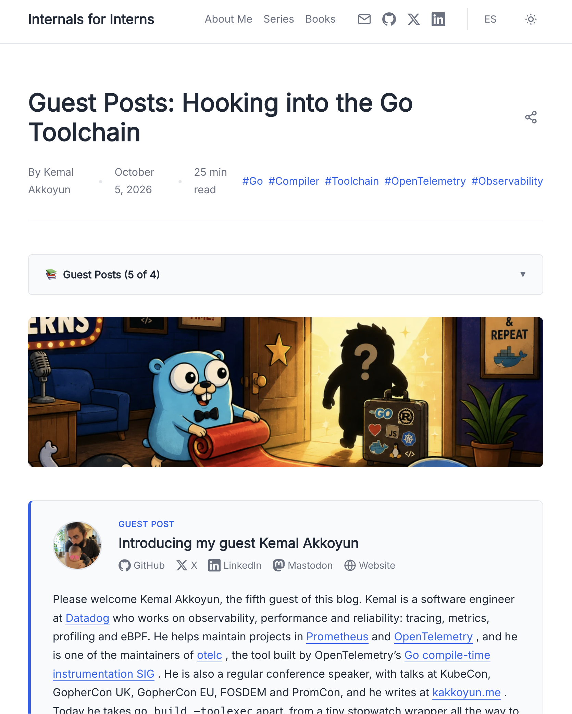

</div>
<div>

This section is the short version. The guest post starts from a stopwatch wrapper and builds up to `otelc`.

[Hooking into the Go Toolchain · Internals for Interns](https://internals-for-interns.com/posts/hooking-into-the-go-toolchain/)

</div>
</div>

<!--
SAY

This section is the short version. I wrote a guest post that takes the long
way. It starts from a stopwatch wrapper around `-toolexec` and builds up to
otelc itself.

If you want the internals step by step, that is the post.

DO

Short stop. Point at the link, not the screenshot. Then move to process start.
-->

---
<!-- _class: section -->
<!-- _paginate: false -->

###### 03

# Process start: the injector

<div class="signal-map">
<span>Traces<b>SDK capabilities</b></span>
<span>Metrics<b>SDK capabilities</b></span>
<span>Logs<b>SDK capabilities</b></span>
<span>Profiles<b>SDK capabilities</b></span>
<small>The SDK supplies the signals. The Go hook shown here is in development.</small>
</div>

<!--
SAY

Next is process start. An injector activates instrumentation before the
application runs. The SDK can supply the same signal types as the build path.
The supported SDK and integrations still determine the coverage.

The constraint changes from build ownership to a compatible startup path.

DO

Point to the four signal indicators. Startup injection is not attachment to a running process.
-->

---

## How process-start injection works

<div class="center">

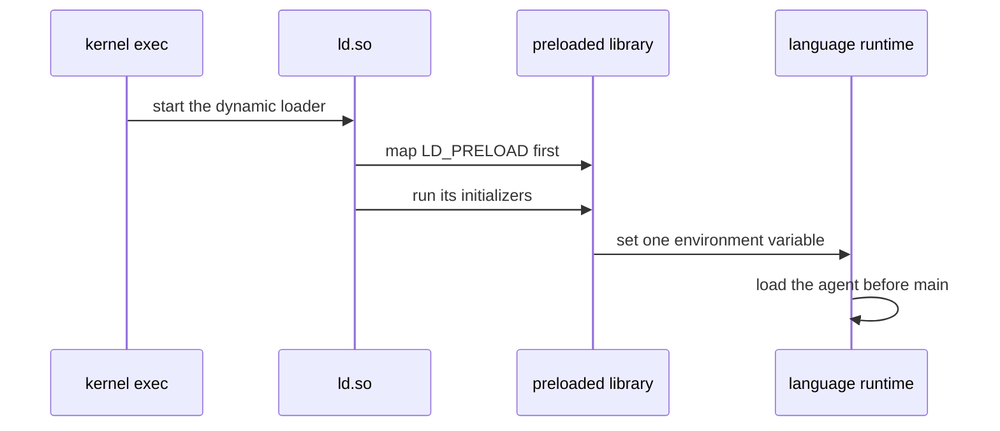

</div>

<div class="tiny">

[ld.so(8)](https://man7.org/linux/man-pages/man8/ld.so.8.html): preloaded objects load "before all others" · System V ABI: shared-object initializers run "before the executable file gains control"

</div>

<!--
SAY

On Linux, a dynamically linked program does not start at main. It starts in
the dynamic loader, ld.so.

The loader reads LD_PRELOAD. It maps those libraries before all others. The
ELF rules say that their initializers run before the program gains control.

So the injector runs first. It sets startup environment variables. The language
runtime does the rest: Java loads an agent, Node.js loads a module, .NET loads
a profiler.

DO

The two quotes in the footer are the evidence. Read neither aloud.
-->

---

## Runtime hooks that injectors use

| Runtime | The hook the injector sets |
| --- | --- |
| Java | `JAVA_TOOL_OPTIONS=-javaagent:…` |
| Node.js | `NODE_OPTIONS=--require …` |
| .NET | CLR profiler and startup-hook variables |
| Python | `sitecustomize` on `PYTHONPATH` |
| Ruby | `RUBYOPT=-r …` |
| **Go** | **none** |

<div class="small">

[OpenTelemetry injector](https://github.com/open-telemetry/opentelemetry-injector): Java, Node.js, .NET, Ruby, Python · [Datadog SSI](https://docs.datadoghq.com/tracing/trace_collection/automatic_instrumentation/single-step-apm/): Java, Python, Ruby, Node.js, .NET, PHP

</div>

<!--
SAY

Each non-Go runtime on this table has a designed entry point for an agent. The
injector only has to find it.

The OpenTelemetry injector is a small shared library. It covers Java, Node.js,
.NET, Ruby, and Python. Datadog Single Step Instrumentation uses the same
LD_PRELOAD mechanism on Linux and lists Java, Python, Ruby, Node.js, .NET, and
PHP.

Look at the last row. Go has no such entry point.

DO

Python is off by default in the OpenTelemetry injector. Say so if asked.
-->

---

## Runtime injection is a narrower route

<ul>
<li>Dynatrace OneAgent injects into eligible Go binaries, including static pure-Go ones started by a dynamic parent.</li>
<li>The OpenTelemetry host injector ships Java, Node.js, .NET, Ruby, and Python agents. It does not inject Go.</li>
<li>Datadog is working on a Go path for Single-Step Instrumentation.</li>
</ul>

<br>

Runtime injection works, but static Go binaries force vendor-specific workarounds.

<!--
SAY

Runtime injection exists for Go, but it is narrow.

Dynatrace OneAgent injects into eligible Go binaries, including static pure-Go
ones started by a dynamic parent. The OpenTelemetry
host injector ships Java, Node.js, .NET, Ruby, and Python. It does not inject
Go.
The OpenTelemetry Operator has a separate, feature-gated Go eBPF sidecar.

Datadog is working on a Go path for Single-Step Instrumentation.

DO

Do not promise a release date. Separate public language lists from Go work in development.
-->

---

## A static Go binary has no loader

<div class="center">

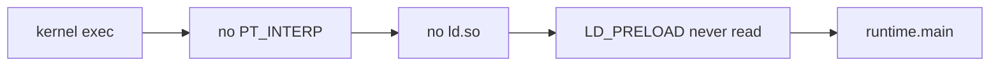

</div>

`CGO_ENABLED=0` gives no dynamic loader and no libc. Nothing reads the variable.

With musl, internal linking skips preloaded constructors ([golang/go#28909](https://github.com/golang/go/issues/28909)).

<!--
SAY

Now a default Go binary. With CGO_ENABLED=0 there is no interpreter entry in
the ELF file. The kernel never starts ld.so. There is no libc. Nobody reads
LD_PRELOAD.

With cgo, the binary is often dynamic. On glibc, the loader runs preloaded
constructors, even with internal linking. On musl, internal linking skips them.
The Go team said it plainly in that issue: anybody who wants to use
LD_PRELOAD must force the use of external linking.

DO

Be exact: the variable is not ignored, it is never read.
-->

---

## `LD_PRELOAD` reaches only some Go binaries

```bash
LD_PRELOAD=./tracer.so ./python-app
LD_PRELOAD=./tracer.so ./go-app

go build -ldflags="-linkmode=external"
```

| Build | Result |
| --- | --- |
| Dynamic, including a default cgo build | Injection can work |
| `CGO_ENABLED=0` or static cgo | No dynamic-loader hook |
| Pure-Go PIE | Loader runs, no libc |

<!--
SAY

The default Go binary gives the loader no entry point.

LD_PRELOAD works when the Go binary is dynamically linked. A default cgo build
is dynamic, so the loader runs preloaded constructors on glibc. A CGO_ENABLED=0
binary has no loader at all. A pure-Go PIE has a loader, but no libc for the
agent.

DO

Be precise. Do not say LD_PRELOAD never works with Go.
-->

---

## We made it work

```bash
LD_PRELOAD=./libdd_go_hook.so \
DD_SERVICE=my-service \
DD_TRACE_DEBUG=1 \
./my-go-app
```

`DD_TRACE_DEBUG=1` shows span creation and trace-id extraction on stderr.

<span class="chip caution">in development</span>

<!--
SAY

We made it work.

I am not going to tell you how today. That is next year's talk.

What you see is the invocation and the result. LD_PRELOAD, a service name,
debug mode on. Span creation and trace-id extraction on stderr.

DO

Get there first. Do not be drawn on mechanism: not the linking model, entry path,
or .gopclntab. Defer. The chip is amber: in development, not released.
-->

---
<!-- _class: punchline dark -->
<!-- _paginate: false -->

## No rebuild.

## No source change.

## No kernel version gate.

### *One line.*

<!--
SAY

No rebuild. No source change. No kernel version gate. One line.

DO

Advance.
-->

---
<!-- _class: section -->
<!-- _paginate: false -->

###### 04

# OBI: observe from the kernel

<div class="signal-map">
<span>Traces<b>emitted</b></span>
<span>Metrics<b>emitted</b></span>
<span class="signal-out">Logs<b>correlation only</b></span>
<span class="signal-out">Profiles<b>not emitted</b></span>
<small>No rebuild. Linux and privileges.</small>
</div>

<!--
SAY

The third intervention point is the kernel. We can observe a deployed program
without rebuilding it or loading an SDK at startup.

OBI supplies traces and metrics. Its log feature adds correlation, not log
export. The costs are Linux, privileges, and compatibility.

DO

Point to the signal indicators. Explain one uprobe hit, then apply it to OBI.
-->

---
<!-- _class: punchline dark -->
<!-- _paginate: false -->

## OBI *v1.0.0* shipped

### 30 October. Three days ago

<!--
SAY

And some news before we start. OBI v1.0.0 shipped on the thirtieth of
October. Three days before this talk. Congratulations to the OBI maintainers
and contributors.

DO

Smile, pause, let the room clap. Ten seconds. Do not explain "stable" here. If the talk moves off 2 November, change "Three days ago" on the slide.
-->

---

## One DaemonSet, a whole node, no rebuild

**OBI** is the upstream successor to Grafana Beyla, donated to OpenTelemetry in 2025.

<ul>
<li>No application rebuild.</li>
<li>One DaemonSet can observe a mixed-language node.</li>
<li>Network protocols provide broad coverage.</li>
<li>Go-specific uprobes add library-level detail.</li>
</ul>

<br>

<span class="chip note">v1.0.0, 30 Oct 2026: stable core</span> <span class="chip caution">Go module API and gRPC telemetry not yet stable</span>

<!--
SAY

Imagine a platform team with forty Go services and no rebuild window this
quarter. They deploy one DaemonSet. The same afternoon, they see HTTP and SQL
spans for every supported service, Go or not. What they do not see is the
tenant ID. Hold on to that.

OBI is the upstream successor to Grafana Beyla, donated to OpenTelemetry in
2025.

One DaemonSet can observe a mixed-language node. Network protocols give broad
coverage. Go-specific uprobes add library-level detail.

What does v1 mean here? A stable core: the configuration, the command line,
the images, and the telemetry marked stable. Not everything. The Go module API is not stable, even with a v1 tag.
And gRPC telemetry is still a release candidate.

DO

Two chips: teal for the stable core, amber for what is outside it. Say "stable core", never "OBI is stable". Do not quote the README.
-->

---

## A checked program runs at an event

<div class="center">

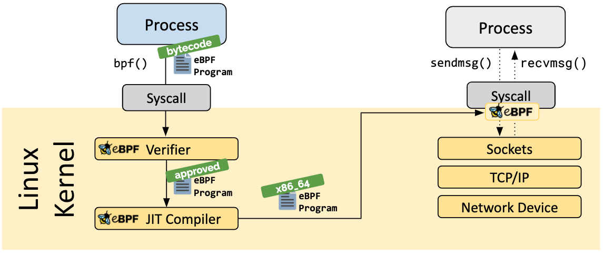

</div>

Load once. The verifier checks it. It runs when the event occurs.

<div class="tiny">

Diagram: eBPF.io authors, "Loader", [ebpf.io/what-is-ebpf](https://ebpf.io/what-is-ebpf/), [CC BY 4.0](https://creativecommons.org/licenses/by/4.0/)

</div>

<!--
SAY

eBPF lets you attach a small program to an event in Linux.

A loader sends the program to the kernel. The verifier checks every memory
access and every operation before the program can run. A supported JIT can turn the bytecode into native instructions.

The program calls helpers for kernel services. It keeps state in maps. User
space reads the maps.

Loading, verification, and JIT compilation happen once, at load time. After that, the program runs each time
the event occurs.

DO

Credit the diagram verbally to eBPF.io. Do not say the verifier proves the system safe.
-->

---

## For Go code, the hook is a uprobe

| Hook | Observes |
| --- | --- |
| tracepoint | a named kernel event |
| kprobe | a kernel function or instruction |
| fentry / fexit | a kernel or BPF function, through a BPF trampoline |
| **uprobe** | **an instruction in a user-space binary** |
| uretprobe | a function return, through a return trampoline |

<!--
SAY

Next, choose where to look. A tracepoint is a named kernel event. A kprobe
observes a kernel function. Fentry and fexit use a fast trampoline, but only
for kernel and BPF functions.

For a Go function, the hook is a uprobe: an instruction in a user-space
binary. A uretprobe observes a return. Keep that one in mind, because Go
breaks it.

DO

Point at the uprobe row. Do not imply fentry works for Go functions.
-->

---

## A uprobe hit enters the kernel

<div class="center">

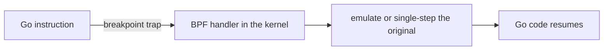

</div>

<div class="small">

Conventional x86 path. The kernel patches the mapped code, not the file on disk. Every active hit has a cost.

</div>

<!--
SAY

Here is one uprobe hit. Think of it this way: a breakpoint that does not
stop the program.

The loader finds the instruction from the symbol. The
kernel puts a breakpoint into the mapped code of the process. The file on disk
does not change.

When the goroutine reaches the breakpoint, the thread enters the kernel and our
handler runs. Then the kernel must still do the work of the original
instruction. It emulates the instruction, or it single-steps a copy. Then Go
code continues.

Newer kernels made this path scale much better. But each active hit still
crosses into the kernel. Keep that cost in mind as we apply the mechanism to OBI.

DO

Fifty seconds. Do not quote a nanosecond number on stage.
-->

---

## OBI turns observations into spans

<div class="center">

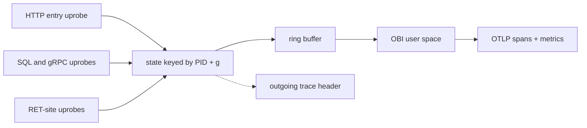

</div>

Probe sites give events. Correlation turns them into spans.

<!--
SAY

OBI uses that mechanism at supported HTTP, gRPC, and SQL functions.
It attaches uprobes at entry and at each RET instruction.

The handlers read request data. They keep timestamps and trace context in a
map keyed by process ID and goroutine. At the end site, a completed event goes
through a ring buffer to OBI in user space. OBI exports OTLP spans and metrics.

On supported paths, OBI can also write the outgoing trace header, so the next
service continues the trace.

DO

Show the result first. The next slides explain the Go details.
-->

---

## Read Go values, not C arguments

<div class="center">

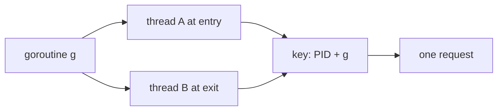

</div>

A goroutine is the identity. A thread is only the carrier.

<div class="small">

amd64 ABIInternal (Go 1.17+): the first integer arguments go in `AX`, `BX`, `CX`, not in the C order.

</div>

<!--
SAY

Now the Go part. Go does not pass arguments the way C does. On amd64, since Go
1.17, the first integer arguments go in AX, BX, and CX. When enough registers remain, a string uses two of them. Otherwise Go passes it on the stack. A tracer that expects the C order reads garbage.

Second problem. The goroutine can start a function on one thread and finish it
on another. So the thread ID cannot tie entry and exit together. OBI uses the
process ID and the address of the goroutine, the g pointer.

DO

Say amd64 out loud. Do not mix the g pointer and the goroutine ID.
-->

---

## Probe the RET, not the return address

<div class="columns">
<div>

### Conventional uretprobe

Replaces the saved return address with a trampoline.

Go copies the stack when it grows. The runtime can reject the foreign frame.

<span class="chip caution">crash risk in Go</span>

</div>
<div>

### What OBI does

Finds every `RET` instruction in the function.

Attaches an ordinary uprobe at each one.

The caller address stays untouched.

</div>
</div>

<!--
SAY

Here is why uretprobes and Go do not mix. A uretprobe replaces the saved
return address on the stack with a trampoline address.

Go copies stacks when they grow. To do that, the runtime walks every frame.
It finds an address that does not belong to any Go function. The runtime can
reject the stack, and the process can crash.

So OBI does not use uretprobes for Go. It disassembles the function, finds
every RET instruction, and puts an ordinary uprobe on each one. The return
address is never touched.

What that means is: OBI never touches the stack that Go needs to move.

DO

Forty-five seconds. Do not skip it.
-->

---

## CO-RE adapts kernel layouts, not Go layouts

<div class="center">

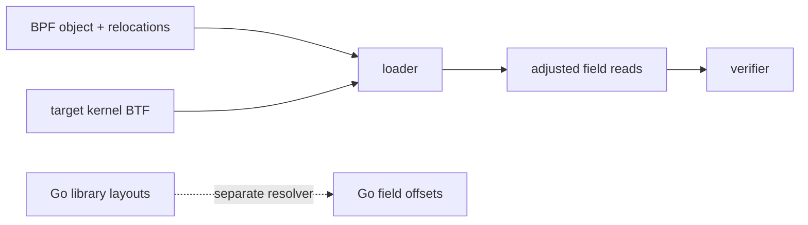

</div>

BTF describes the kernel's types. CO-RE fixes field reads at load time.

**A Go HTTP request is not a kernel type.**

<!--
SAY

A field in a kernel struct can move between kernel builds. BTF describes the types of the current kernel. CO-RE uses BTF to adjust the field reads
in the program before it loads. One compiled object can then work across supported kernel layouts.

Remember the limit. CO-RE knows kernel types. It knows nothing about a Go HTTP
request. For Go, we need a separate source of layouts. That is the next step.

DO

Thirty seconds. The dotted branch is the point.
-->

---

## Find the instruction and the field

<div class="center">

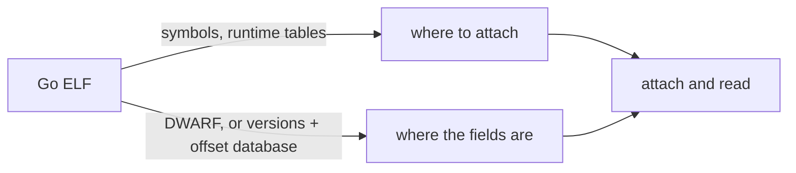

</div>

A function address is not a type layout.

<!--
SAY

A tracer needs two different things. An instruction address, to attach the
probe. And a field offset, to read the request inside the function.

The function address comes from the symbol table or from Go's own runtime
tables. Field offsets come from DWARF, if the binary still has debug
information. If it does not, OBI reads the Go and library versions from the
build information and looks the offsets up in a prepared database.

A function address is not a type layout. That is the Go-side half of the CO-RE
problem.

DO

Thirty-five seconds. Link back to CO-RE.
-->

---
<!-- _class: punchline dark -->
<!-- _paginate: false -->

# No source change. No rebuild. No *rollout*.

<!--
SAY

No source change. No rebuild. No application rollout.

DO

Pause after each line. Then add: the DaemonSet still has a deployment and security cost.
-->

---

## Go library coverage: 13 documented baselines

<div class="columns">
<div>

<ul>
<li><code>net/http</code></li>
<li><code>golang.org/x/net/http2</code></li>
<li><code>gorilla/mux</code></li>
<li><code>gin-gonic/gin</code></li>
<li><code>google.golang.org/grpc</code></li>
<li><code>net/rpc/jsonrpc</code></li>
<li><code>database/sql</code></li>
</ul>

</div>
<div>

<ul>
<li><code>go-sql-driver/mysql</code></li>
<li><code>lib/pq</code></li>
<li><code>redis/go-redis/v9</code></li>
<li><code>segmentio/kafka-go</code></li>
<li><code>IBM/sarama</code></li>
<li><code>mongo-driver</code> v1 and v2</li>
</ul>

</div>
</div>

<div class="tiny">

`gin >= v1.6.0, != v1.7.5` · `redis/go-redis/v9 >= v9.0.0` · [OBI v1.0.0 support matrix](https://github.com/open-telemetry/opentelemetry-ebpf-instrumentation/blob/v1.0.0/SUPPORT_MATRIX.md)

</div>

<!--
SAY

Thirteen documented baselines. HTTP, gRPC, databases, messaging.

The support matrix is the contract. Library internals can change faster than a
slide deck.

DO

Do not read all thirteen. Point to a few categories.
-->

---

## OBI emits traces and metrics. Logs get correlation.

<div class="columns">
<div>

### Native signals

**Traces**
HTTP, gRPC, database, messaging

**Metrics**
RED and runtime metrics

</div>
<div>

### Log correlation

Adds `trace_id` and `span_id` to selected **JSON and plain-text logs** while a span is active.

Not a log exporter. Linux 6.0+, no kernel lockdown.

</div>
</div>

<div class="tiny">

[OpenTelemetry: OBI trace-log correlation](https://opentelemetry.io/docs/zero-code/obi/trace-log-correlation/) · [OBI v1.0.0 telemetry contract](https://github.com/open-telemetry/opentelemetry-ebpf-instrumentation/blob/v1.0.0/TELEMETRY.md)

</div>

<!--
SAY

OBI emits traces and metrics. HTTP, gRPC, database, messaging. RED and runtime
metrics.

Its log feature enriches selected JSON and plain-text writes with trace and
span IDs while a span is active. It leaves log shipping to your existing
pipeline. It is not a log exporter. It needs Linux 6.0 or newer and no kernel
lockdown.

In v1, the stable part is HTTP and SQL: their spans and duration metrics.
gRPC is a release candidate. Go runtime metrics are still in development.

DO

Say explicitly: correlation is log support, not a log exporter. Say the stability line once.
-->

---

## OBI needs Linux, BTF, and kernel 5.8 or a backport

| Requirement | OBI |
| --- | --- |
| Operating system | Linux only |
| Architecture | `amd64`, `arm64` |
| Kernel | 5.8+, or documented RHEL 4.18+ backports |
| Kernel metadata | BTF |
| Deployment | Host process, sidecar, or DaemonSet |
| macOS / Windows | Linux VM or remote cluster |

<!--
SAY

Linux only. amd64 and arm64. Kernel 5.8 or newer, with BTF. Deploy as a host
process, sidecar, or DaemonSet. macOS and Windows need a Linux VM or remote
cluster.

DO

Read across the table, not every row.
-->

---

## Privileges depend on the mode

| Mode | Additional access |
| --- | --- |
| Network flow capture | `CAP_BPF`, `CAP_NET_RAW` |
| Application observability | `CAP_PERFMON`, `CAP_NET_RAW`, process and ELF access |
| Context propagation | `CAP_NET_ADMIN` |
| Go library propagation | `CAP_SYS_ADMIN` on kernel 5.10+ |

<br>

`kernel.perf_event_paranoid`, Secure Boot, and kernel lockdown can change what works.

<!--
SAY

Privileges are a ladder, not one list.

Network capture needs BPF and raw-socket access. Application observability
adds perf monitoring, raw sockets, and process and executable inspection.
Context propagation adds network administration. Go library propagation may
need SYS_ADMIN on kernel 5.10 or newer because it uses bpf_probe_write_user.

What that means is: the feature you turn on decides the access you ask for.

DO

Speak the ladder as four rungs, never as a table. CAP_SYS_PTRACE inspects /proc. It does not PTRACE_ATTACH. Since v0.14.0, most probes attach without SYS_ADMIN. The write helper still needs SYS_ADMIN. Secure Boot and kernel lockdown can still turn it off.
-->

---

## What actually works without source changes

<div class="columns">
<div>

### OBI handles

<ul>
<li>Service boundaries</li>
<li>HTTP and gRPC spans</li>
<li>RED and runtime metrics</li>
<li>Supported library operations</li>
<li>Log correlation</li>
</ul>

</div>
<div>

### Application code still owns

<ul>
<li>Business events</li>
<li>Domain-specific attributes</li>
<li>Arbitrary internal functions</li>
<li>Unsupported libraries</li>
<li>Custom sampling decisions</li>
</ul>

</div>
</div>

<div class="tiny">

Go spans you write with `otel.Tracer` and no SDK: OBI can export them through the Auto SDK. It needs `CAP_SYS_ADMIN`.

</div>

<!--
SAY

OBI can see service boundaries, HTTP and gRPC spans, RED and runtime metrics,
supported library operations, and log correlation.

Remember the platform team. It cannot infer their tenant ID, a checkout stage, or a domain event unless those
semantics already cross an instrumented boundary.

One thing moved. If you write a span with otel.Tracer and register no SDK,
OBI can now export it. You still write the span. You do not need the SDK.

DO

The honesty is the point. The otel.Tracer line needs SYS_ADMIN.
-->

---
<!-- _class: punchline dark -->
<!-- _paginate: false -->

# But it still has a *cost*

<!--
SAY

The application avoids a rollout. The observer still has a cost.

DO

Pause before the cost slide.
-->

---
<!-- _class: meme -->
<!-- _paginate: false -->


zero-touch means zero cost... right?

<!--
SAY

Zero-touch does not mean zero cost.

DO

Two seconds, then advance. Do not answer the meme aloud.
-->

---

## Uprobes have real costs

<div class="columns">
<div>

### Infrastructure cost

An attached uprobe crosses into the kernel. Heavy contention once hurt scalability across many CPUs.

Kernel 6.12 includes major RCU-protected hot-path improvements.

</div>
<div>

### Program and compatibility cost

Shared BPF state can serialize a concurrent application path.

Go runtime and library layout changes can invalidate offsets. Go 1.26 required an OBI symbol-resolution fix.

</div>
</div>

<div class="tiny">

[Usama Saqib, FOSDEM 2026](https://fosdem.org/2026/schedule/event/H3LM7G-performance_and_reliability_pitfalls_of_ebpf/) · [Linux uprobe hot-path series](https://lists.openwall.net/linux-kernel/2024/08/13/142) · [OBI PR #1851](https://github.com/open-telemetry/opentelemetry-ebpf-instrumentation/pull/1851)

</div>

<!--
SAY

Uprobes have real costs.

Infrastructure: an attached uprobe crosses into the kernel. Heavy contention
once hurt scalability across many CPUs. Kernel 6.12 includes major
RCU-protected hot-path improvements. Do not describe old scalability results
as current on every kernel.

Program: the BPF program itself can serialize a hot path if it touches shared
state. Instrumenting a thread-safe function does not guarantee the observer
preserves its concurrency.

Compatibility: uprobes target compiled locations and inferred layouts. Go
1.26 removed pcHeader.textStart. OBI changed its resolver in PR 1851.

DO

Credit Usama Saqib verbally. Point to his FOSDEM talk in the footer.

Static-PIE anecdote (cuttable, allow about 1:25):

Here is what that compatibility cost looks like in practice. A Kubernetes
controller changed one build flag to static-PIE. No application code changed.
On nodes running OBI, its pods exited 139. kubectl logs previous was empty.
GOTRACEBACK equals crash was silent, because the SIGSEGV beat the Go
runtime's signal handler.

Static-PIE is ET_DYN with no PT_INTERP. The external linker restructured
segments. The runtimeText offset OBI derived from .gopclntab stopped matching
prog.Vaddr, and the computed offset put the uprobe in the wrong place.

Fixed by PR 1851, which derives runtime.text from runtime.moduledata after Go
1.26 removed pcHeader.textStart.

The line it earns: that is the maintenance cost of inferring a layout you did
not compile.

DO

Cuttable. If running long, skip it and keep only the PR 1851 line. Present it as maintenance cost, not an unfixed defect.
-->

---

## Usama Saqib: pitfalls of production eBPF

<div class="columns">
<div class="center">


</div>
<div>

He covers the pitfalls found building production eBPF at Datadog: kprobe performance across kernel versions, a fentry kernel bug, and the pain of scaling uprobes.

Twenty-eight minutes, public, and it goes deeper than this section can.

[Performance and reliability pitfalls of eBPF, FOSDEM 2026](https://fosdem.org/2026/schedule/event/H3LM7G-performance_and_reliability_pitfalls_of_ebpf/)

</div>
</div>

<!--
SAY

Usama Saqib covers this in depth at FOSDEM 2026. The pitfalls of building
production eBPF at Datadog: kprobe performance across kernel versions, a fentry
kernel bug, and the pain of scaling uprobes.

Twenty-eight minutes, public, and it goes deeper than this section can.

DO

Credit him verbally. Do not read the screenshot.
-->

---
<!-- _class: meme -->
<!-- _paginate: false -->


somehow, it works

<!--
SAY

Somehow, it works.

DO

Ten seconds. Do not explain the joke. Advance.
-->

---
<!-- _class: section -->
<!-- _paginate: false -->

###### 05

# Profiles: observe CPU from the kernel

<div class="signal-map">
<span class="signal-out">Traces<b>not emitted</b></span>
<span class="signal-out">Metrics<b>not the application signal</b></span>
<span class="signal-out">Logs<b>not the application signal</b></span>
<span>Profiles<b>CPU samples</b></span>
<small>A rebuild-free route to profiling. Linux node access required.</small>
</div>

<!--
SAY

That was the first part, the three ways in. Second part: the evidence they
still miss.

We now know where to intervene. What evidence does the problem need?

The build path can include profiling. This profiler gives us another route:
CPU profiles from outside the application, without rebuilding it.

DO

Point to profiles in the signal indicators.
-->

---
<!-- _class: punchline dark -->
<!-- _paginate: false -->

## Traces tell you which request was slow

## Profiles tell you where the *CPU* went

<!--
SAY

Traces tell you which request was slow. Profiles tell you where the CPU went.

DO

Pause between the two questions.
-->

---

## One profiler, every process on the node

Originated as Elastic Universal Profiling and joined OpenTelemetry in June 2024.

<ul>
<li>Samples CPU from the kernel.</li>
<li>Profiles every process on a node.</li>
<li>Requires no application rebuild or injected library.</li>
<li>Emits the OpenTelemetry Profiles signal.</li>
</ul>

<br>

<span class="chip note">Profiles: Alpha specification</span>

<!--
SAY

The OpenTelemetry eBPF Profiler originated as Elastic Universal Profiling and
joined OpenTelemetry in June 2024.

It samples CPU from the kernel. It profiles every process on a node. No
application rebuild, no injected library. It emits the OpenTelemetry Profiles
signal.

The Profiles specification is Alpha.

DO

Do not imply a stable wire or data-model contract.
-->

---
<!-- _class: punchline dark -->
<!-- _paginate: false -->

# But how does it read a *stripped* binary?

<!--
SAY

How does the profiler read a stripped Go binary?

DO

Advance.
-->

---

## Go metadata tells the profiler how to unwind

<div class="center">

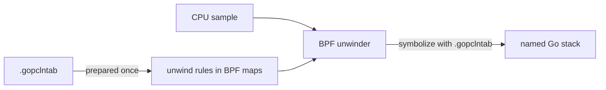

</div>

> "The information remains present even for fully static and stripped executables."
>
> [OpenTelemetry eBPF Profiler documentation](https://github.com/open-telemetry/opentelemetry-ebpf-profiler/blob/main/doc/gopclntab.md)

<!--
SAY

The Go runtime needs .gopclntab to print its own stack traces. So the table
stays even in a static, stripped binary.

The profiler reads it once and prepares unwind rules: how to find the caller
from each function. It loads the rules into BPF maps. When a CPU sample fires,
the BPF unwinder walks the stack with those rules. Then the same table turns
addresses into Go function names.

Ordinary Go frames can use frame pointers. The table covers the rest. You need
no special debug build.

DO

Forty seconds. Do not say the profiler ignores frame pointers.
-->

---

## Zero-touch profiling still has a deployment cost

| Application | Profiler agent |
| --- | --- |
| No source changes | Linux node access |
| No rebuild | `CAP_BPF` + `CAP_PERFMON` or root |
| No in-process agent | DaemonSet / Collector distribution |
| Stripped binaries supported | CPU profiling is the confirmed core signal |

<br>

The signal is profiles. Choose the profiler by its coverage and deployment cost.

<!--
SAY

No source changes, no rebuild, no in-process agent. Stripped binaries are
supported.

But the agent needs Linux node access, BPF and perf monitoring or root, and a
DaemonSet or Collector distribution. CPU profiling is the confirmed core
signal.

DO

Read across the table, not every row.
-->

---
<!-- _class: punchline dark -->
<!-- _paginate: false -->

# Traces and profiles. *Apart.*

<!--
SAY

We have request timing and CPU samples. To connect a request to its samples,
the profiler needs request context. We will return to the proposed bridge
at the end.

Even with both signals, we can still miss the variable that explains the bug.

DO

Establish the correlation need. Keep the OTEP mechanism for the future section.
-->

---
<!-- _class: meme -->
<!-- _paginate: false -->


each one points at the other

<!--
SAY

Each signal points at the other one for the missing context.

DO

Two seconds. Advance.
-->

---
<!-- _class: section -->
<!-- _paginate: false -->

###### 06

# Live debugging: probe a running process

<div class="signal-map">
<span class="signal-out">Traces<b>longer-term goal</b></span>
<span class="signal-out">Metrics<b>goal</b></span>
<span>Logs<b>logpoints + snapshots</b></span>
<span class="signal-out">Profiles<b>not this logpoint</b></span>
<small>Ask for missing evidence while the service runs.</small>
</div>

<!--
SAY

Back to Friday, twenty to five. You need one value, the cart total, on one
line, in production. Every tool so far adds telemetry that you planned. This one
answers a question that you did not plan. The signal here is a dynamic log,
with a snapshot of the available variables.

DO

Point to logs in the signal indicators. Metrics and traces are goals, not capabilities. Name the opening loop.
-->

---

## The probe goes to the running process

<div class="center">

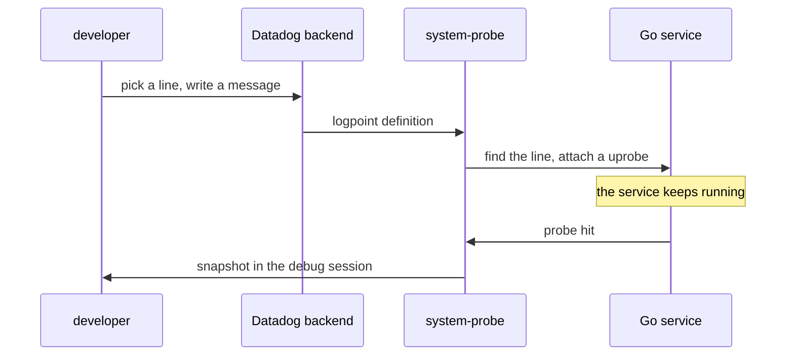

</div>

<div class="tiny">

Simplified. [Datadog Live Debugger](https://docs.datadoghq.com/tracing/live_debugger/): "non-breaking breakpoints that collect diagnostic data without pausing the application"

</div>

<!--
SAY

You pick a line in the debugger and write a message. The backend sends the
logpoint to the Datadog agent on that host. The system probe finds the line in
the binary and attaches a uprobe.

The service keeps running. Nothing restarts. When the line runs, the probe
captures the values. The snapshot appears in your debug session.

DO

Do not add steps to the diagram. A logpoint can take a couple of minutes to
capture. If asked why it is not instant, say so.
-->

---

## From a line to a machine address

<div class="center">

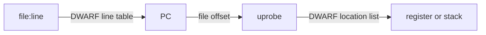

</div>

The same uprobe as before. DWARF supplies the address and the variable locations.

<!--
SAY

This is the same uprobe as OBI, with DWARF line and variable information.

The DWARF line table maps file and line to machine addresses. The tool prefers a statement row for that line. If only other rows match, it uses the first one. That gives a PC. It turns the PC into a file offset
and attaches the uprobe there.

When the probe hits, DWARF location lists say where each variable lives at that
PC: in a register, or on the stack.

DO

The source is the public datadog-agent code. Present it as how the code works,
not as a product guarantee.
-->

---

## Some variables are not there

<div class="columns">
<div>

### The compiler moved them

Inlining and register allocation leave some values with no location at that PC.

</div>
<div>

### The probe still fires

The snapshot marks the variable **unavailable**.

Some lines have no safe place for a probe.

</div>
</div>

<!--
SAY

The compiler does not keep every variable alive at every line. After inlining
and register allocation, some values have no location at that PC.

The probe still fires. The snapshot marks those variables as unavailable.
Some lines have no safe place for a probe at all, and the tool tells you.

DO

If the room laughs at "unavailable", let it.
-->

---

## Bounded by design

| Control | Public limit |
| --- | --- |
| Logpoint with variable capture | 1 execution per second |
| Logpoint without capture | 5000 per second per service instance |
| Lifetime | Expires with the debug session |
| Sensitive identifiers | Redacted before the data leaves the host |

<div class="small">

Go: Linux 5.17+, Datadog Agent 7.73+, Go SDK 2.9+ recommended · [Live Debugger docs](https://docs.datadoghq.com/tracing/live_debugger/) · [Sensitive data scrubbing](https://docs.datadoghq.com/tracing/live_debugger/sensitive-data-scrubbing/)

</div>

<!--
SAY

A debugger in production needs hard limits.

A logpoint that captures variables runs at most once per second. Without
capture, the limit is five thousand per second per service instance.
Logpoints expire when the debug session ends. The system probe redacts values with sensitive identifiers, such as password, before the data leaves the host.

For Go, you need Linux 5.17 or newer and Agent 7.73 or newer on the same host. The docs strongly recommend the Go SDK 2.9 or newer.

DO

Do not add an overhead percentage. The public docs give none for Go.
-->

---

## Other ways, and their cost

| | Code change | Stops the program | Reads variables |
| --- | --- | --- | --- |
| Delve breakpoint | no | **yes** | yes |
| Flight recorder (Go 1.25) | **yes** | no | no, execution trace |
| Hand-written uprobe | no | no | by hand |
| Live Debugger logpoint | no | no | yes, bounded |

<!--
SAY

There are other ways. A Delve breakpoint shows the available variables, but it stops the program. The Go 1.25 flight recorder does not stop anything, but you must
add it to the code, and it records an execution trace, not variable values. A
hand-written uprobe works, but you do the DWARF work yourself.

A logpoint gives bounded variable snapshots with no code change and no pause. You decode nothing by hand.

DO

Read the last row, not the whole table. Delve tracepoints print events, not snapshots.
-->

---
<!-- _class: section -->
<!-- _paginate: false -->

###### 07

# Choose the signal and the layer

<!--
SAY

Third part: how to choose, and what Go could make easier.

We can now choose on two grounds. Which signal answers the question?
Which intervention point can our service support?

DO

Compare signal coverage before the constraint table.
-->

---

## Similar signals, different coverage

| Approach | Traces | Metrics | Logs | Profiles |
| --- | --- | --- | --- | --- |
| Build time | SDK | SDK | SDK | SDK |
| Injector (in development) | SDK | SDK | SDK | SDK |
| OBI | Yes | Yes | Correlation | No |
| eBPF Profiler | No | No | No | CPU |
| Live Debugger | Goal | Goal | Logpoints | No |

<!--
SAY

The build and injector paths can activate SDK instrumentation across all four
signals. Actual coverage depends on the bundle.

OBI emits traces and metrics, and correlates existing logs. The eBPF Profiler
emits profiles. Live Debugger gives us logs and variable snapshots.

Similar signals do not mean identical coverage or deployment costs.

DO

Keep the signal order. Say once: SDK means it depends on the SDK and
integrations. The Go injector is in development. Live probe metrics and traces remain goals.
-->

---

## When to reach for what

| Constraint | Prefer |
| --- | --- |
| No rebuild window | OBI on supported Linux hosts |
| Non-Linux target | otelc |
| Mixed-language boundary coverage | OBI |
| Rich Go library semantics | otelc |
| No privileged runtime agent | otelc |
| Whole-node CPU profiles | eBPF Profiler |
| A missing variable in production | Live Debugger logpoint |

<!--
SAY

No rebuild window: OBI. Non-Linux target: otelc or Orchestrion.
Mixed-language boundary coverage: OBI. Rich Go library semantics: otelc or
Orchestrion. No privileged runtime agent: otelc or Orchestrion. Whole-node
CPU profiles: the eBPF Profiler. A missing variable: a live logpoint.

DO

Read examples across the table, not every row.
-->

---

## A practical production combination

<div class="center">

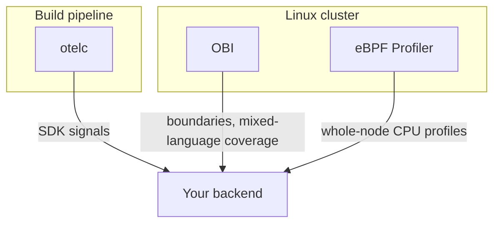

</div>

Add a layer when its signal earns the cost. Use live logpoints for missing evidence.

<!--
SAY

Use build-time instrumentation where you own the Go build. OBI for
rebuild-free and mixed-language boundaries. The profiler for whole-node CPU.

Use a live logpoint when that baseline does not answer the question.
Add each layer only when the signal pays for its cost.

Those are choices we can make now. What should become easier to build?

DO

This is an example, not a universal stack. Do not repeat the adoption number.
-->

---
<!-- _class: section light -->
<!-- _paginate: false -->

###### 08

# Asks for the Go team

<div class="section-meme">


I can find you in the hallway. Pretty please 😊

</div>

<!--
SAY

These are asks, not demands. I have four, and a bonus.

If you work on Go, I will find you in the hallway.

DO

One beat. Deadpan. Do not explain the GIF.
-->

---

## They already asked the question

> "We don't have a great way to add instrumentation in general. Companies will maintain patches to add hooks. What should we do?"
>
> Go runtime diagnostics sync, 31 July 2025

> "Maybe eBPF is the answer?"
>
> Go team, same meeting

Our answer: yes, if Go gives eBPF something stable to read.

<!--
SAY

In a Go runtime diagnostics sync, the question came up like this:

"We don't have a great way to add instrumentation in general. Companies will maintain patches to add hooks. What should we do?"

The Go team answered: "Maybe eBPF is the answer?"

Our answer is yes, if Go gives eBPF something stable to read.

Go 1.27 moved HTTP/2 into a new internal package. It also added a field to moduledata. Tools that inferred by symbol or offset had to catch up.

DO

Say it as thanks, not blame. Say "the Go team". Do not name people.
-->

---

## Ask 1: USDT probes in Go

<div class="columns">
<div>


</div>
<div>

<ul>
<li>A probe is a NOP plus an ELF note: a name and where each value lives.</li>
<li>Go 1.27 emits none. Salp adds them through cgo.</li>
<li>The eBPF profiler reads allocator USDT probes. The Go allocator has none.</li>
</ul>

**Ask:** let the toolchain emit SDT notes. Start with runtime sites.

<span class="chip caution">proof of concept</span>

</div>
</div>

<!--
SAY

USDT lets a program declare its own probes. The producer puts a NOP at the probe site and writes an ELF note. The note names the probe and says where each value lives.

Go 1.27 emits no USDT probes. Salp adds them through cgo. My fork is a proof of concept. It shows the toolchain side.

The OpenTelemetry eBPF profiler now reads allocator USDT probes for memory profiles. The Go allocator has none.

So the ask is simple. Let the toolchain emit these notes. Start with runtime sites: goroutine start and exit, GC phases, and allocation samples.

In the December 2024 sync, the Go team asked, "How would this look?" The fork is one answer.

DO

If someone cites golang/go#22008, a USDT site is fixed at compile time. Call the fork a proof of concept, not a plan.
-->

---

## Ask 2: a read contract for pprof labels

| Today | Ask |
| --- | --- |
| Build-time rewriting adds fields to `runtime.g` | Use the labels Go already has |
| eBPF readers infer offsets per release | Document where `g.labels` lives |
| OTEP 4947 tells Go readers to read pprof labels | Keep that layout stable |

<!-- code-header: none -->

```yaml
threadlocal.schema_version: "go_pprof_labels_v1"
```

<div class="tiny">

[OTEP 4947: Alternative for Go support](https://github.com/open-telemetry/opentelemetry-specification/blob/main/oteps/profiles/4947-thread-ctx.md#alternative-for-go-support) · [golang/go#68785](https://github.com/golang/go/issues/68785)

</div>

<!--
SAY

This ask does not add goroutine-local storage. The Go team rejected that many times.

Profile labels already flow through contexts, as designed. dd-trace-go already sets pprof labels.

OpenTelemetry proposal 4947 tells Go readers to read pprof labels. Today, eBPF readers infer where the label field lives in each release. Build-time tools add fields to runtime.g.

The ask is to document where the labels live, and keep that layout stable for out-of-process readers.

DO

Lead with "no new API". Then say "read contract". Present proposal 4947 as proposed work.
-->

---

## Ask 3: close the `-toolexec` gaps

<ul>
<li>otelc and Orchestrion both build on <code>-toolexec</code>.</li>
<li>A tool cannot add its own inputs to a package's build ID.</li>
<li><a href="https://github.com/golang/go/issues/69887">golang/go#69887</a> lists the gaps, from build-ID influence to new build-graph edges.</li>
</ul>

<br>

**Ask:** close those gaps. A problem report, not a new build mode.

<!--
SAY

otelc and Orchestrion both build on `-toolexec`. A tool cannot add its own inputs to a package build ID. Then the build cache can reuse a stale result.

Issue 69887 lists the gaps. On that issue, the Go team called it "a problem report, which is still very helpful".

The ask is to close those gaps. It is not a new build mode.

DO

Do not repeat the 20% number as a claim about Go users.
-->

---

## Ask 4: one supported start-up door

| Variable | Values an agent must handle |
| --- | --- |
| libc | glibc, musl, none |
| Link mode | internal, external |
| Build mode | exe, PIE, static |
| `plugin` | the exact toolchain and dependency versions |

**Ask:** tell agent authors which door Go supports.

<span class="chip note">cgo without a C toolchain: GOEXPERIMENT accepted (#81662)</span> <span class="chip caution">fit for agents still open</span>

<!--
SAY

Other runtimes give an agent one documented door. Java has JAVA_TOOL_OPTIONS.

Go gives an agent a matrix. The agent must handle libc, which is glibc, musl, or none. It must handle link mode, internal or external. It must handle build mode, exe, PIE, or static.

The plugin package does not solve this. Its documentation says crashes are likely unless the application and its plugins use the same toolchain version, build tags, flags, and dependency sources. For a vendor, the support matrix grows fast.

The ask is simple. Tell agent authors which door Go supports.

Native agent libraries may fit cgo without a C toolchain. The accepted experiment is GOEXPERIMENT cgobindings. The fit is still open.

DO

Keep this generic. Never describe how the Datadog injector links or enters.
-->

---

## Four asks. I will find you in the hallway.

<div class="columns">
<div>

| Ask | Prior art |
| --- | --- |
| USDT probes | #57175 |
| A read contract for pprof labels | OTEP 4947, #68785 |
| `-toolexec` gaps | #69887 |
| A start-up door | #28909, #12465 |
| Bonus: stable runtime offsets | `moduledata` |

</div>
<div class="center">


**Draft problem reports**

</div>
</div>

<!--
SAY

Four asks. USDT probes. A read contract for pprof labels. The `-toolexec` gaps. One start-up door.

There is one bonus. Stable runtime offsets, such as moduledata.

The QR code leads to draft problem reports in the talk repository.

If you work on Go, I will find you in the hallway. If you do not, please introduce me.

DO

Pause on the QR code for three seconds.
-->

---

## Where our tools go next

| Tool | Today | Plan |
| --- | --- | --- |
| Live Debugger | Logpoints and variable snapshots | Goal: metrics. Then traces, 12+ months |
| Go injector | In development | Go in Single-Step Instrumentation |
| eBPF Profiler | CPU profiles | Allocation profiling merged on `main`. Live heap in review |

<span class="chip caution">goals, not release commitments</span>

<!--
SAY

Live Debugger has logpoints and variable snapshots today. Metrics are a goal. Traces are a longer-term goal, more than twelve months away.

The Go injector is in development. The plan is Go in Single-Step Instrumentation.

The eBPF profiler has CPU profiles today. Allocation profiling is merged on main. Live heap is in review.

These are goals, not release commitments.

DO

Say "goals" out loud. Do not give a release date.
-->

---
<!-- _class: section -->
<!-- _paginate: false -->

###### 09

# From question to evidence

<!--
SAY

Those proposals can make the tools easier to build. Now return to the bug
that we can investigate with the tools we already have.

DO

End the future section. The agent callback uses current preview capabilities.
-->

---
<!-- _class: vcenter -->

## The loop, without the redeploy

<br>

Describe the bug in words. The agent places the probe and reads *production evidence*.

No source edit. No restart. No *redeploy*.

<br>

Bits Live Debugger does this today, in preview.

Same move as the opening joke, except now the agent has the *framework*.

<!--
SAY

Remember Friday. The slow tenant. The log line. The redeploy. The wrong place.

Now: describe the bug in words. The agent places the probe and reads production
evidence. No source edit, no restart, no redeploy.

Bits Live Debugger does this today, in preview.

Same move as the opening joke. Except now the agent has the framework.

DO

This is the one place enthusiasm is the point. Name the product once. Give the specifics here: system-probe, kernel 5.17, logpoints that expire, preview tier.
-->

---
<!-- _class: punchline dark -->
<!-- _paginate: false -->

# Takeaways

<!--
SAY

Go gave us simple binaries. We paid for them with late instrumentation.
That bill is getting smaller.

DO

Pause. Advance to the two lines to remember.
-->

---
<!-- _class: punchline dark -->
<!-- _paginate: false -->

## Start from the *constraint* you cannot change.

## Add a layer only when its *signal* pays for its *operational cost*.

<!--
SAY

Start from the constraint you cannot change.

Add a layer only when its signal pays for its operational cost.

DO

Slow down. These two lines are the whole talk.
-->

---

## Get involved in the SIGs

<div class="columns">
<div class="center">


</div>
<div>

[github.com/open-telemetry/community](https://github.com/open-telemetry/community) has every SIG's calendar, notes, and channels.

<ul>
<li>Go Compile-Time Instrumentation (<code>otelc</code>)</li>
<li>eBPF Instrumentation (OBI)</li>
<li>Injector</li>
<li>Profiling</li>
</ul>

</div>
</div>

<!--
SAY

If you want to help, bring a concrete requirement: a probe site, a context
contract, or a deployment restriction. The SIGs need those cases.

These tools are built in the open, in these SIGs. Bring them your case.

github.com/open-telemetry/community has every SIG's calendar, notes, and
channels.

Go Compile-Time Instrumentation. eBPF Instrumentation. The Injector. Profiling.

DO

Point to the community repo.
-->

---
<!-- _class: punchline dark -->
<!-- _paginate: false -->

# Shameless plug

## Why Your Go Benchmarks Are Lying (And How to Stop Them)

### Tomorrow · 10:45 · Golab #2

[golab.io/talks/why-your-go-benchmarks-are-lying-and-how-to-stop-them](https://golab.io/talks/why-your-go-benchmarks-are-lying-and-how-to-stop-them)

<!--
SAY

One more thing, and I am not sorry about it.

Tomorrow morning, ten forty-five, room Golab number two: my other talk. Why
Your Go Benchmarks Are Lying, and How to Stop Them.

Today was about observing what you shipped. Tomorrow is about knowing whether
it got faster.

DO

Deadpan. Say the time and the room slowly enough to photograph.
-->

---
<!-- _class: dark -->

# Take it with you

<div class="columns">
<div>

### Talk material

[github.com/kakkoyun/golab-26](https://github.com/kakkoyun/golab-26)

Both decks · research · [earlier FOSDEM version](https://youtu.be/0TvrSebuDPk)

### zeroins toolkit

[github.com/kakkoyun/zeroins](https://github.com/kakkoyun/zeroins)

`obi-integration` · `otelc-aspect`<br>
`kubectl-obi` · `kubectl-profiler`

</div>
<div class="center">


**Scan for the talk repository**

</div>
</div>

<!--
SAY

The talk repository has both decks, the research, and the earlier FOSDEM
recording. The zeroins toolkit has the four commands.

Pick the constraint you cannot change. Then choose the layer that can still
reach your service.

DO

Advance to the last slide.
-->

---
<!-- _paginate: false -->
<!-- _class: end gopher-balloon -->

# Grazie!

Find me in the hallway.

[kakkoyun.me](https://kakkoyun.me) · [github.com/kakkoyun](https://github.com/kakkoyun)

[linkedin.com/in/kakkoyun](https://www.linkedin.com/in/kakkoyun/) · [bsky.app/profile/kakkoyun.me](https://bsky.app/profile/kakkoyun.me) · [x.com/kakkoyun_me](https://x.com/kakkoyun_me)

<span class="small">Talk repo [github.com/kakkoyun/golab-26](https://github.com/kakkoyun/golab-26) · Tools [github.com/kakkoyun/zeroins](https://github.com/kakkoyun/zeroins)</span>

<!--
SAY

Next time production surprises you, do not redeploy to ask. Ask. Without
changing a single line of code.

Grazie.

DO

End with this line. Stop. The slot has no Q&A: point to the hallway and
leave the links visible.
-->
