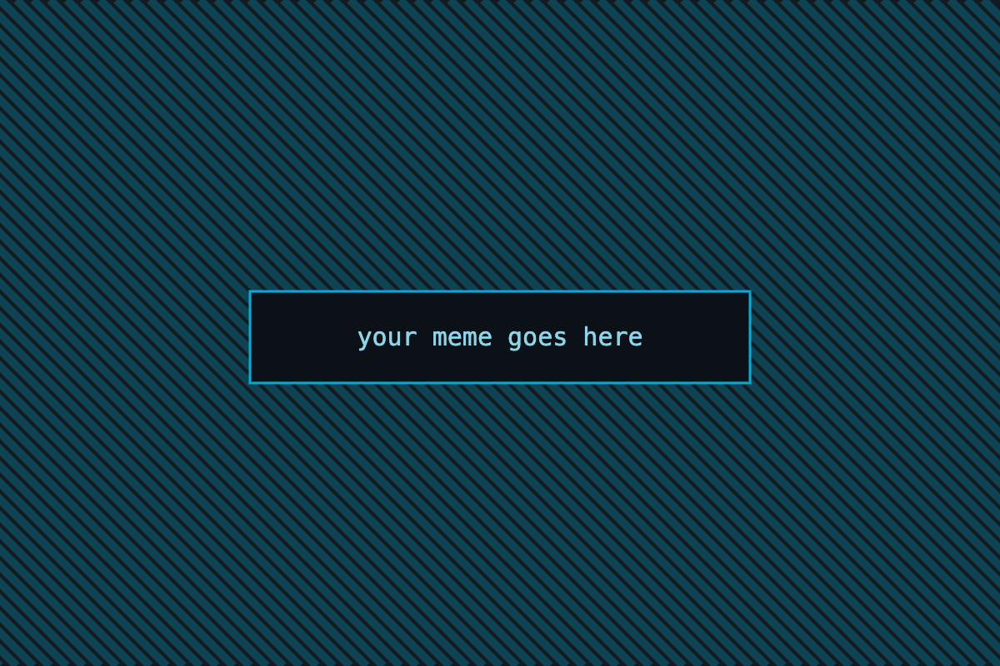
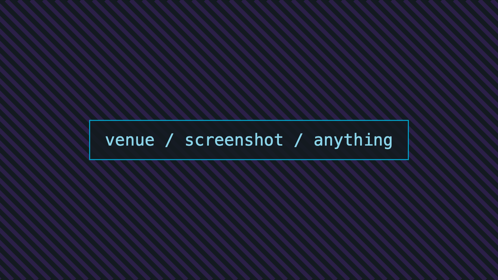
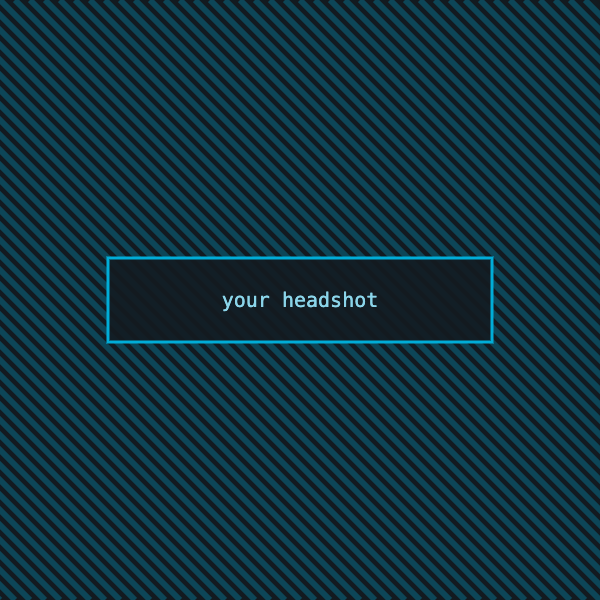

<!-- _class: title gopher-hero -->
<!-- _paginate: false -->

##### GoLab · November 2026

# Profiling Go in production

### Speaker Name

Go engineer

---

<!-- _class: section -->

###### 01

# Runtime internals

Where the scheduler spends its time, and how to see it.

---

# Collect without allocating

###### profiler/collect.go

```go
// Collect runs one CPU profile window.
func (p *Profiler) Collect(ctx context.Context) error {
	buf := p.pool.Get()
	defer p.pool.Put(buf)

	if err := pprof.StartCPUProfile(buf); err != nil {
		return fmt.Errorf("start profile: %w", err)
	}
	defer pprof.StopCPUProfile()
}
```

---

# Disassemble the hot path

###### profiler/collect.go

```asm
TEXT ·Collect(SB), NOSPLIT, $0-8
    MOVD  buf+0(FP), R0
    CALL  runtime·pprofStartCPUProfile(SB)
```

The header names the source file for this disassembly.

---

# Captured output

###### collect.bench

```text
BenchmarkCollect-10   14322   81.4 ns/op   0 B/op
```

The header names the source of the captured output. The `$` marks command output.

---

# A shell command

```bash
go test -bench=Collect -benchmem -count=10
```

The command has a reading rail and a corner `$`.

---

# Three labels

<span class="chip note">structural aside</span>

<span class="chip measure">a reading</span>

<span class="chip caution">do not ship this</span>

---

<!-- _class: emoji -->

# Four things we tried first

* 🔥 Flame charts can mislead you. Depth is not cost.
* 🧊 Cold paths that still bill you every request
* 📉 Averages, which hid the only number that mattered
* 🤖 Automating the diff instead of the reading

---

<!-- _class: chart -->

# p99 latency, by endpoint

##### milliseconds · 24h window

<div class="bars">
  <div class="row"><span class="label">/checkout</span><span class="track"><span class="fill" style="width:92%"></span></span><span class="value">412</span></div>
  <div class="row"><span class="label">/search</span><span class="track"><span class="fill" style="width:60%"></span></span><span class="value">268</span></div>
  <div class="row"><span class="label">/inventory</span><span class="track"><span class="fill" style="width:43%"></span></span><span class="value">191</span></div>
  <div class="row mark"><span class="label">/checkout*</span><span class="track"><span class="fill" style="width:20%"></span></span><span class="value">88</span></div>
</div>

---

<!-- _class: stat -->

# 79%

of the CPU time was in code **nobody had read** for two years.

---

<!-- _class: compare -->

# One line, measured

###### −79%

> **Before**
> `buf := new(bytes.Buffer)`
> ## 412 <small>ms</small>
> 18 MB / minute

> **After**
> `buf := p.pool.Get()`
> ## 88 <small>ms</small>
> 0.4 MB / minute

---

<!-- _class: terminal -->

# Live demo

```console
$ go tool pprof -http=:6060 cpu.pprof
Fetching profile over HTTP from localhost:6060
Saved profile in ~/pprof/pprof.samples.cpu.001.pb.gz
Serving web UI on http://localhost:6060

$ go test -bench=Collect -benchmem
BenchmarkCollect-10   14322   81.4 ns/op   0 B/op
```

---

<!-- _class: meme -->



when the profiler blames the GC

---

# What the numbers said

| Change | Allocations | p99 | Verdict |
| --- | --- | --- | --- |
| Buffer pool | −99% | −79% | Ship it |
| Tighter sampling | −4% | −2% | Noise |
| GC tuning | 0% | +1% | Revert |

---

<!-- _class: dark -->

# Two columns, any content

<div class="cols">
<div class="card">

### Read the flame

Wide bars are cost, not depth. Compare two windows before you tune anything.

</div>
<div class="card measure">

### Then measure

Every frame is a decision someone made. Find the decision, not the frame.

</div>
</div>

---

> A profile is a hypothesis, not a verdict.

---

<!-- _class: section pink -->

###### 02

# Shipping it

What survived contact with production.

---

<!-- _class: agenda -->

# Where we're going

1. Runtime internals
2. **Reading a profile without lying to yourself**
3. Shipping it
4. What I'd do differently

---

<!-- _class: photo -->



##### The Brewery, 2025

# Three hundred people, one profile graph

Nobody in the room agreed on what it meant.

---

<!-- _class: emoji -->

# Reveal these one at a time

* 🔥 First you notice the wide bar
* 🧊 Then you notice it's been there for a year
* 📉 Then you notice nobody owns it
* 🤖 Then you write the tool you should have written first

---

<!-- _class: punchline dark -->

# It was a *for loop*.

---

<!-- _class: speaker -->



# Speaker Name

### Go engineer

* social **@handle**
* GitHub **@handle**
* slides **example.dev/golab**

---

<!-- _class: end gopher-rocket teal -->
<!-- _paginate: false -->

# Thank you

<div class="qr"></div>

* slides → example.dev/golab
* social → @handle
* code → github.com/handle/talk

---

<!-- _class: section violet -->

###### III

# More layout choices

The left panel gives the title room to wrap.

---

<!-- _class: title pink gopher-none -->

# A second opener

### Speaker Name

Go engineer

---

<!-- _class: section left -->

###### IV

# Colour options

Every layout family on every accent background. The accent panel is on the left here.

---

<!-- _class: section left pink -->

###### V

# Left panel, pink

The mirrored divider keeps the body on the light panel.

---

<!-- _class: section left violet -->

###### VI

# Left panel, violet

The template uses white title text on this panel.

---

<!-- _class: section yellow -->

###### VII

# Full yellow divider

No art: the yellow fills the whole slide.

---

<!-- _class: section light -->

###### VIII

# Full light divider

The split stays, the accent goes.

---

<!-- _class: yellow -->

# Content on yellow

Text, tables, and code keep the dark palette on every accent.

| Option | Reading |
| --- | --- |
| Yellow | dark text |

---

<!-- _class: pink -->

# Content on pink

| Option | Reading |
| --- | --- |
| Pink | dark text |

---

<!-- _class: violet -->

# Content on violet

| Option | Reading |
| --- | --- |
| Violet | white text |

---

<!-- _class: teal -->

# Content on teal

| Option | Reading |
| --- | --- |
| Teal | dark text |

---

<!-- _class: stat yellow -->

# 42%

of the requests paid the pool tax.

---

<!-- _class: stat pink -->

# 42%

of the requests paid the pool tax.

---

<!-- _class: stat violet -->

# 42%

of the requests paid the pool tax.

---

<!-- _class: stat teal -->

# 42%

of the requests paid the pool tax.

---

<!-- _class: compare yellow -->

# Compare on yellow

###### −42%

> **Before**
> `new(bytes.Buffer)`
> ## 412 <small>ms</small>

> **After**
> `p.pool.Get()`
> ## 88 <small>ms</small>

---

<!-- _class: compare pink -->

# Compare on pink

###### −42%

> **Before**
> `new(bytes.Buffer)`
> ## 412 <small>ms</small>

> **After**
> `p.pool.Get()`
> ## 88 <small>ms</small>

---

<!-- _class: compare violet -->

# Compare on violet

###### −42%

> **Before**
> `new(bytes.Buffer)`
> ## 412 <small>ms</small>

> **After**
> `p.pool.Get()`
> ## 88 <small>ms</small>

---

<!-- _class: compare teal -->

# Compare on teal

###### −42%

> **Before**
> `new(bytes.Buffer)`
> ## 412 <small>ms</small>

> **After**
> `p.pool.Get()`
> ## 88 <small>ms</small>

---

<!-- _class: chart yellow -->

# Chart on yellow

<div class="bars">
  <div class="row"><span class="label">/checkout</span><span class="track"><span class="fill" style="width:92%"></span></span><span class="value">412</span></div>
  <div class="row mark"><span class="label">/checkout*</span><span class="track"><span class="fill" style="width:20%"></span></span><span class="value">88</span></div>
</div>

---

<!-- _class: chart pink -->

# Chart on pink

<div class="bars">
  <div class="row"><span class="label">/checkout</span><span class="track"><span class="fill" style="width:92%"></span></span><span class="value">412</span></div>
  <div class="row mark"><span class="label">/checkout*</span><span class="track"><span class="fill" style="width:20%"></span></span><span class="value">88</span></div>
</div>

---

<!-- _class: chart violet -->

# Chart on violet

<div class="bars">
  <div class="row"><span class="label">/checkout</span><span class="track"><span class="fill" style="width:92%"></span></span><span class="value">412</span></div>
  <div class="row mark"><span class="label">/checkout*</span><span class="track"><span class="fill" style="width:20%"></span></span><span class="value">88</span></div>
</div>

---

<!-- _class: chart teal -->

# Chart on teal

<div class="bars">
  <div class="row"><span class="label">/checkout</span><span class="track"><span class="fill" style="width:92%"></span></span><span class="value">412</span></div>
  <div class="row mark"><span class="label">/checkout*</span><span class="track"><span class="fill" style="width:20%"></span></span><span class="value">88</span></div>
</div>

---

<!-- _class: terminal yellow -->

# Terminal on yellow

```console
$ go tool pprof cpu.pprof
Saved profile in ~/pprof
```

---

<!-- _class: terminal pink -->

# Terminal on pink

```console
$ go tool pprof cpu.pprof
Saved profile in ~/pprof
```

---

<!-- _class: terminal violet -->

# Terminal on violet

```console
$ go tool pprof cpu.pprof
Saved profile in ~/pprof
```

---

<!-- _class: terminal teal -->

# Terminal on teal

```console
$ go tool pprof cpu.pprof
Saved profile in ~/pprof
```

---

<!-- _class: emoji yellow -->

# Emoji on yellow

* 🔥 wide bars are cost
* 🧊 cold paths still bill

---

<!-- _class: emoji pink -->

# Emoji on pink

* 🔥 wide bars are cost
* 🧊 cold paths still bill

---

<!-- _class: emoji violet -->

# Emoji on violet

* 🔥 wide bars are cost
* 🧊 cold paths still bill

---

<!-- _class: emoji teal -->

# Emoji on teal

* 🔥 wide bars are cost
* 🧊 cold paths still bill

---

<!-- _class: agenda yellow -->

# Agenda on yellow

1. Runtime internals
2. **Reading a profile**
3. Shipping it

---

<!-- _class: agenda pink -->

# Agenda on pink

1. Runtime internals
2. **Reading a profile**
3. Shipping it

---

<!-- _class: agenda violet -->

# Agenda on violet

1. Runtime internals
2. **Reading a profile**
3. Shipping it

---

<!-- _class: agenda teal -->

# Agenda on teal

1. Runtime internals
2. **Reading a profile**
3. Shipping it

---

<!-- _class: punchline yellow -->

# One idea *per slide.*

---

<!-- _class: punchline pink -->

# One idea *per slide.*

---

<!-- _class: punchline teal -->

# One idea *per slide.*

---

<!-- _class: punchline light -->

# One idea *per slide.*

---

<!-- _class: end violet gopher-hero -->
<!-- _paginate: false -->

# Thank you

<div class="qr"></div>

* slides → example.dev/golab

---

<!-- _class: end pink gopher-balloon -->
<!-- _paginate: false -->

# Thank you

* slides → example.dev/golab
* code → github.com/handle/talk

---

<!-- _class: end light gopher-network -->
<!-- _paginate: false -->

# Thank you

* slides → example.dev/golab
* code → github.com/handle/talk

---

<!-- _class: title violet gopher-none -->

# Opener on violet

### Speaker Name

Go engineer

---

<!-- _class: title teal gopher-hiking -->

# Opener on teal

##### GoLab · November 2026

### Speaker Name

Go engineer

---

<!-- _class: title light gopher-none -->

# Opener on light

### Speaker Name

Go engineer

---

<!-- _class: speaker yellow -->


# Speaker Name

### Go engineer

* social **@handle**
* slides **example.dev/golab**

---

<!-- _class: vcenter teal -->

This paragraph centres vertically on the teal background.
